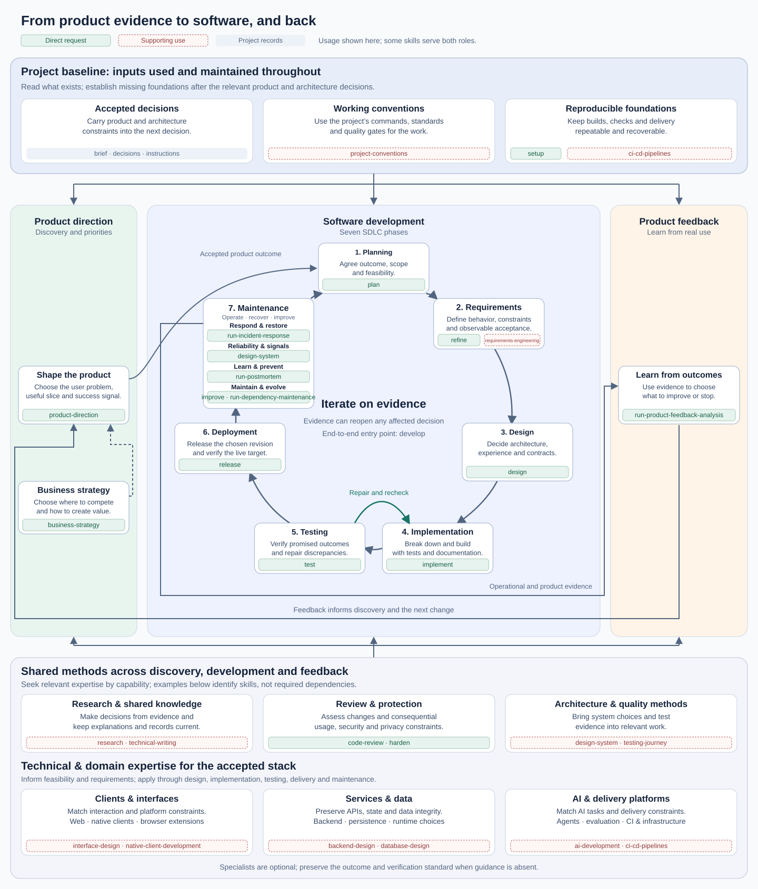

# Agent Skills Public

A collection of reusable skills for coding agents. It packages the activities, methods and technical guidance I use to take software work from a rough request through design, implementation, verification and operation. Each plugin is an independent installation choice: no plugin requires another, and an activity keeps its outcome when optional specialist guidance is absent.

It is for people who use an agent such as Claude Code, Codex, OpenCode, Pi or VS Code with GitHub Copilot and want consistent engineering judgment rather than an ad-hoc prompt for each task. The repository is maintained for my own work and published as-is. Package and link checks run in CI; behavioral coverage is partial and recorded in the [evaluation notes](evals/README.md#recorded-evidence-and-limits).

## Quick start

The published packages live on the generated `claude-marketplace` branch, which holds complete bundles and catalogs for Claude Code and Codex. You do not need this checkout to install them.

**Claude Code**

```bash
claude plugin marketplace add joao-aires/agent-skills-public#claude-marketplace
claude plugin install sdlc@agent-skills-public
```

**Codex**

```bash
codex plugin marketplace add joao-aires/agent-skills-public --ref claude-marketplace
```

Open the plugin browser in a supported Codex client, install `sdlc` from Agent Skills Public, then start a new session.

For a local build instead, you need Git and Python 3.10+. Follow [installation](docs/installation.md#build-the-bundles) to create a virtual environment, build the bundles and load them in your client. The same page covers OpenCode, Pi, VS Code, ChatGPT desktop and updates.

### First useful result

Open an application repository and start a new session so the client discovers the installed skills. Then request an activity by name and state the outcome and stopping point:

```text
Use develop to add read-only sharing to saved searches. Preserve the existing
architecture, UI and private defaults. Ask about consequential decisions,
state reversible assumptions and prepare a PR without merging.
```

In Claude Code the explicit form is `/sdlc:develop`; in Codex, select `develop` in the skill picker. A plain request such as "Use develop to..." works where the client supports selection by name.

Expect the agent to inspect the repository, ask only about choices that materially change the result, make reversible assumptions explicit, implement a working slice and report checks and gaps. It stops where you asked it to; merge, deployment and external writes need separate authority.

If you do not know which activity fits, use `/sdlc:activity-system` or ask `activity-system` for help.

## What it does

The `sdlc` bundle covers the full lifecycle: planning, requirements, design, implementation, testing, delivery, operations, security and governance. Add other bundles only for the capabilities the work needs.

| Need | Install |
| --- | --- |
| Full software lifecycle, artifact guides, architecture and verification | [sdlc](plugins/sdlc/) |
| Product and business direction | [strategy](plugins/strategy/) |
| Interface design, design research and frontend implementation | [frontend-development](plugins/frontend-development/); [frontend-reactjs-development](plugins/frontend-reactjs-development/) or [frontend-native-development](plugins/frontend-native-development/) for an accepted stack |
| Service design and backend implementation | [backend-development](plugins/backend-development/); [backend-python-development](plugins/backend-python-development/) for Python |
| AI feature design, evaluation and operation | [ai-development](plugins/ai-development/); [ai-python-development](plugins/ai-python-development/), [ai-adk-development](plugins/ai-adk-development/) or [ai-langchain-development](plugins/ai-langchain-development/) for an implementation |
| Data and database engineering | [database-development](plugins/database-development/); [database-postgresql-development](plugins/database-postgresql-development/) for PostgreSQL |
| SaaS product behavior | [saas-development](plugins/saas-development/) |
| Browser extensions | [browser-extension-development](plugins/browser-extension-development/) |
| Platforms, delivery tooling and diagnostics | [operations-platforms](plugins/operations-platforms/), [development-tooling](plugins/development-tooling/) |
| TypeScript or Go implementation | [typescript-development](plugins/typescript-development/), [go-development](plugins/go-development/) |
| Writing, agent-instruction craft, diagrams and interactive explanation | [documentation](plugins/documentation/), [visualization](plugins/visualization/) |
| Optional local SDLC state for OpenCode | [integrations/sdlc-mod](integrations/sdlc-mod/) |

The collection has 21 plugins: 9 generic and 12 technical. Technical guidance applies only when the project has accepted the matching technology. The integration entry is separate from the plugin bundles: it is a local OpenCode plugin, not an Agent Plugin package.

Unlike a prompt collection, each skill names the outcome it owns, where it stops and what evidence completes the work. Plugins remain independent, so installing one does not pull in another or choose a technology for the project.



The cycle shows outcome dependencies, not a required sequence of skill invocations. Enter at the activity the work needs, repeat implementation and verification as evidence demands, and reopen earlier decisions when product or operating evidence changes. [SDLC coverage](docs/sdlc.md) explains the phases and entry points.

## Documentation

Start with the [documentation map](docs/README.md) for the full set by reader need.

| Guide | Question it answers |
| --- | --- |
| [Installation](docs/installation.md) | How do I build, load, update and check the bundles? |
| [Usage](docs/usage.md) | Which activity should I request, and what should I expect? |
| [Architecture](docs/architecture.md) | How do activities, methods and technical guidance compose? |
| [SDLC coverage](docs/sdlc.md) | Where does each capability fit in the lifecycle? |
| [Engineering artifacts](docs/artifact-workflow.md) | How do I record a change, choose a home and hand off work? |
| [Migration](docs/migration.md) | How do I replace an older installation or skill name? |
| [Maintainer reference](docs/maintainer-reference.md) | How do I change, validate and evaluate the collection? |

## Development

Use a virtual environment and the validation dependencies from [installation](docs/installation.md#build-the-bundles). From the repository root:

```bash
python scripts/validate_plugins.py
python scripts/check_collection.py
npm --prefix evals run lint
python -m unittest discover -s tests -v
python scripts/build_plugins.py --all --destination /tmp/built-agent-plugins
python scripts/check_collection.py --built /tmp/built-agent-plugins
```

The destination must be new. The checks validate manifests, metadata, links, source pins, package resources and complete builds; they do not establish client discovery or agent behavior. Diagram sources under `docs/diagrams/` are rendered to `docs/images/` with Mermaid; the [maintainer reference](docs/maintainer-reference.md#maintaining-the-collection) has the command.

## Support and contribution

Use [GitHub Issues](https://github.com/joao-aires/agent-skills-public/issues) for defects and focused questions. There is no response-time commitment. Read [AGENTS.md](AGENTS.md) for repository rules and use the [git-contributions](plugins/sdlc/skills/git-contributions/SKILL.md) method for worktrees, commits and pull requests. Update affected documentation and run the checks above before opening a PR.

## Status and limits

This is a maintained personal collection, not a supported product or a compliance control. It contains instructions and resources only: no generated applications, configured MCP servers, credentials or deployment automation. Optional MCP endpoints are declared in plugin manifests; declaring one does not connect it. The `sdlc-mod` integration is a local state aid and does not grant or record authority.

Guidance is versioned here and installed from a build. A client's discovery, invocation controls and instruction adherence depend on its version and configuration. Behavioral evaluation is incomplete: the [evaluation notes](evals/README.md#recorded-evidence-and-limits) record which scenarios ran, what they observed and what remains unverified. Package checks do not establish application correctness, production readiness or compliance.

## License

Repository-authored material is MIT licensed; see [LICENSE](LICENSE). Acquired skills retain their upstream licenses. Generated bundles include per-skill notices, and the [source catalogue](docs/maintainers/sources.md) records origins, pins and adaptations.
