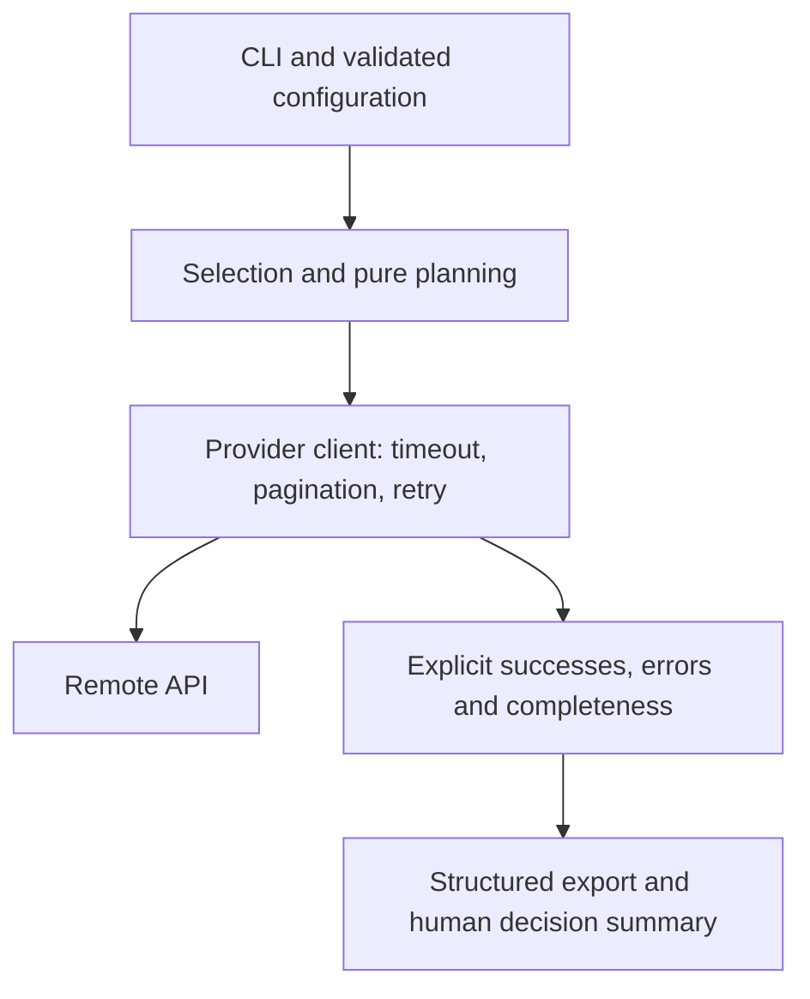
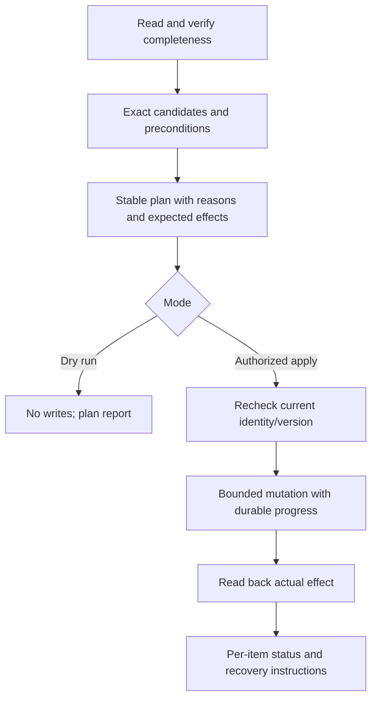

# Useful and maintainable Python automations

## Contents

- [Value and project structure](#value-and-project-structure)
- [CLI and configuration contracts](#cli-and-configuration-contracts)
- [APIs and concurrency](#apis-and-concurrency)
- [Planning, mutation and recovery](#planning-mutation-and-recovery)
- [Reporting and observability](#reporting-and-observability)
- [Tests, docs and adoption](#tests-docs-and-adoption)

## Value and project structure

Start with the operational problem: repeated manual effort, avoidable mistakes, missing evidence or slow decision-making. State who uses the result and what decision/action it enables. Automation that generates an unread report or needs frequent manual repair may add toil instead of reducing it.

Use a small script for genuinely small work; a reusable/scheduled CLI benefits from a project:

```text
tool/
  pyproject.toml
  chosen lockfile
  README.md
  .env.example             names/placeholders only when applicable
  src/tool_name/
    cli.py                 arguments, config, exit/output contract
    models.py              input/plan/result schemas
    service.py             orchestration and pure planning
    client.py              provider I/O and error mapping
    report.py              serialization/human summaries
  tests/                   fixture/contract/integration tests
```

These boundaries need not each become a file/class until complexity justifies it. Keep import-time code free of credential lookups, network calls, logging reconfiguration and writes. Inject clients/configuration/clock into logic that needs them; pure transformations are cheap to test.

For packaged tools declare `[project]`, supported Python, dependencies, build backend and `[project.scripts]` in pyproject. Use current dependency-group syntax supported by the selected tooling for development dependencies. Lock application/tool environments for reproducible execution; library metadata constraints and exact deployed lock resolution are different contracts.

Respect existing uv/Poetry/pip tooling per subproject. Choose supported runtimes based on deployment needs; avoid one obsolete runtime or one latest local version as a universal requirement. Use Ruff, a chosen type checker and pytest where appropriate; commands/tool configuration must actually exist.

## CLI and configuration contracts

Use argparse for simple CLIs or a supported CLI library for multi-command ergonomics. Document precedence (for example arguments > explicit environment > config > defaults). Parse booleans as booleans and reject unknown values. A case-sensitive string test that converts a typo into mutation mode is dangerous.

Useful operational options include exact target filters, bounded `--limit`/workers/time, output destination/format, plan/apply mode and explicit checkpoint/resume. Defaults should be conservative for mutations, while read-only reports need not require ceremonial approval. Unattended mode does not prompt or open a browser; human mode can provide progress and tables.

`--help` and import must work without secrets. Missing credentials return an actionable sanitized error at execution. Prefer protected identity/environment/store input over CLI token arguments that appear in process listings/history. Keep stdout valid JSON when selected; logs/progress go to stderr and colors are disabled for nonterminal consumers.

## APIs and concurrency



Use sessions/clients and close them with context managers/finally. Set connection/read/overall request budgets appropriate to the library. Keep TLS verification enabled. Distinguish authentication/authorization/invalid-input/conflict/not-found from transient failures; do not retry every HTTP error. Respect rate-limit/reset/Retry-After with bounded exponential backoff/jitter and a total budget.

Paginate using the provider's actual continuation contract. SDK iterators may make requests lazily; decorating only iterator creation does not retry consumption errors. GraphQL outer pagination does not paginate nested reviews/comments/reactions: check every relevant connection, count/cursor and platform search cap. Window partitioning may be necessary for capped search. Expose deliberate limits/truncation rather than claim “all data.”

Batch fetches can reduce calls, but partial errors and incomplete nested collections still require handling. Missing data and zero records are different. Maintain per-target errors and coverage in the result; do not catch an API error, break the loop and publish an apparently complete report.

Bound concurrent tasks/threads with a pool/semaphore and backpressure. `async def` with blocking HTTP still blocks unless delegated; threads require a supported client-sharing model and protected mutable results. Cancellation stops work, releases clients and leaves a recoverable checkpoint. Do not spawn an unbounded task per repository simply because gather is convenient.

Use subprocess argument sequences with `shell=False`, checked return codes, timeouts and scoped cwd/env for commands. Avoid secret values in arguments/errors or unlimited captured output. Keep platform-specific shell/batch behavior explicit.

## Planning, mutation and recovery



A dry-run must issue no mutation requests, not merely print “would.” Prefer one shared planner used by dry-run and apply so behavior stays aligned. Plan records include candidate identity, source revision/version, reason, intended change and conflict/retention protection.

Read current state before mutation and skip already-satisfied values. For tickets/resources use stable natural keys/idempotency keys or reconciliation to avoid duplicate creation. For documents use version/ETag checks; a blind replace of previously read content can overwrite another editor's change. Empty selectors mean none, not all.

Destructive branch/artifact cleanup needs reachability/merge/in-use/rollback checks, not age alone. Exact selected identity can change between read and apply; check the API's available preconditions and stop/report conflicts. Write one-item journals/checkpoints so partial success is recoverable. An ambiguous timeout after a write requires reconciliation before retry.

Do not hide partial failure behind exit 0 unless an explicitly documented result contract lets the scheduler distinguish it. One possible convention: 0 complete/no-op, 2 invalid input, 1 operation incomplete/failed; use the project's equivalent. Findings discovered by a successful audit may still exit 0 if its structured findings are the intended result.

## Reporting and observability

Use schema-versioned results with run/source time, tool version, selection, counts, per-target outcome/errors, truncation/coverage and verification. Use timezone-aware UTC, monotonic elapsed time, explicit bytes/IEC units and stable sorting/IDs. Avoid assuming a missing artifact tag is `latest`; keep digest identity and distinguish tagged/untagged/multi-arch objects and accounting limitations.

Write exports to an owned temp file and atomically replace the intended path where supported; use explicit output directories, never silently overwrite source files. Preserve useful partial data with incomplete status. Generated reports/credentials/datasets are not committed unless the project explicitly expects them.

Protect exported personal/confidential content and escape it in HTML/Markdown according to the destination. Offline record IDs may be useful high-cardinality fields; they are not automatically safe labels for a live metrics backend. Avoid per-user productivity ranking or claims that a tool caused improvement from time-to-merge correlation alone; document cohort/selection bias and evidence limits.

Record run success, duration, processed/error counts and checkpoint identity without values of tokens/auth headers. A warning containing full API payloads or URLs can leak secrets; sanitize error context.

## Tests, docs and adoption

Test pure planning and local fake clients for pagination (outer/nested), partial responses, transient/permanent error classification, missing/no data, stable repeated output, duplicates, dry-run/no writes and conflicting versions. Exercise the actual entrypoint/install and documented examples with fixtures. Use isolated live integration targets only when the task grants that access.

README should contain:

- Purpose and the user decision/value it supports; owner and support path.
- Prerequisites, supported Python/tool manager and minimal permissions.
- Copyable setup and read-only/dry-run example before mutation examples.
- Inputs, precedence, exact defaults and selection/limit behavior.
- Output schema/version, completeness flags, exit codes and examples.
- Scheduling/unattended mode, retry/checkpoint/concurrency and recovery.
- Known limitations, sensitive export handling and cost/API quota impact.
- Local lint/format/type/test/package commands and change notes for interfaces.

Keep a navigable monorepo catalog so tools can be discovered; each subproject retains authoritative commands. Examples and help should agree with actual behavior. Measure adoption, manual steps/time removed, run reliability, errors prevented and maintenance effort; retain or retire automation based on that evidence.

**Acceptance cases:** a report missing nested API pages; errors mistaken for no results; env boolean typo; resumed ticket creation without duplicates; optimistic document update conflict; bounded concurrent registry inventory; packaged CLI help without credentials.

References: [PyPA pyproject guide](https://packaging.python.org/en/latest/guides/writing-pyproject-toml/), [Python subprocess](https://docs.python.org/3/library/subprocess.html), [Python logging](https://docs.python.org/3/howto/logging.html), [HTTPX timeouts](https://www.python-httpx.org/advanced/timeouts/), [pytest](https://docs.pytest.org/), [Google SRE eliminating toil](https://sre.google/workbook/eliminating-toil/).
