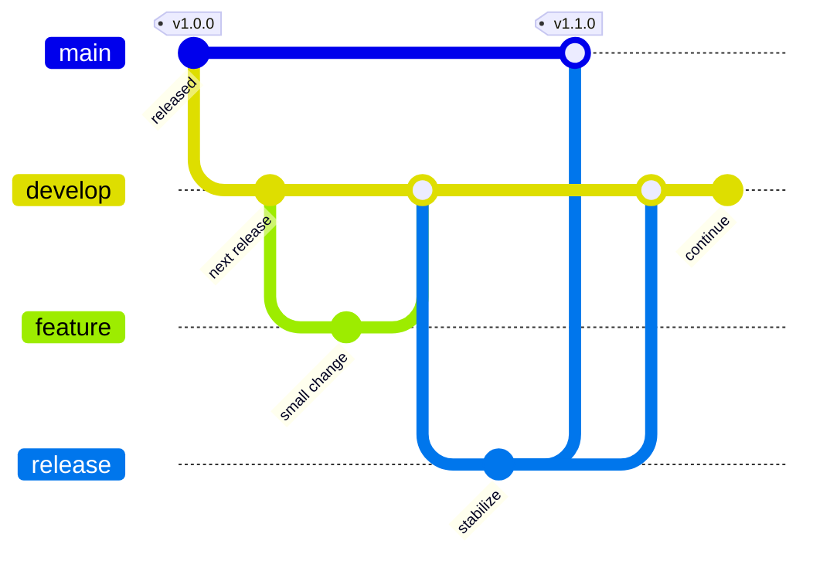
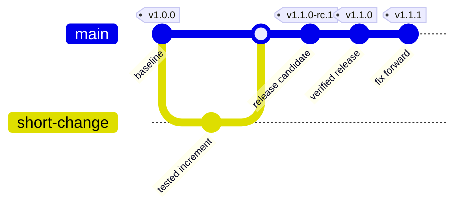
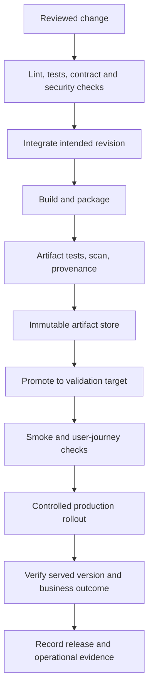

# From branch to production

## Contents

- [Choose a model](#choose-a-model)
- [Gitflow](#gitflow)
- [Trunk-based development](#trunk-based-development)
- [Build, release and deployment](#build-release-and-deployment)
- [Implement in any stack](#implement-in-any-stack)
- [Operate and evolve](#operate-and-evolve)

## Choose a model

Branching manages integration and supported code histories. Release management chooses and labels deliverable artifacts. Deployment changes a runtime. Feature release exposes behavior to users. A feature flag can separate deployment from exposure, and a Git tag does not imply anything is deployed.

| Context | Usually useful | Costs/requirements |
| --- | --- | --- |
| One continuously delivered service | Trunk, short-lived reviewed branches | Fast CI, releasable trunk, incremental changes/flags |
| Scheduled versioned releases with overlapping stabilization | Gitflow or trunk with just-in-time release branches | Explicit release isolation, fixes propagated back, bounded branch lifetime |
| Several supported customer versions | Maintenance branches from exact supported tags, with either integration model | Backport policy and automated testing for each supported line |
| Configuration/docs repository | Simple trunk workflow | Validation and controlled application of configuration |

Choose the simplest model satisfying actual needs. Team size alone is not a branching criterion. Classic Gitflow is useful for explicit version/support management, but long-lived parallel integration increases conflicts and delayed feedback. Trunk can support release branches without becoming Gitflow if they are release-only, not parallel feature-development lines.

## Gitflow

Classic model: `main` represents release-ready history; `develop` integrates next-release work. Features branch from and return to develop. A release branch isolates stabilization; merge it to main and tag, then propagate its fixes to develop. Hotfixes start from the actual supported production tag/main state, finish on the release history and propagate to develop and any active release/support lines that need the fix.

An alternative upmerge model promotes a selected develop revision directly into main without a separate release branch, then synchronizes release/version changes back. This is a variation, not the definition of all Gitflow implementations. Paired maintenance release/development branches per major/minor are another variant: document their purpose rather than require them everywhere.

| Operation | Inputs | Results / checks |
| --- | --- | --- |
| Prepare release | Intended source revision, version, changes | Candidate with traceable identity, frozen scope, stabilization gates |
| Finish release | Validated candidate | Main/release tag, notes, correct artifact, fixes propagated, next dev version when needed |
| Prepare hotfix | Exact affected supported tag | Narrow maintenance work, no unrelated unreleased features |
| Finish hotfix | Tested patch | Unique patch tag/artifact, target delivery, required forward/backport records |

Use merges or explicit cherry-picks according to branch relationships. A hotfix on an old line must not merge all incompatible newer-main changes into that line. Release branch conflicts require semantic resolution and rerun gates; do not blindly pick one side's version file.

## Trunk-based development

Integrate frequently into one releasable trunk. Reviewed branches should be small and short-lived. Feature flags and branch-by-abstraction allow incremental changes; flags need owners, tests for relevant states and a removal condition.

The candidate/final labels illustrate logical states, not a requirement to create different commits. If the candidate bytes are unchanged, promote the same artifact and record its identity. Tags/metadata strategy must not silently rebuild it.

For release branches, cut from the selected trunk revision close to release. Stabilize with narrowly scoped fixes; keep trunk current and backport only needed changes to supported branches. Protect required checks and use a merge queue when concurrent integration makes individually green PRs incompatible.

Migration from Gitflow: inventory supported lines and consumers, shorten feature work, build releasable increments, establish flags and merge checks, move integrations deliberately, update automation/branch protections and decommission develop only after dependencies are migrated. Renaming branches alone does not create continuous integration.

## Build, release and deployment

Use patch/minor/major according to the public compatibility contract, not the branch name alone. Prerelease labels such as `1.2.0-rc.1` distinguish candidates. Development identity should include source SHA and uniqueness; timestamps help traceability but do not replace digest identity. Container tag characters differ from full SemVer syntax; validate format for the actual registry.

Never overwrite a published version. Release notes should identify source/artifact/config revisions, behavior changes, compatibility/migration steps, dependency impact and verification. Conventional commits can help generate notes if adopted, but do not detect every breaking change automatically.

A dedicated application repository can build/publish while a configuration repository promotes the image and a GitOps controller reconciles it. Single-repo and platform-native delivery are also valid. Audit the complete config diff, not just the changed image field.

## Implement in any stack

Use native wrappers/lockfiles and stable commands; do not replace build tools solely to follow a sample.

| Stack | Commands/inputs to adapt |
| --- | --- |
| JVM | Maven/Gradle wrapper, toolchain, dependency/BOM resolution, unit/integration/contract tests, JAR and OCI packaging |
| Node | Chosen package-manager lockfile and frozen install, lint/type/test/build tasks, workspace-aware affected checks |
| Python | Locked environment, lint/type/test/package commands, wheel/container identity |
| Rust/Go/.NET | Native lock/toolchain/module/package conventions and target-platform testing |
| Infrastructure | Format, render, schema/policy tests, plan, protected state and serialized apply |

Create a task contract (`make verify`, `make package`, or equivalent native tasks) with identical local/CI behavior. Keep credentials and host-specific upload/dispatch operations at the orchestration boundary. Expose artifact identity as an explicit output rather than parse arbitrary build logs.

Implementation order:

1. Make local verification repeatable and document prerequisites.
2. Add unprivileged PR checks with correct merge-result coverage.
3. Build/publish trusted revisions; isolate permission elevations into necessary jobs.
4. Add release dry-run, unique version checks and resumable side effects.
5. Add target promotion, compatibility checks and rollout verification.
6. Add hotfix propagation and recurring audit of drift/aging release lines.

## Operate and evolve

Serialize release/tag writers and target/state mutators. Cancel superseded validation runs only when their side effects make cancellation safe. Support reruns: identify what was already created and verify it instead of creating duplicate releases or reusing a version for different bytes.

Rollback requires compatible schemas, state and interfaces. Use expand/contract migrations or roll-forward when old binaries cannot read the new state. Record known-good artifact/config targets and recovery criteria. Verify actual origin/edge/browser identity and async outcomes; readiness and a green pipeline are insufficient.

During maintenance preserve the intended existing scope; on completion remove only this operation's maintenance and account for concurrent changes. Run public-path checks, not only privileged paths bypassing edge rules.

Track lead time, failed-change/recovery behavior, flaky tests, gate duration and artifact provenance gaps to guide improvement. Recurring automation should make small evidenced proposals rather than redesign branching on each run.

**Review scenarios:** set up a new service in a selected stack; release an old-line hotfix without importing unreleased work; resume a partially tagged release without overwriting versions; find that a deployment is green but serves stale content; identify skipped/advisory checks masquerading as gates.

References: [Gitflow original and 2020 reflection](https://nvie.com/posts/a-successful-git-branching-model/), [Trunk-based development](https://trunkbaseddevelopment.com/), [Semantic Versioning](https://semver.org/), [GitHub Actions security reference](https://docs.github.com/en/actions/reference/security/secure-use), [SLSA](https://slsa.dev/).
