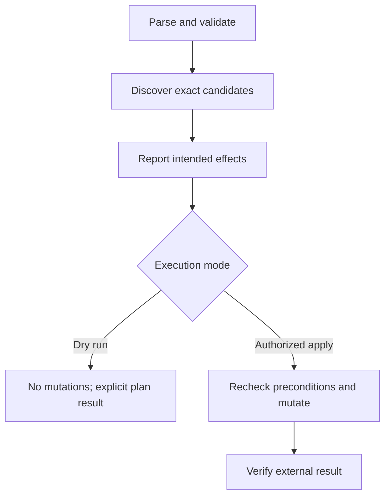

# Bash utilities that fail honestly

## Contents

- [Contract and portability](#contract-and-portability)
- [Arguments and structured data](#arguments-and-structured-data)
- [Failures and shell options](#failures-and-shell-options)
- [State and side effects](#state-and-side-effects)
- [Tests and documentation](#tests-and-documentation)

## Contract and portability

Choose Bash explicitly when using arrays or `[[ ]]`. Declare the minimum version: associative arrays and `mapfile` need newer Bash than the system Bash on some developer machines. `#!/usr/bin/env bash` selects PATH Bash; a fixed shebang selects a fixed installation. Test the actual chosen environments, not the developer's zsh session.

Document GNU-only utilities (`readlink -e`, GNU sed/date/find options, `grep -P`) or use portable alternatives. Check dependency availability with `command -v`, and version/capability when required. A tool existing does not prove its options match.

For a CLI define validation errors, operational failures and intentional no-change results. `--help` exits successfully; invalid flags fail. Keep human logs on stderr and a stable result on stdout. Do not repurpose a nonzero code for “changed” unless every caller handles that documented meaning correctly.

## Arguments and structured data

```bash
flags=(--strict --summary)
flags+=(--schema-location "$schema_location")
validator "${flags[@]}" "$manifest"
```

An argument array preserves whitespace and empty values. A space-joined string is not an argument list; nesting quotes in it does not repair expansion. Forward `"$@"`, not unquoted `$*`. Use `--` where a tool supports it and identifiers might start with `-`.

Validate option values before referencing `$2` or shifting two arguments. Reject unknown modes/invalid booleans; do not silently convert typos into apply mode. Avoid evaluating user-controlled strings as commands, arithmetic expressions or array subscripts; validate numeric fields first.

For arbitrary file names use NUL-delimited discovery. If producer failure matters, materialize/check its output before consuming it:

```bash
if find "$root" -type f -name '*.yaml' -print0 > "$file_list"; then
  while IFS= read -r -d '' file; do
    if validator "$file"; then
      :
    else
      rc=$?
      printf 'ERROR - validation failed for %s\n' "$file" >&2
      return "$rc"
    fi
  done < "$file_list"
else
  rc=$?
  printf 'ERROR - file discovery failed\n' >&2
  return "$rc"
fi
```

This is a function fragment: `root` and `file_list` must be initialized and `file_list` must be an owned temporary file. Do not parse `ls`, `for file in $(...)`, or join discovered paths into whitespace-delimited arrays. Newline-only input contracts cannot represent filenames with newlines; state that limitation when choosing them.

Use `jq`/the selected `yq` for structured data, with variables passed via supported parameters. Avoid hand-concatenating JSON, parsing YAML kinds with grep as complete validation, or extracting the last SHA-like log token as artifact identity.

## Failures and shell options

`set -euo pipefail` is a useful executable baseline when compatible with the script, but it is not a substitute for explicit contracts:

- `-e` is ignored in important conditional/negation/AND/OR contexts, including functions called there. Check critical operations inside such functions explicitly.
- Command substitutions can change `errexit` behavior; use an explicit checked assignment. `local value="$(command)"` can hide the command's status behind `local`—declare separately.
- `! command` negates status, so `$?` inside the following branch is not the original failure. Use `if command; then ... else rc=$?; ... fi` when preserving it.
- `((count++))` returns failure when its expression evaluates to zero. Use assignment `count=$((count + 1))` when the result is not a predicate.
- Pipeline exit status without `pipefail` normally comes from the last stage. If individual statuses matter, snapshot `PIPESTATUS` immediately; the next simple command overwrites it.
- A producer in process substitution can fail without the loop reporting it. Use checked materialization or explicit producer process/status handling where necessary.
- `grep` status 1 can mean no match rather than an operational failure; status 2 means error. Handle those separately instead of broad `|| true`.
- An early-exit consumer can cause an upstream SIGPIPE under `pipefail`; distinguish intended short-circuit behavior from lost data rather than blanket-ignore pipelines.

Background jobs require stored PIDs and checked waits. Bound concurrency and terminate/wait for owned children on cancellation. Timeouts and retries should be finite and apply only to safe/idempotent operations; repeating a mutation after an ambiguous result can duplicate it.

## State and side effects



Use `local` for function state and explain inputs/outputs/return effects for nontrivial functions. Libraries should not set global shell options, change directory or call main when sourced. A sourced/executed guard can help, but does not undo earlier side effects.

Locate bundled resources relative to a checked script directory. Avoid unbounded `cd` sequences; a subshell scopes directory changes when useful. Never overwrite/delete caller files to emulate temporary storage. Use `mktemp`, appropriate permissions/umask and an owned directory; cleanup must handle success/failure/signal and preserve the original exit code. A trap cannot handle SIGKILL, so persistent resources need recovery/reconciliation too.

Dry-run performs reads/planning but no remote writes, history rewriting, staging or configuration changes. Revalidate candidate identity/version before apply to prevent acting on stale state. An empty selection means no resources, not “all resources.” A cleanup script should verify merge/reachability/retention, not delete solely by age.

Do not log secret values or use `set -x` around them. Prefer protected stdin/file descriptors or supported secret integration to command arguments. Use `printf '%s\n' "$message"` rather than letting content become a format string or escape-aware `echo -e` input.

## Tests and documentation

Use `bash -n`, ShellCheck and shfmt where configured, then behavioral tests with local fixtures/stub commands or Bats. Valuable cases include filenames with spaces/leading dashes, unknown/missing arguments, upstream and downstream pipeline failures, partial apply, signal cleanup, no candidates and repeat execution.

For Git operations use a temporary working repository and local bare remote; assert the remote ref/state, not merely printed output. Never use a real production endpoint as a fixture. Check generated result cleanliness and log separation.

README: purpose, supported shell/platforms/tools, exact options/defaults, example plan/apply, output and exit semantics, authority/preconditions, failure recovery and local validation commands. Keep CI action contracts consistent with CLI behavior. Exceptions to linters need narrow scope and an actual reason; do not inherit old suppressions by copying a script.

**Acceptance cases:** validator pipeline reports a downstream failure; arbitrary path preserved as one argument; sourced helper preserves caller state; dry-run leaves fixture remote unchanged; failed discovery does not masquerade as empty success.

Public references: [Google Shell Style Guide](https://google.github.io/styleguide/shellguide.html), [Bash set builtin](https://www.gnu.org/software/bash/manual/html_node/The-Set-Builtin.html), [ShellCheck](https://www.shellcheck.net/), [Bats](https://bats-core.readthedocs.io/).
