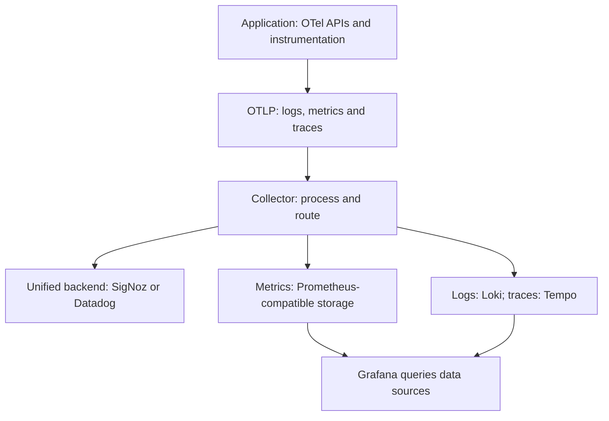

# Selected telemetry backend integration

## Instrumentation and routing

Backend routes are alternatives, or an explicitly configured fan-out. Application instrumentation stays independent of exporter credentials/routing. A Grafana deployment needs the relevant storage backends; Grafana itself is not telemetry storage. Test generation and actual target ingestion separately. Queries, dashboards and proprietary features still need backend-specific work. Read/query APIs or CLI let agents inspect correlated evidence; an MCP is optional.

## Setup references

- [OpenTelemetry Collector](https://opentelemetry.io/docs/collector/): receivers, processors and exporters at the deployment boundary.
- [OTLP exporter settings](https://opentelemetry.io/docs/specs/otel/configuration/sdk-environment-variables/): verify support in the selected SDK and runtime.
- [Semantic conventions](https://opentelemetry.io/docs/specs/semconv/): HTTP, database, messaging, resource and GenAI naming; inspect stability/version before adopting changes.
- [SigNoz AI observability](https://signoz.io/docs/ai-observability/): compatible GenAI traces, field requirements and self-hosted versus cloud availability.
- [SigNoz Docker installation](https://signoz.io/docs/install/docker/): current supported installation/sizing rather than legacy bundled manifests.
- [Datadog OTel ingestion](https://docs.datadoghq.com/opentelemetry/setup/collector_exporter/): exporter requirements, supported signals and feature mappings.
- [Prometheus OTel ingestion](https://prometheus.io/docs/guides/opentelemetry/): metrics receiver, resources and translation considerations.
- [Grafana Loki](https://grafana.com/docs/loki/latest/get-started/overview/) and [Tempo](https://grafana.com/docs/tempo/latest/): logs and traces are separate storage/query capabilities.
- [Langfuse datasets](https://langfuse.com/docs/evaluation/experiments/datasets) and [self-hosting](https://langfuse.com/self-hosting): optional evaluation workflow, dependencies and edition boundaries.

Collector routing makes instrumentation reusable; dashboards, alerts, queries and proprietary capabilities still need adaptation. Verify the actual target with representative data. Do not treat Grafana Cloud AI features as guaranteed features of a local OSS deployment.

## Optional AI dataset services

For a selected Langfuse workflow, verify dataset/experiment publication and supported edition/version behavior; retain application-side cases and scorers. [Langfuse datasets](https://langfuse.com/docs/evaluation/experiments/datasets) and [self-hosting](https://langfuse.com/self-hosting) describe the service boundary. [OpenTelemetry GenAI conventions](https://opentelemetry.io/docs/specs/semconv/gen-ai/) and [SigNoz AI observability](https://signoz.io/docs/ai-observability/) describe compatible signal setup. These services do not replace quality acceptance or deterministic authorization checks.

For selected OpenTelemetry SDKs, prefer supported `OTEL_*` configuration and verify the actual runtime/exporter mapping. The application SDK owns initialization; avoid overlapping providers or double exports.
