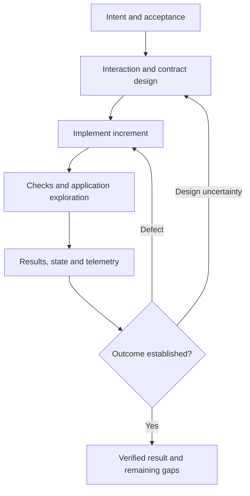

# Journey evaluation references

## Implementation feedback

Use the main skill's platform/evidence rules alongside deliver-reliable-changes. Run affected checks during meaningful increments and broader regression before completion. Keep intended outcomes and reviewed baselines stable; report missing capability or repeated unexplained failures. Versioned AI quality cases complement deterministic application handling.

## Evidence and accessibility

Use project-compatible drivers and inspect their actual coverage; no hosted visual service or device farm is required. Component assertions, reviewed visual comparisons, keyboard/focus operation and actual route/device calls establish different boundaries. See [W3C accessibility evaluation](https://www.w3.org/WAI/test-evaluate/) for the distinction between automated checks and appropriate manual/user evaluation. Use available technical driver guidance only when implementing that selected tool.
