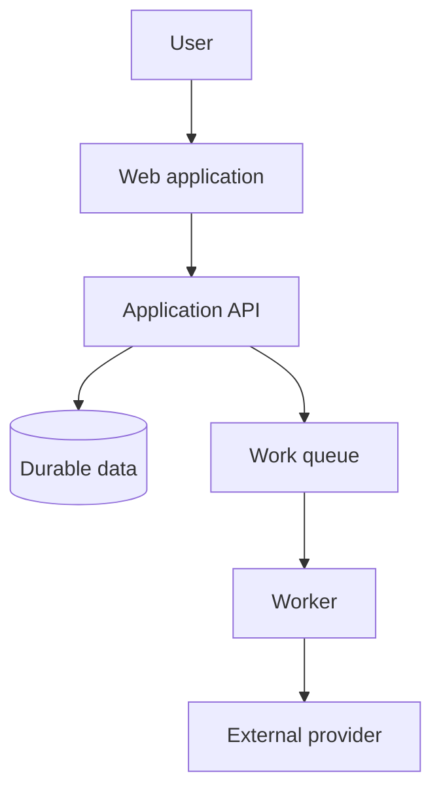
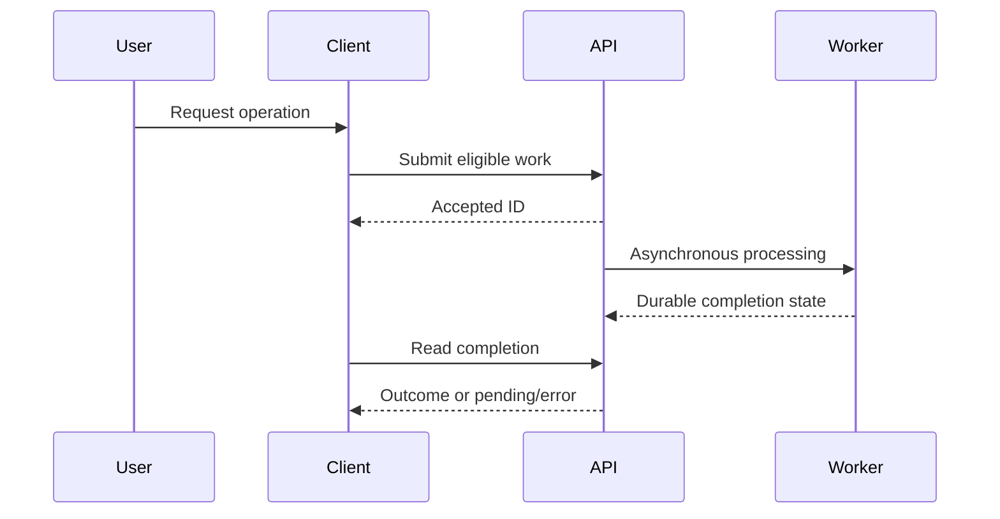

# Mapping a system for operations

A map answers what users do, which components participate, what must work, who owns it and where the evidence lives. A catalog of repository names does not answer those questions.

## Evidence model

| Record | Essential fields |
| --- | --- |
| Node | Stable ID, capability, type, owner, source/reference/revision, known deployment targets |
| Runtime edge | Caller, callee, protocol/operation, sync/async, condition, evidence, certainty |
| Journey | User/intent, start/end, required/optional stages, variants, failure/cancel branches, deadline |
| Observation | Actual target/version/time, source and coverage limit |
| Gap | Missing/conflicting fact, impact on downstream analysis, owner/question |

Do not assume manifests exist in exactly one repository. Shared charts, application overlays, platform templates and generated configuration may all contribute. A URL-like value suggests a possible integration; confirm its client/contract/routing before labeling the target as another known service.

## Views

These are illustrative patterns, not inferred facts about the target. Label static dependency, chronological request sequence and asynchronous dataflow distinctly. Diagrams should expose observation gaps and failure boundaries, not only the happy path.

## Practical workflow

Start with README/architecture/contract docs, handlers and client bindings. Check feature/UI flows against backend entry points. Locate deployment/CI/configuration sources and ownership files. Search incident/runbook material for known failure paths. Timestamp live observations and note inaccessible sources.

For a changed feature, update only the affected map and dependent journeys. A recurring report lists added/removed/changed evidenced edges, stale references and unresolved conflicts. Stable IDs let downstream SLO/runbook/action records survive cosmetic renames.

Keep abbreviation text if its expansion is not documented. Ask a focused question or mark unknown; do not pause all unrelated discovery. Read source dates critically: newer prose does not automatically outweigh an older but active implementation, and live telemetry may omit low-volume paths.

**Acceptance cases:** map a system with split infrastructure sources and no live access; distinguish build dependencies from runtime calls; trace a browser-to-third-party path absent from server logs; update a feature map without recreating unrelated documentation.
