# Engineering artifacts and workspaces

Every durable engineering output is an artifact: an ECR, PRD, roadmap, product feedback analysis, RFC, ADR, issue, PR, architecture view, data model, runbook, README, guide, code module, test suite or release note. Each has a type, a primary plane, a home, an authority, a maturity and relations. The ECR is the coordination spine for a change, not the only artifact.

Use the [artifact system](../plugins/sdlc/skills/artifact-system/SKILL.md) for the shared model, contracts, homes, quality and assurance. This page is the practical route into it.

| Need | Owning guidance |
| --- | --- |
| Understand the artifact model, planes and relations | [Artifact model](../plugins/sdlc/skills/artifact-system/references/model.md) |
| Choose the type, plane and contract | [Artifact catalog](../plugins/sdlc/skills/artifact-system/references/catalog.md) |
| Decide what evidence a frontend, backend, AI or library/CLI design needs | [Software types](../plugins/sdlc/skills/artifact-system/references/software-types.md) |
| Compare design directions and record the choice | [Option set](../plugins/sdlc/skills/design/references/option-set.md), [design proposal](../plugins/sdlc/skills/artifact-system/references/contracts/design-proposal.md), [design validation](../plugins/sdlc/skills/design/references/design-validation.md) |
| Produce or review an artifact | [Artifact guide registry](../plugins/sdlc/skills/artifact-system/references/guide-registry.md) |
| Resolve where an artifact lives, or establish the repository map | [Artifact homes](../plugins/sdlc/skills/artifact-system/references/homes.md) and [project conventions](../plugins/sdlc/skills/project-conventions/SKILL.md) |
| Choose an activity and its stopping point | [Activity system](../plugins/sdlc/skills/activity-system/SKILL.md) |
| Record an engineering change and check its evidence | [ECR contract](../plugins/sdlc/skills/artifact-system/references/contracts/ecr.md) and [artifact assurance](../plugins/sdlc/skills/artifact-system/references/assurance.md) |
| Know what the next phase needs | [Handoff](../plugins/sdlc/skills/artifact-system/references/handoff.md) |
| Persist a coordination record | [Coordination storage](../plugins/sdlc/skills/artifact-system/references/storage/coordination.md) |
| Hand work to an implementer or reviewer | [Issue contract](../plugins/sdlc/skills/artifact-system/references/contracts/issue.md) and [PR contract](../plugins/sdlc/skills/artifact-system/references/contracts/pr.md) |
| Document the current system or a durable data model | [System documentation guide](../plugins/sdlc/skills/guide-system-documentation/SKILL.md), [data model guide](../plugins/sdlc/skills/guide-data-model/SKILL.md) |
| Write a runbook, README, guide or release note | [Runbook](../plugins/sdlc/skills/artifact-system/references/contracts/runbook.md), [repository README](../plugins/sdlc/skills/artifact-system/references/contracts/repository-readme.md), [guide](../plugins/sdlc/skills/artifact-system/references/contracts/guide.md), [release note](../plugins/sdlc/skills/artifact-system/references/contracts/release-note.md) |
| Check sufficiency, links and rendered output | [Artifact quality bar](../plugins/sdlc/skills/artifact-system/references/quality-bar.md) |
| Explain structure and interactions with accurate views | [Diagram lifecycle](../plugins/sdlc/skills/artifact-system/references/diagram-lifecycle.md) |

## Artifacts, contracts and guides

Artifact types pair with a contract and, where the craft is distinct, a guide. The contract owns lifecycle, authority, maturity, evidence and handoff; the guide owns structure, conventions and review.



The map reads left to right: each artifact type has a contract, and where the craft is distinct a guide. API reference, work product, deployment record, guide and glossary have no dedicated guide for the reasons recorded in the registry.

The artifact graph shows relationships across intent, coordination, system knowledge, implementation, delivery and entry. Intent informs the ECR; the ECR links the design proposal and implementation; the design proposal links the design specification and architecture views; code and tests produce review and release evidence; release and operations produce runbook, incident and postmortem knowledge; learning reopens the ECR. The ECR is one node, not the center.



A handoff is **content, not a document**. The next phase may need a decision, a design specification, a contract, a test result and an open decision from different artifacts. Read [handoff](../plugins/sdlc/skills/artifact-system/references/handoff.md) for the phase matrix; the ECR is the index, not a copy of every artifact.

## Planes and homes

Every artifact has a **primary plane** and a **home**. The plane is its role; the home is where the authoritative copy lives. They are different: a runbook is system knowledge but may live in an operations repository; an ECR is coordination knowledge that lives in the engineering workspace. Read the [artifact model](../plugins/sdlc/skills/artifact-system/references/model.md) for the plane definitions and [artifact homes](../plugins/sdlc/skills/artifact-system/references/homes.md) for resolution. Do not infer a home from a plane.

A repository should record where its durable artifacts live. Put a short pointer in `AGENTS.md` and the full map in `docs/README.md` or `docs/artifact-homes.md`.

| Artifact | Home | Authority | Owner | Update when |
| --- | --- | --- | --- | --- |
| Product brief / PRD | `docs/product/` | Canonical product intent | Product lead | Outcome, scope or priority changes |
| Product feedback analysis | `docs/product/feedback/` | Canonical product evidence for a decision | Product lead | New evidence changes scope, findings or the next decision |
| Architecture set | `docs/architecture/` | Canonical implemented architecture | Architect | Boundary, interface or deployment changes |
| Data model | `docs/architecture/data-model.md` | Canonical logical data model | Data owner / architect | Entity, ownership, invariant, retention or evolution changes |
| ADRs | `docs/decisions/` | Canonical decision history | Architect / tech lead | A consequential decision is accepted or superseded |
| Runbooks | `ops/<application>/runbooks/` | Canonical operations | SRE | Failure, recovery or escalation changes |
| Guides | `docs/guides/` | Canonical how-to | Docs owner | Workflow or command changes |
| ECR | `../engineering/changes/<name>/ecr.md` | Canonical change record | Change owner | Each phase |
| Issue / PR | Tracker / Git provider | Views of the change | Change owner | Status or diff changes |
| Code / tests | `src/`, `tests/` | Canonical implementation | Engineering | Every change |

`setup` establishes or verifies the map. Implementation reads it before creating or moving a durable artifact and updates it when a type, home or owner changes. A missing map is a project-foundation gap, not permission to choose an arbitrary path.

A project might record these workspace instructions after authorizing a separate folder.

```text
Engineering workspace: resolve ../engineering from the application checkout.
Change records: reuse the existing record under changes/<name>/ecr.md.
Research: retain decision-oriented reports under research/.
Implemented architecture, contracts and runbooks: use the application's docs.
History: the engineering folder is independently versioned.
```

A connected document project can serve the same purpose. For the first storage choice, provider limits and access failures, follow the workspace method. In a mixed setup, an issue can repeat acceptance criteria and link the authoritative record even when the issue and record live in different tools.

## Example research report

This example concerns a synthetic webhook consumer. Its question is whether the system can deduplicate work across process restarts and workers.

**Recommendation.** Use a durable receipt and dispatch intent in SQLite for a modest single-host installation. For multiple hosts, assess the existing relational primary. Confirm the receiver's idempotency and lookup contract before accepting either design.

| Option | Fit | Main limit |
| --- | --- | --- |
| In-process map | One disposable worker | Restarts and separate workers lose shared identity |
| SQLite | Workers on one host with a durable local volume | Writer contention and volume recovery need testing |
| Shared relational database | Workers on multiple hosts | Availability and failover depend on the actual deployment |

**Observed evidence.** In the local probe, retry after an ambiguous send produced two effects with an unkeyed receiver and one effect when the simulated receiver enforced a stable key. Link the runnable probe and primary sources below the decision material. Keep measured local behavior separate from assumptions about the real receiver.

**Open decision.** The integration owner needs to confirm key scope, expiry and lookup semantics. The service owner needs to decide how to handle ambiguous sends. The recommendation remains proposed.

## Example issue

### Investigate durable webhook deduplication

**Context.** The consumer's in-process cache loses event identity on restart and cannot coordinate independent workers. Link the failing restart case and the current consumer baseline.

**Intended outcome.** The team has a recommended durable storage approach for one host and a clear decision about the multi-host case, supported by observed evidence.

**Scope.** Compare local and shared durable stores. Exercise restart, worker contention and the uncertain result of an external send. Keep the investigation separate from production implementation. Out of scope: changing the production consumer or deploying a database.

**Acceptance**

- Compare plausible storage options for one host and multiple hosts on the same dimensions.
- Reproduce at least one durable claim and a crash around the receiver effect.
- Explain what the probe establishes, what remains unverified and which decision the team needs next.

**Verification.** Run the local probe at the recorded fixture revision and retain its source and output. Record the exact environment and the cases the simulated receiver does not establish.

**Status.** Ready for investigation; owner to be assigned. The production choice remains blocked on the receiver contract.

## Example architecture handoff

For asynchronous exports, use the repository's current container view and permission checks as the baseline. In the ECR or its RFC, show the proposed queue and worker and the sequence for rechecking permission before dispatch. Keep the diagram editable and confirm reviewers can open the rendered view. Once implementation is checked, update the relevant current views in the application repository and describe differences from the proposal.

For a local language-selector persistence bug with the same state owner and interaction flow, a compact ECR can state why the existing views are unaffected and point to the failing and passing regression.
