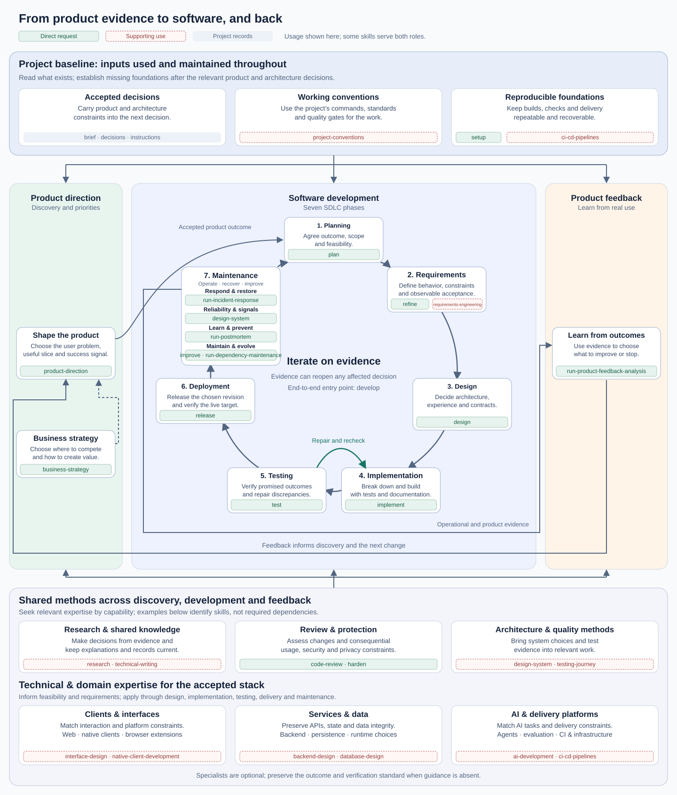
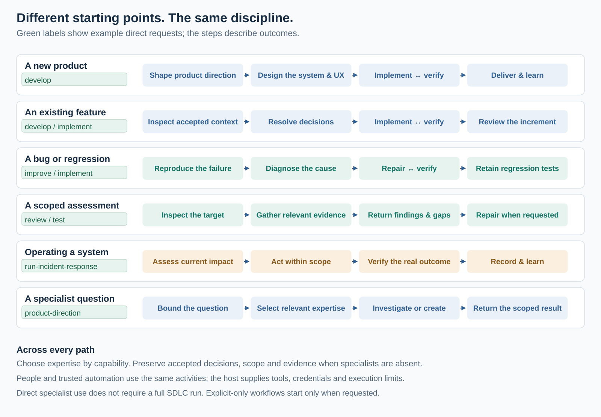

# SDLC coverage

The collection supports seven lifecycle outcomes: **planning, requirements, design, implementation, testing, deployment and maintenance**. These are outcomes, not stage gates or required skill invocations. Enter where an outcome is missing and revisit earlier decisions when evidence changes them. [Usage](usage.md#choose-a-path) shows common task compositions, and the [skill reference](sdlc-reference.md#skills-by-area) is the lookup catalogue.

## Work in parallel threads

Work is not a single pipeline. Requirements, design, implementation and testing can run at the same time, and evidence can reopen an earlier decision. One focus is active at a time; other threads remain open.

The lanes read as follows: requirements frame outcome and acceptance; design compares options, links artifacts and records the decision; implementation builds and checks; testing produces evidence and review findings; deployment releases; maintenance observes and learns. A missing state reopens design, a contradiction reopens the decision, and operating evidence can reopen requirements or design. [Engagement state](../plugins/sdlc/skills/activity-system/references/engagement-state.md) defines the record for focus, threads and reopens.

Every phase starts by checking its inputs, deciding what work is needed and identifying the evidence or decision the next person will need. Scale that preparation to the uncertainty. During implementation, break agreed requirements and design into deliverable increments, dependencies and checks. The [implementation preparation method](../plugins/sdlc/skills/activity-system/references/implementation-preparation.md) supports requests that stop at a breakdown.

| Part of the diagram | How it contributes |
| --- | --- |
| Product direction | Select users, problems, value, priorities and success signals; learn from delivered value |
| Engineering lifecycle | Establish and deliver required behavior, design, implementation, evidence, release and long-lived operational health |
| Project baseline | Reuse accepted decisions, contracts, instructions and evidence; update their canonical owners as they change |
| Shared methods | Research, documentation, security and review provide conditional expertise across phases |
| Technical and domain expertise | Choose by actual engineering concern and accepted stack rather than assuming a language or framework |

Entry-point labels identify directly requested activities; specialist labels identify supporting expertise. They are examples, not a dependency graph. The agent still respects user scope, runtime access, credentials and separate authorization for deployment or production actions.

## Entry points

| Need or missing outcome | Entry point |
| --- | --- |
| Business direction | `business-strategy` |
| Product direction, priority or first slice | [product-direction](../plugins/sdlc/skills/product-direction/SKILL.md) |
| Engineering requirements and acceptance | [refine](../plugins/sdlc/skills/refine/SKILL.md), supported by [requirements-engineering](../plugins/sdlc/skills/requirements-engineering/SKILL.md) when substantive |
| Architecture, user experience or a contract | `design`, with `design-system`, `interface-design` or `backend-design` expertise when applicable |
| Dependency-ordered implementation | Request an implementation breakdown |
| Build an already-defined change | `implement` |
| A rough idea through implementation, tests and review | `develop` |
| Behavior checks and change assessment | `test` and the review composition; review also applies earlier |
| Delivery readiness or a named authorized deployment | `release` |
| A live incident or restoration | [run-incident-response](../plugins/sdlc/skills/run-incident-response/SKILL.md), with recovery expertise as applicable |
| Proactive improvement or upkeep | `improve`, `run-dependency-maintenance`, `run-operations-review`, `run-security-maintenance`, with [observability and monitoring](../plugins/sdlc/skills/design-system/references/observability-and-monitoring.md) as supporting detail |
| Project foundations or activity selection | `setup`, `activity-system` |

## Starting situations

The same capabilities serve full applications and bounded changes. Reuse accepted context and reopen only affected decisions. A new product needs enough outcome, feasibility, requirements and design evidence before irreversible commitments; a bug fix starts with reproduction; an incident starts with response and recovery, not product planning.

| Starting situation | Typical work and stopping points |
| --- | --- |
| Company product request | Product direction sets priority → `refine` defines behavior and quality constraints → `design` settles consequential choices → `implement`, `test`, review and `release` as authorized |
| Refactor or rearchitecture | Inspect current behavior and maintenance pain → `refine` the preserved contracts, migration constraints and outcome → `design` alternatives and migration boundary → authorized implementation in compatible increments with rollback and checks |
| Agent-assisted feature or new app | Select `develop` for an authorized end-to-end slice, or `plan`, `refine`, `design` or `implement` for a bounded artifact or stopping point |
| Known bug or narrow change | Use `fix` to reproduce, repair and verify. No planning ceremony or new specification |
| Incident, recovery or operational drift | Start with the matching operations activity and causal evidence. Turn confirmed learning into a requirement, design change or improvement only when warranted |
| Exploration, security review or architecture question | Request research, `harden`, `code-review` or specialist expertise; stop at the requested analysis rather than beginning implementation |

Direct strategy, design, documentation and specialist requests can end at their own useful results. People and trusted automation can request the same activities; the host supplies triggers, tools, credentials, limits and action scope. Implementation and testing iterate, and a passing test does not establish a deployment or recovery.

## The phases

### 1. Planning

Use [plan](../plugins/sdlc/skills/plan/SKILL.md) to agree why a change is worth doing, its first useful scope and whether it is feasible. Product expertise supplies discovery and priority, engineering supplies feasibility, and delivery coordination helps when several changes or owners share prerequisites. Record the decision in the ECR or link the existing product brief or roadmap. A planning ticket can hand off a concrete investigation or a change with clear acceptance.

### 2. Requirements

Start with [refine](../plugins/sdlc/skills/refine/SKILL.md). For new systems, significant changes, rearchitecture or uncertain requirements, use [requirements-engineering](../plugins/sdlc/skills/requirements-engineering/SKILL.md) to elicit needs, define functional and measurable quality constraints, validate conflicts and link acceptance to evidence. Preserve accepted product intent. Requirements can be ready for solution design before implementation architecture is settled.

### 3. Design

Use [design](../plugins/sdlc/skills/design/SKILL.md) to settle a consequential choice before implementation. Start with [software types](../plugins/sdlc/skills/artifact-system/references/software-types.md) to identify the affected components — frontend, backend, AI or library/CLI — and mark unaffected types explicitly. A software type belongs to a component, not to the project. A browser extension, REST API, multi-tenant backend or LangChain stack is a constraint on that type, not a new type.

For a consequential choice, produce at least three materially different options using the [option set](../plugins/sdlc/skills/design/references/option-set.md), and represent each for its type: wireframes or prototypes for UI; contracts, sequences, C4 views or a data model for services; context and evaluation plans for AI; public-surface and compatibility views for libraries. When types meet, decide the seam once — contract, error and denial mapping, pagination, authority, retry and compatibility — instead of duplicating it.

Record the decision in the [design proposal](../plugins/sdlc/skills/artifact-system/references/contracts/design-proposal.md) as ECR §4, an RFC or a linked design record. Validate with [design validation](../plugins/sdlc/skills/design/references/design-validation.md) when uncertainty is material, and hand off through [design review](../plugins/sdlc/skills/design/references/design-review.md).

Design may run in parallel with requirements or implementation. A greenfield design can be entirely proposed with no implementation; label assumed technology as assumed. A trivial local fix does not need a comprehensive design document.

### 4. Implementation

Break agreed work into bounded increments and choose verification for each. Use [implementation preparation](../plugins/sdlc/skills/activity-system/references/implementation-preparation.md) when dependencies, migration, recovery or coordination warrant an explicit breakdown; otherwise keep the breakdown in the ECR or the existing plan. Start with `implement` when the work is already defined and explicitly selected, or `develop` for the broader engagement. Use [git-contributions](../plugins/sdlc/skills/git-contributions/SKILL.md) for the objective worktree and matching frontend, backend, AI, database, native or platform expertise. Carry tests and affected documentation with the change.

### 5. Testing

Start with [test](../plugins/sdlc/skills/test/SKILL.md), with [testing-journey](../plugins/frontend-development/skills/testing-journey/SKILL.md), performance or resilience methods where relevant. Observe real behavior, repair failures and recheck without weakening acceptance. The review composition can apply in any phase. See [engineering artifacts](artifact-workflow.md) for how verification evidence joins the change record.

### 6. Deployment

Start with [release](../plugins/sdlc/skills/release/SKILL.md). [CI/CD pipeline design](../plugins/development-tooling/skills/ci-cd-pipelines/SKILL.md) supports provider-neutral stages, artifacts, promotion, rollout and recovery; remote actions need named authorization and a verified target. Under continuous deployment, the merge, tag or pipeline trigger is the release event: verify the rollout and served outcome rather than inventing a second manual action.

### 7. Maintenance

Maintenance has four complementary responsibilities: **respond and restore**, **reliability and signals**, **learn and prevent**, and **maintain and evolve**. They are not substeps of `improve`.

- Respond to incidents with [run-incident-response](../plugins/sdlc/skills/run-incident-response/SKILL.md), recovery methods and [guide-runbook](../plugins/sdlc/skills/guide-runbook/SKILL.md), then learn through [run-postmortem](../plugins/sdlc/skills/run-postmortem/SKILL.md).
- Manage [reliability](../plugins/sdlc/skills/design-system/references/reliability.md), [observability](../plugins/sdlc/skills/design-system/references/observability-and-monitoring.md), capacity, cost, vulnerabilities and credentials through the matching activities.
- Use `improve` and `run-dependency-maintenance` for evolution and upkeep.
- Feed operating evidence back into requirements, design and testing.

## Before and around the cycle

- **Product direction.** [product-direction](../plugins/sdlc/skills/product-direction/SKILL.md) owns user problems, priorities, useful scope and success signals. `business-strategy` owns viability and value capture, and `define-positioning` owns the positioning decision. These decisions inform planning and may be reopened by evidence.
- **Foundations.** `setup` uses [project-conventions](../plugins/sdlc/skills/project-conventions/SKILL.md) and relevant [CI/CD pipeline design](../plugins/development-tooling/skills/ci-cd-pipelines/SKILL.md). Establish foundations after enough product and architecture decisions exist for a new project; maintain them as conditions change.
- **Feedback.** [run-product-feedback-analysis](../plugins/sdlc/skills/run-product-feedback-analysis/SKILL.md) evaluates existing user evidence and records a product-feedback analysis for product direction. Incident learning covers reliability and can also expose missing requirements or design protections.
- **Consequential findings.** Follow the [shared decision policy](../plugins/sdlc/skills/activity-system/references/authority.md#consequential-findings) and continue independent authorized work. Do not invent acceptance or account permissions.

[Technical writing](../plugins/documentation/skills/technical-writing/SKILL.md) supplies cross-type writing craft and reader review. [Writing for agents](../plugins/documentation/skills/writing-for-agents/SKILL.md) supplies instruction structure for skills and agent-facing documents. [Guide to system documentation](../plugins/sdlc/skills/guide-system-documentation/SKILL.md) explains structural/runtime/interface/deployment views with source evidence. The [artifact system](../plugins/sdlc/skills/artifact-system/SKILL.md) owns artifact contracts, homes, quality and assurance; design-system owns design choices.

## Roles across the phases

These are typical contributions; in a small team one person can cover several. Involve specialists when the change affects their decisions or evidence.

| Phase | Leads | Contributes | ECR contribution |
| --- | --- | --- | --- |
| Planning | Product manager, or the change owner when the work is already defined | Architect on feasibility, engineer on cost, designer on the user problem, SRE on material operating risk | Outcome, scope, feasibility and next decision, with links to a brief, PRD or roadmap when useful |
| Requirements | Product manager and architect together: the product intent and the technical requirements are one decision | Engineer on feasibility and interfaces, QA on observable acceptance, designer on journeys, SRE on reliability requirements and SLOs | Agreed behavior, quality constraints and acceptance |
| Design | Architect and designer, each in their own concern | Engineer on implementability, QA on testability, SRE on operating and recovery implications | Affected software types, materially different options, linked artifacts, seam and accepted decision |
| Implementation | Engineer | Architect on boundaries, designer on the affected surface, QA on test design, SRE on operability | Task breakdown, planned checks, actual changes and deviations |
| Testing | Engineer and QA | Product manager on outcomes, designer on the experience, architect on affected contracts, SRE on reliability paths | Checked behavior, actual results and remaining gaps |
| Deployment | Engineer and SRE, executing within the project's release authorization | QA on smoke checks, architect on compatibility and rollback | Target, rollout or rollback evidence and observed result |
| Maintenance | SRE | Engineer on defects and changes, QA on regressions, product manager on priorities from feedback | Operational learning and linked follow-up decisions |

Two leads in a phase means the decision is genuinely shared, not that both sign everything: requirements join product intent to technical constraints, testing joins implementation to deployment, deployment joins delivery to maintenance. A contributor supplies evidence or constraints for that phase's decision without owning it.

## Coverage and limits

The skills describe ways of working across the lifecycle; installing them does not establish application correctness, production readiness or compliance. Tooling, credentials, devices and platform-specific procedures must exist in the target environment. Package and discovery checks are recorded separately from application evidence in the [eval suite and evidence limits](../evals/README.md#recorded-evidence-and-limits).

Artifact types, planes, homes and handoffs are owned by the [artifact system](../plugins/sdlc/skills/artifact-system/SKILL.md); the practical guide is [Engineering artifacts and workspaces](artifact-workflow.md). Method and diagram detail lives with the owning skills, including [test](../plugins/sdlc/skills/test/SKILL.md), [testing-journey](../plugins/frontend-development/skills/testing-journey/SKILL.md), [performance](../plugins/development-tooling/skills/performance-testing/SKILL.md), [resilience](../plugins/sdlc/skills/testing-resilience/SKILL.md) and [observability](../plugins/sdlc/skills/design-system/references/observability-and-monitoring.md).
