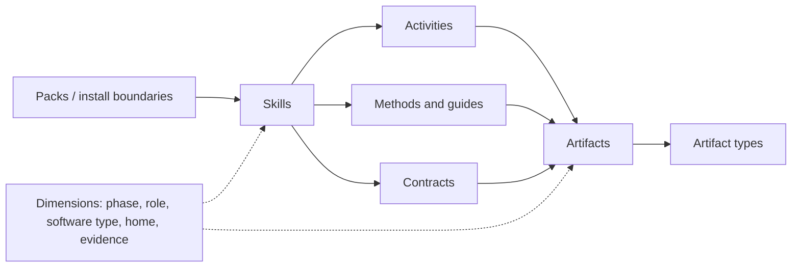

# Skills map

Generated from `SKILL.md` metadata and `agent-depot.json` labels. Open [skills-map.html](skills-map.html) for the filterable explorer.

## The simple model

Two core models, a method layer, three cross-cutting dimensions:

- **Activity** — what work is requested and where it stops.
- **Artifact** — what durable output exists, with authority, home, maturity, relations and evidence.
- **Method** — how to deepen or produce the work; `kind: guide` skills own artifact craft.
- **Dimensions** — phase, role, software type, home and evidence filter the two core models.

## Counts

167 skills · 21 plugins · 4 packs · 20 domains

| Pack | Skills |
| --- | ---: |
| `technical` | 76 |
| `sdlc` | 65 |
| `product` | 15 |
| `craft` | 11 |

| Kind | Skills |
| --- | ---: |
| `method` | 104 |
| `activity` | 30 |
| `guide` | 22 |
| `workflow` | 9 |
| `system` | 2 |

## Activities

Every skill with `kind: activity`, derived from metadata. The sdlc bundle's [activity catalog](../plugins/sdlc/skills/activity-system/references/catalog.md) adds curated stopping points and outputs for that bundle; this table is the complete list.

| Activity | Plugin | Phase | Use when |
| --- | --- | --- | --- |
| [design](../plugins/sdlc/skills/design/SKILL.md) | sdlc | design | Design UI interactions, backend contracts, AI behavior or architecture for a requested change before implementation. Use when the user wants to settle a solution, compare directions or review a proposal, including a continuation of an exploratory conversation. Use for consequential design alternatives; produce options, type-appropriate linked artifacts and a recorded decision. |
| [develop](../plugins/sdlc/skills/develop/SKILL.md) | sdlc | cross-phase | Take a rough business idea, feature, refactor or improvement through clarification, design, implementation, testing and review in one requested engagement. Use when the user asks to build a feature, including after a discussion of its requirements or design. Reuse agreed decisions and fill only gaps needed to implement safely. |
| [fix](../plugins/sdlc/skills/fix/SKILL.md) | sdlc | cross-phase | Investigate and repair reported incorrect software behavior when the user asks for a fix. Compare observed behavior with intent, reproduce the defect, apply a focused repair, verify it and hand off the evidence. Use for local or authorized engineering repair after an incident. |
| [harden](../plugins/sdlc/skills/harden/SKILL.md) | sdlc | cross-phase | Assess and address security/privacy weaknesses in the supplied feature, diff or repository. Use for a scoped hardening task with evidence-backed fixes and verification, preserving accepted architecture and task authority. |
| [implement](../plugins/sdlc/skills/implement/SKILL.md) | sdlc | implementation | Implement an agreed change in small verified increments. Use when the work is ready to build, whether the client provides slash commands and a Git flow or only local files and tests. |
| [improve](../plugins/sdlc/skills/improve/SKILL.md) | sdlc | cross-phase | Assess codebase improvement opportunities or implement a specified improvement objective. Use for architecture, performance, reliability, testability, UX consistency or developer-experience work; bare invocation discovers prioritized evidence-backed opportunities. |
| [plan](../plugins/sdlc/skills/plan/SKILL.md) | sdlc | planning | Decide whether and what to pursue for a feature, structural change, product area or new application. Use when discussion turns to what to ship first, what is in scope, whether it is feasible, or how to sequence and coordinate multiple changes. |
| [refine](../plugins/sdlc/skills/refine/SKILL.md) | sdlc | requirements | Refine a rough idea, brief, conversation or optional tracker item into repository-aware actionable work. Use to establish scope, acceptance criteria, affected UX/API/data boundaries and material questions before implementation, including when a conversation moves from ideation to defining an actionable feature without authorizing code. |
| [release](../plugins/sdlc/skills/release/SKILL.md) | sdlc | deployment | Prepare, review or verify an application release or deployment, whether merge-triggered continuous deployment or an explicitly authorized target action. Use for release readiness, post-rollout verification or an authorized target action; bare invocation prepares and reports rather than deploying. |
| [run-dependency-maintenance](../plugins/sdlc/skills/run-dependency-maintenance/SKILL.md) | sdlc | cross-phase | Run dependency and runtime maintenance: review updates, compatibility, release notes and dependent code paths, and handle dependency-update pull requests with CI evidence. Use for explicit or configured maintenance jobs; auto-merge only under an established eligible-update policy. Not for vulnerability triage or general supply-chain audit. |
| [run-incident-response](../plugins/sdlc/skills/run-incident-response/SKILL.md) | sdlc | maintenance | Coordinate and investigate active service incidents using impact-led triage, reversible stabilization, causal evidence, escalation, communication and independent recovery verification. Use for live or authorized unattended response, not readiness exercises, recurring review or durable repair. |
| [run-operations-review](../plugins/sdlc/skills/run-operations-review/SKILL.md) | sdlc | maintenance | Plan and run recurring operational reviews of capacity, artifact retention, backup activity, dependency queues, expiring access, scheduled environments, and runbook ownership. |
| [run-postmortem](../plugins/sdlc/skills/run-postmortem/SKILL.md) | sdlc | maintenance | Facilitate and follow up an incident postmortem: reconstruct evidence, analyse causes and response, derive testable learning actions, and verify that the controls actually work. |
| [run-product-feedback-analysis](../plugins/sdlc/skills/run-product-feedback-analysis/SKILL.md) | sdlc | cross-phase | Analyze existing user feedback and product usage evidence to evaluate outcomes, identify friction and unmet needs, and inform the next product decision. Use when reviewing a shipped feature, investigating adoption or usability, or prioritizing from available evidence; do not start surveys, contact users or install analytics without a request. |
| [run-production-readiness-review](../plugins/sdlc/skills/run-production-readiness-review/SKILL.md) | sdlc | deployment | Run a scoped production-readiness review of whether a service, launch or material capability change is ready to be depended on. Assess reliability and SLOs, observability and alerts, security and authority, capacity and failure behavior, recovery and rollback, runbooks, on-call and support, and open limits. Do not authorize a release or certify the service. |
| [run-security-maintenance](../plugins/sdlc/skills/run-security-maintenance/SKILL.md) | sdlc | maintenance | Run credential lifecycle and vulnerability remediation operations — inventory, issue, rotate, revoke and retire credentials, and triage, remediate and verify findings across dependencies, images, infrastructure and deployed targets. |
| [setup](../plugins/sdlc/skills/setup/SKILL.md) | sdlc | planning | Establish a new application or adopt an existing repository, discover working commands and accepted constraints, and prepare a useful first slice. Use for explicit project setup or adoption; preserve an existing project layout and tooling. |
| [test](../plugins/sdlc/skills/test/SKILL.md) | sdlc | testing | Select, add, run and review checks; establish completion evidence for a change, journey, component or application. Use as part of implementation or the in-review step, or for an explicit verification request, within the authorized target scope. |
| [build-strategic-roadmap](../plugins/strategy/skills/build-strategic-roadmap/SKILL.md) | strategy | planning | Turn an accepted strategy into a bounded operating period: observable outcomes, strategic initiatives, OKRs, capacity, dependencies, cadence and decision rights. Use after the strategy is accepted; stop before the product roadmap, PRD, feature sequencing or delivery commitments. |
| [define-positioning](../plugins/strategy/skills/define-positioning/SKILL.md) | strategy | design | Decide who the offer is for, what it is compared with, why the customer should switch and why the claim is credible. Use for positioning, category, value proposition and differentiation work; return a defensible argument with proof gaps and exclusions, not marketing copy. |
| [design-business-model](../plugins/strategy/skills/design-business-model/SKILL.md) | strategy | design | Decide how the business captures value: who pays, for what outcome, on what metric, at what packaging, with what unit economics and what makes the position durable. Use for business model, pricing, packaging and monetization questions; stop before the full financial plan or launch. |
| [discover-customers](../plugins/strategy/skills/discover-customers/SKILL.md) | strategy | planning | Establish how a target customer behaves today, what the status quo costs and where a new choice would fit. Use for interviews, workflow reconstruction, ICP and jobs-to-be-done work before demand or pricing claims; do not invent personas or treat interest as demand. |
| [model-finances](../plugins/strategy/skills/model-finances/SKILL.md) | strategy | planning | Build a driver-based financial model for a strategy or business model: revenue drivers, cost structure, unit economics, runway and conservative/base/upside plus strategic-downside scenarios. Use for planning, sensitivity and what-must-be-true questions; not for valuation opinions or fundraising process. |
| [plan-go-to-market](../plugins/strategy/skills/plan-go-to-market/SKILL.md) | strategy | design | Design a repeatable route to the chosen customer: motion, channels, launch sequence, growth loop, funnel metrics and a bounded first plan. Use for launch planning, channel choice and motion changes; stop before product scope or delivery commitments. |
| [raise-capital](../plugins/strategy/skills/raise-capital/SKILL.md) | strategy | planning | Prepare a fundraise around a specific milestone: readiness, round size from the cash model, instrument trade-offs, investor pipeline, data room and runway. Use when deciding whether and how much to raise; do not give legal or tax advice or contact investors without authorization. |
| [review-strategy](../plugins/strategy/skills/review-strategy/SKILL.md) | strategy | cross-phase | Re-test an existing strategy against new evidence and decide continue, narrow, park, pivot or kill. Use for scheduled strategy reviews, fired tripwires and red-team challenges; produce a recorded verdict, not a status meeting. |
| [run-market-scan](../plugins/strategy/skills/run-market-scan/SKILL.md) | strategy | planning | Scan a market, segment, competitor set or trend to a decision-relevant depth. Use for entry questions, landscape reviews and competitor profiles; return the strategic implication and gaps, not a feature matrix or a data dump. |
| [set-strategy](../plugins/strategy/skills/set-strategy/SKILL.md) | strategy | planning | Commit to one integrated strategy from competing options. Frame the decision, compare at least three materially different choices, state the cascade, exclusions, economics, falsifiers and opportunity cost, and produce an accepted or explicitly proposed strategy brief. |
| [test-assumptions](../plugins/strategy/skills/test-assumptions/SKILL.md) | strategy | cross-phase | Design and interpret experiments that buy a specific decision: tie each test to an assumption, precommit the bar, grade the evidence and choose persevere, narrow, repackage, pivot, park or stop. Use when a live thesis needs behavioural evidence; use validate-idea for premise triage. |
| [validate-idea](../plugins/strategy/skills/validate-idea/SKILL.md) | strategy | planning | Decide whether an early business idea deserves more investment. Challenge the premise, inventory existing evidence, map the decisive assumptions and return go, investigate or stop; use before interviews, pilots or build work, since this activity runs no experiments. |

## Artifact guides

| Guide | Domain | Use for |
| --- | --- | --- |
| [guide-data-model](../plugins/sdlc/skills/guide-data-model/SKILL.md) | database | Guide to documenting a logical data model. Covers entities and relationships, ownership, identity and keys, lifecycle, invariants, consistency, retention, access and tenancy, compatibility, evidence and open decisions. |
| [guide-release-note](../plugins/sdlc/skills/guide-release-note/SKILL.md) | delivery | Guide to writing a release note or changelog. Covers what shipped, target, changes, migration, compatibility, verification and rollback. |
| [guide-adr](../plugins/sdlc/skills/guide-adr/SKILL.md) | development | Guide to writing an architecture or product decision record. Covers context, options, decision, consequences, status and supersession. |
| [guide-compatibility-matrix](../plugins/sdlc/skills/guide-compatibility-matrix/SKILL.md) | development | Guide to producing and reviewing a compatibility matrix. Use for public surfaces, versions, platforms, runtimes, deprecation, migration and consumer evidence across libraries, CLIs and APIs. |
| [guide-design-proposal](../plugins/sdlc/skills/guide-design-proposal/SKILL.md) | development | Guide to writing a design proposal. Covers the decision, constraints, affected components, materially different options, linked artifacts, tradeoffs, seam and recommendation. |
| [guide-ecr](../plugins/sdlc/skills/guide-ecr/SKILL.md) | development | Guide to writing an Engineering Change Record. Covers overview, problem, requirements, solution design, implementation, verification and decisions across a change. |
| [guide-issue](../plugins/sdlc/skills/guide-issue/SKILL.md) | development | Guide to writing an actionable issue. Covers context, intended outcome, scope, acceptance, constraints, verification, dependencies and ownership. |
| [guide-pr](../plugins/sdlc/skills/guide-pr/SKILL.md) | development | Guide to writing a pull request description. Covers why, what changed, design impact, validation, risk, release and reviewer links. |
| [guide-product-feedback-analysis](../plugins/sdlc/skills/guide-product-feedback-analysis/SKILL.md) | development | Guide to writing a product feedback analysis. Covers the decision question, scope, evidence limits, said versus did, findings, competing explanations, implications and open gaps. |
| [guide-research-report](../plugins/sdlc/skills/guide-research-report/SKILL.md) | development | Guide to writing a decision-oriented research report. Covers question, recommendation, evidence, alternatives, limits and open decision. |
| [guide-rfc](../plugins/sdlc/skills/guide-rfc/SKILL.md) | development | Guide to writing a request for comments or technical proposal. Covers problem, current state, affected components, proposal, alternatives, impact and open decision. |
| [guide-state-machine](../plugins/sdlc/skills/guide-state-machine/SKILL.md) | development | Guide to producing and reviewing state machines. Use for states, triggers, guards, terminal states, denied transitions, invariants and concurrent or retried behavior. |
| [guide-system-documentation](../plugins/sdlc/skills/guide-system-documentation/SKILL.md) | development | Guide to discovering, tracing, creating and reviewing the current-system architecture set. Covers evidence, boundaries, responsibilities, runtime behavior, interfaces, deployment, current versus proposed state and document quality. |
| [guide-readme](../plugins/sdlc/skills/guide-readme/SKILL.md) | documentation | Guide to writing a repository README. Covers purpose, audience, quickstart, what it does, open-source adoption, honest claims, docs map, development, support, status and limits. |
| [guide-design-spec](../plugins/sdlc/skills/guide-design-spec/SKILL.md) | frontend | Guide to producing a design specification that implementation can build and verify from. Covers flows, wireframes, mockups, prototypes, states, content, components, responsiveness, accessibility, motion, assets, handoff and design QA. |
| [guide-assurance-assessment](../plugins/sdlc/skills/guide-assurance-assessment/SKILL.md) | governance | Guide to writing a scoped assurance assessment. Covers applicability, service boundary, controls, evidence, gaps, disposition and ownership. |
| [guide-incident-record](../plugins/sdlc/skills/guide-incident-record/SKILL.md) | operations | Guide to writing an incident record. Covers impact, severity, ownership, timeline, mitigation, recovery verification, current state and follow-up. |
| [guide-postmortem](../plugins/sdlc/skills/guide-postmortem/SKILL.md) | operations | Guide to writing a blameless postmortem. Covers timeline, contributing conditions, what worked, actions, owners, verification and open questions. |
| [guide-runbook](../plugins/sdlc/skills/guide-runbook/SKILL.md) | operations | Guide to authoring, exercising and auditing operational runbooks. Covers triggers, prerequisites, diagnosis, mitigation, verification, escalation, recovery, artifact craft and exercise evidence; invoke from design, release, incident response, recovery and operations review as well as runbook maintenance. |
| [guide-prd](../plugins/sdlc/skills/guide-prd/SKILL.md) | product | Guide to writing a product brief or PRD. Covers problem, audience, outcome, scope, success signal, constraints, evidence and open decisions. |
| [guide-roadmap](../plugins/sdlc/skills/guide-roadmap/SKILL.md) | product | Guide to writing and reviewing a strategic or product roadmap. Covers outcomes and evidence, Now/Next/Later horizons, confidence, dependencies, capacity, sequencing, explicit deferrals, status, review cadence and common failures. |
| [guide-architecture-views](../plugins/sdlc/skills/guide-architecture-views/SKILL.md) | visualization | Guide to producing and reviewing C4 and sequence views. Use for system boundaries, actors, responsibilities, directed dependencies, current versus proposed state, request ordering, synchronous versus asynchronous work, failure, retry, recovery and text equivalents. |

## Full inventory

Run `python scripts/skill_map.py` to regenerate this page and the HTML explorer. The generated HTML is the filterable view; this page is the stable summary.
