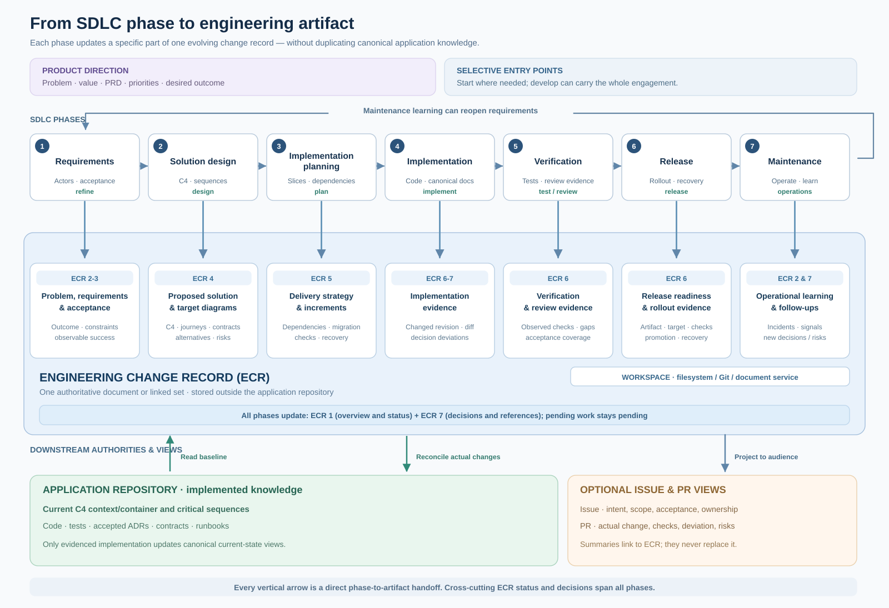

# Engineering artifacts and workspaces

[SDLC overview](sdlc.md) · [Artifact contract](../plugins/development/skills/engineering-artifacts/SKILL.md) · [Workspace method](../plugins/development/skills/engineering-workspace/SKILL.md) · [Usage](usage.md)



The assessment labels on the phase-to-artifact arrows show **where missing acceptance, inconsistent designs, uncovered implementation behavior or unreliable release evidence should be caught**. They are not seven mandatory execution gates: each check is proportionate to changed risk and the next requested work. Common ECR identity/status and decision history remain cross-cutting; no tracker or workflow orchestrator is required.

## Two kinds of knowledge, three audiences

Engineering change records describe **the intended change and its evidence**, not the current application. The application repository remains the source of code, tests, implemented architecture (C4/context/container/component where appropriate), critical sequences, contracts and operating documentation. Issues and PRs are audience-focused **views**: issues focus on outcome/acceptance/coordination, PRs on actual changes/review evidence. Neither must exist for the underlying engineering record to be complete.

Every **performed** activity—`refine`, `design`, `plan`, `implement`, `test`, `review`, `release`, or end-to-end `develop`—must create/update a reviewable ECR outcome. It may be a compact seven-section record for a small bug or a linked document set for a significant initiative; no separate document per phase or mandatory issue. Record `pending` or `not applicable` (with a reason) where necessary; never mark planned work as completed just because the section exists.

## The standardized ECR

Use these same headings in order, with the expected content described in [the full contract](../plugins/development/skills/engineering-artifacts/references/engineering-change-record.md):

| Section | Essential questions | Main producer/consumer |
| --- | --- | --- |
| 1. Overview and lifecycle | Which change, owner, stage, related PRD/issues/PRs and evidence revision? | Every activity |
| 2. Problem and scope | Which user/system problem, desired outcome, protected behavior and non-goals? | Product direction → refine |
| 3. Requirements and acceptance | Who can do what, under which quality/permission/failure constraints, and how can we observe success? | Refine → design |
| 4. Solution design | Which architecture/UX/service choice, current/target diagrams, alternatives and dependencies? | Design → plan |
| 5. Implementation strategy | Which ordered increments, migrations, checks and recovery steps? | Plan → implementation |
| 6. Verification and release | What was **actually** implemented/tested/reviewed/deployed, at which revision/target and with what limitations? | Implement/test/review/release |
| 7. Decision history and references | Which choices changed or were superseded, why, and which canonical artifacts support them? | All consumers |

The format is **Markdown-like prose with stable section names**, not a YAML schema. Standardize reviewability and statuses while allowing content depth to match material risk. The ECR links adjacent PRD, substantive RFC, target diagrams, accepted ADRs and source-based verification; do not copy those documents in full. Preserve a stable change identity and known source revision, but don't invent numeric IDs when the storage provider has none.

## Choosing a workspace backend

The **engineering workspace** is a logical location **parallel to the application repository**. Its authority is configured by an existing project convention or user instruction, not deduced from whichever service happens to be connected.

| Configuration | ECR home | Optional coordination |
| --- | --- | --- |
| Filesystem (first-class default when authorized) | A designated folder **outside the application repository**, optionally an independent Git repo | No ticket required |
| External documents | Connected document collection/capability in Linear, Plane, another tool | Linked issues/projects if already configured |
| Issue-only workspace | Suitable issue body for bounded ECR, or linked separately authorized document for substantial/diagram-heavy work | Project board optional |
| Hybrid | One authoritative ECR home, references to a separately owned PRD/RFC/diagram file and optional tracker issues | No duplicated ECR authorities |

For filesystem mode, an example *after authorization* is `workspace/engineering/changes/async-exports/ecr.md` beside `workspace/app/`; the latter holds code and current-state docs. Established paths win over this example. **If no ECR home or explicit inline-only preference exists, an interactive agent asks the user to choose first**—in `refine`, `design`, `plan`, `develop` or `setup`, not only at setup. Offer an authorized filesystem location, an existing connected document provider or no persistence/inline only. Never presume that an available connector is the selected authority. If the answer/path is still unavailable or the task is unattended, report the storage blocker and return structured content inline **without claiming persistence**. Do not create a sibling directory or switch providers silently.

Workspaces have different actual capabilities. They do not share an assumed adapter SDK, revision primitive or synchronization engine. The [filesystem guide](../plugins/development/skills/engineering-workspace/references/filesystem.md) and [provider integration guide](../plugins/development/skills/engineering-workspace/references/providers.md) describe read/write/update/link semantics without inventing APIs. Agent access/authorization is distinct from a document link.

### Configure it once during project setup

The explicit `setup` activity checks for an existing ECR home and preserves it, while **all interactive phase entry points must offer the same choice when an ECR needs storing and no preference is known**. When missing, the agent asks one storage question: **an authorized filesystem workspace** (for example, a separately versioned folder alongside the application), **an existing connected document provider**, or **inline-only without persistence**. It may propose a nearby filesystem directory, but must **not** create it without permission outside the allowed tree. After selecting a durable backend, it verifies actual access and stores a **portable discovery pointer** in existing project instructions if authorized: workspace backend, how to resolve its root on a fresh checkout, ECR discovery convention, history/permissions, and links to the application repository. Example project instruction:

```text
Engineering change records: filesystem workspace
Discovery: engineering folder alongside the app checkout, under our approved project root
ECRs: reuse existing change record; new changes under changes/<slug>/ecr.md
History: independent Git repository when available
Architecture baseline: app docs/architecture (implemented state)
```

These are example instructions, **not a required configuration schema or a mandate to create the example folder**. If setup cannot establish authority/access, it names the unresolved choice and continues unrelated authorized foundations; future development must not pretend a durable ECR exists.

## Adjacent artifacts and their authoritative homes

- **PRD:** product/project-level intent, audience, value, priorities and success; in an authorized product workspace or existing authority.
- **RFC / proposal:** deep target architecture, options and diagrams for consequential changes; linked from the ECR in the engineering workspace.
- **Target C4, wireflows and sequences:** proposed future state in ECR/RFC; use versioned editable diagram sources when possible.
- **Canonical C4, sequences, ADRs, runbooks and contracts:** implemented or explicitly status-labelled accepted knowledge in the application repo's established docs. An approved prospective ADR must not be confused with a deployed design.
- **Implementation plan and verification:** ECR sections or separate linked documents where duration/team responsibility warrants it.
- **Issue/ticket:** optional coordination view: why, outcome, scope, observable acceptance, owner/dependencies and links.
- **PR:** reviewer view: why, what *actually* changed, architectural impact/deviations, real checks, remaining risk, ECR/issue/diagram references. Respect workspace visibility; don't leak private ECR text to public PRs.

These responsibility boundaries matter more than any proposed filename. For details, read [adjacent artifact authority](../plugins/development/skills/engineering-artifacts/references/artifact-types.md) and [audience views](../plugins/development/skills/engineering-artifacts/references/audience-views.md).

## Diagram ownership and reconciliation

**System mapping / architecture documentation** should ensure that relevant current C4 views and critical runtime/journey sequences exist in the application's **canonical** docs, especially at the first verified implementation of a new system or after a changed architectural boundary. **Solution design** consumes them at a source revision, produces proposed target views in the ECR/RFC and records the change/delta. **Planning** references that proposal, **implementation and verification** reconcile deviations against actual code, and **release/operations** distinguish source/merged state from a truly observed running target. A local change with no affected boundary records that conclusion explicitly; do not generate a C4 diagram purely to tick a box.

Example: the ECR for async exports references `app/docs/architecture/containers.md` at a base commit, links a proposed queue/worker container view and a permission/retry/export sequence, and states the unresolved decision on revocation. A PR later explains the actual worker implementation and verifies cancellation/retry; its code/docs diff updates current architecture to match the implementation, not the originally imagined proposal.

## Sample conversations and outputs

**Local / filesystem:** "Use develop to add recurring exports. Store change artifacts in the `/work/engineering` folder, separate from `/work/app`; don't create issues." The agent discovers an existing ECR or creates the standard record, refines acceptance, proposes applicable target diagrams, implements, checks and updates the ECR plus app canonical docs. It may prepare a PR only when authorized.

**Company / mixed:** "Refine our team-invitation work item; product PRD is in the project wiki, ECRs are filesystem-backed, implementation issues are in Plane and PRs use GitHub." The agent references the PRD, updates one authoritative ECR, adds a concise issue summary only when authorized and links its proposed design to relevant current C4 views. It never copies the ECR into every provider.

**Rearchitecture / design only:** "Design a schema-per-tenant migration without implementation." The agent references current architecture, produces the ECR design/RFC and proposed C4/sequence views, records pending migration/authority choices, and stops with implementation/release sections pending; canonical implemented diagrams remain unchanged.

**Small bug:** "Fix language selection not persisting." The seven sections are concise; the agent records actual cause, acceptance, change and tests. Architecture impact is "not applicable — state owner unchanged", and no new PRD/ADR/diagram/issue is invented.

## Artifact assurance and convergence

The [assurance method](../plugins/development/skills/engineering-artifacts/references/assurance.md) adds three checks to the ECR contract: **structural** (seven sections, dispositions and references where accessible), **semantic** (requirements → proposed C4/sequence/contract → plan consistency), and **convergence** (accepted outcomes against actual checked implementation, test coverage, canonical docs and current PR diff). It includes the readiness dispositions *ready*, *ready with limitations* and *blocked*, applied to the next dependency rather than forcing meetings or an approval at every phase.

The agent checks the **seven ECR sections and their real content** in the authoritative document, preserving nested headings and provider-native document formats. No custom Python checker, static schema, tracker or command is required; a structurally complete document is still not evidence of correct behavior. External document providers are assessed through actual supported reads rather than forced local exports. For consequential contradictions, return explicit evidence, affected artifact/decision owner, fix or blocker, and recheck before claiming readiness. Before PR publication/review, reconcile the cumulative base-to-head diff, ECR/design commitments, actual test results and reviewer-facing description; do not copy a private ECR into a public PR. No workflow runtime, formal provider adapters or arbitrary required gates are introduced here.

## Verification and limits

A document heading or provider link is not proof the work occurred. Review accepted/proposed claims, current-vs-target consistency, actual source/diagram evidence and referenced status. Structured outputs must state what was persisted, what was merely drafted, and the exact checked revision; CI/plugin checks validate source structure but do not establish that agent behavior meets these standards. [Behavioral cases](../evals/development-workflows.json) include filesystem, external-provider and mixed-workspace flows as definitions to execute, not pre-verified results.
