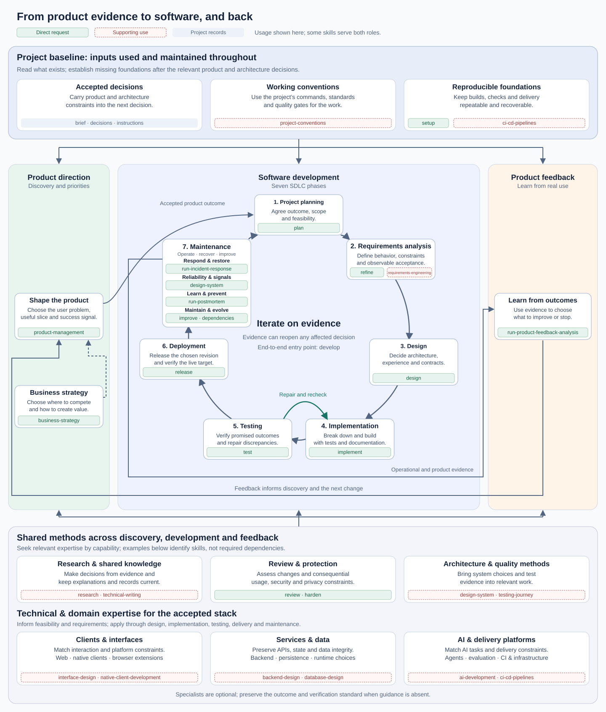
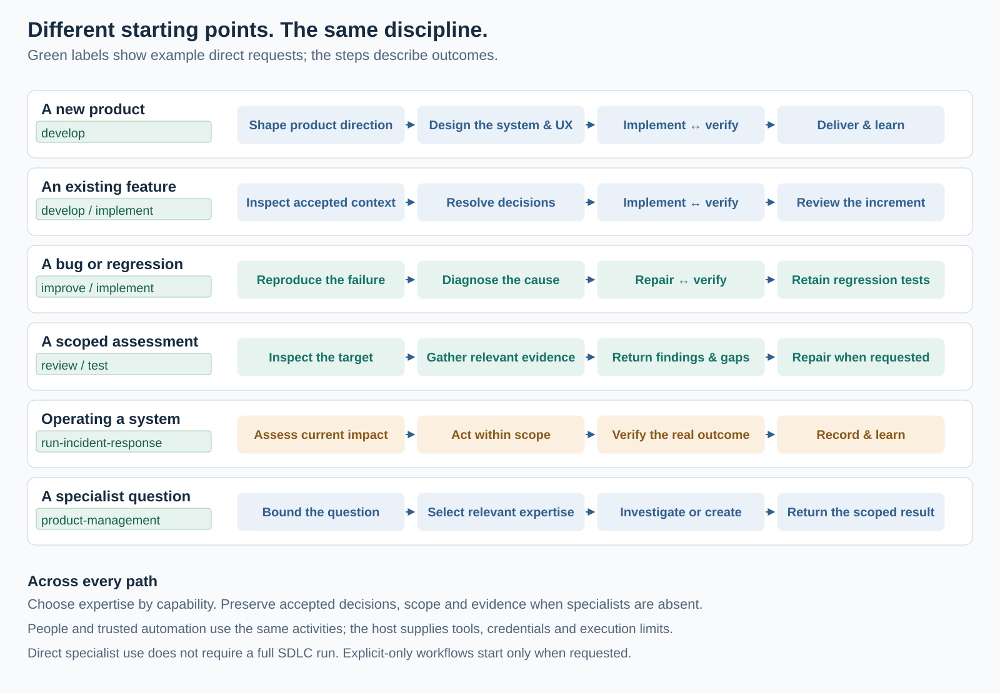

# SDLC coverage

Use the [SDLC overview](../README.md#sdlc-coverage) to orient yourself and the [task menu](usage.md#skills-you-invoke) to start work. This reference links the expertise behind those activities. `develop` spans the useful lifecycle; individual tasks let you enter at any phase. Phases describe outcomes, **not required agent invocations or stage-gate approvals**. For new applications, [new-application flow](../plugins/sdlc/skills/develop/references/new-application-flow.md) defines the dependent decisions; `setup` alone does not establish the full lifecycle.

## Read the lifecycle map

The lifecycle uses seven phases: **project planning → requirements analysis → design → implementation → testing → deployment → maintenance**. Enter where an outcome is missing and revisit earlier decisions when evidence changes them. A known bug can start with reproduction. A new initiative may need feasibility work before requirements. Product direction helps choose the outcome and priority, and feedback can reopen either.

Work is not a single pipeline. Requirements, design, implementation and verification can run as parallel threads, and evidence can reopen an earlier decision. The thread view shows one focus, open threads and reopen paths.

The thread view reads as lanes: requirements frame outcome and acceptance; design compares options, links artifacts and records the decision; implementation builds and checks; verification produces test and review evidence; operations releases, observes and learns. A missing state reopens design, a contradiction reopens the decision, and operational evidence can reopen requirements or design. One focus is active at a time, but the other threads remain open.

Every phase starts by checking the inputs, deciding what work is needed and identifying the evidence or decision the next person will need. Scale that preparation to the uncertainty. During implementation, break agreed requirements and design into deliverable tasks, dependencies and checks. The [implementation preparation method](../plugins/sdlc/skills/activity-system/references/implementation-preparation.md) supports requests that stop at a breakdown.

| Part of the diagram | How it contributes |
| --- | --- |
| Product direction | Select users, problems, value, priorities and success signals; learn from delivered value |
| Engineering lifecycle | Establish and deliver required behavior, design, implementation, evidence, release and long-lived operational health |
| Project baseline | Reuse accepted decisions, existing contracts, instructions and evidence; update their canonical owners as they change |
| Shared methods | Research, documentation, security and review provide conditional expertise across phases |
| Technical/domain expertise | Choose by actual engineering concern and accepted stack rather than assuming Python, React or a particular framework |

Green labels identify entry-point skills or directly requested activities; dashed warm labels identify specialist support. Some expertise can also be requested directly. These are explanatory examples, not a fixed dependency graph. An agent must still respect user scope, runtime access, credentials and separate authorization for deployment or production actions.

## User-facing entry points

| Need or missing outcome | Appropriate entry point |
| --- | --- |
| Business direction and product priority | `business-strategy`, `product-management` |
| Engineering requirements and acceptance | [refine](../plugins/sdlc/skills/refine/SKILL.md), supported by [requirements-engineering](../plugins/sdlc/skills/requirements-engineering/SKILL.md) when substantive |
| Architecture, user experience or interface contracts | `design`, with `design-system`, `interface-design` or `backend-design` expertise when applicable |
| Agreed implementation needs dependency ordering | Request an implementation breakdown |
| Build an already-defined change | `implement` |
| Rough idea through implementation, tests and review | `develop` |
| Behavior checks and change assessment | `test` and the review composition; review also applies earlier |
| Delivery readiness or named authorized deployment | `release` |
| Live incident or restoration | [run-incident-response](../plugins/sdlc/skills/run-incident-response/SKILL.md), recovery expertise as applicable |
| Proactive operation, maintenance and improvement | `improve`, `run-dependency-maintenance`, [observability and monitoring](../plugins/sdlc/skills/design-system/references/observability-and-monitoring.md), and other targeted operating skills |
| Project foundation or activity selection | `setup`, `activity-system` |

### Which entry point should you use?

| Starting situation | Typical work and stopping points |
| --- | --- |
| Company product request | Product direction establishes priority → `refine` defines behavior and quality constraints → `design` settles consequential solution choices → `implement` breaks down and builds the change, `test`, the review composition, `release` as authorized |
| Company refactor / rearchitecture | Inspect current behavior and maintenance pain → `refine` the preserved contracts, migration constraints and expected outcome → `design` alternatives and migration boundary → authorized implementation in compatible increments with rollback and checks |
| Local agent-assisted feature or new app | Select `develop` for an authorized end-to-end slice; it establishes the missing decisions directly with relevant supporting expertise. Select `plan`, `refine`, `design` or `implement` individually when a bounded artifact or stopping point is desired |
| Known bug or narrow change | Use `fix` to reproduce, repair and verify the affected behavior. No required planning or new specification ceremony |
| Incident, recovery or operational drift | Start with the matching operations activity; follow causal evidence and actual operating policy. Turn confirmed learning into a requirement/design/improvement only when warranted |
| Exploration, security review or architecture question | Request research, `harden`, `code-review` or specialist expertise; stop at the requested analysis rather than beginning implementation |

Implementation preparation converts agreed requirements and design into actionable increments, dependencies and tests. It can iterate when implementation discovers a new constraint. The end-to-end `develop` activity does not need to invoke each explicit-only task skill by name to accomplish those outcomes.

## Standard engineering artifacts and workspace handoffs

An Engineering Change Record (ECR) carries the outcome of each performed activity on a change. A standalone inquiry can finish with a research report in the chosen workspace. Use the [artifact system](../plugins/sdlc/skills/artifact-system/SKILL.md) for the shared artifact model, contracts, homes, quality and assurance, and [coordination storage](../plugins/sdlc/skills/artifact-system/references/storage/coordination.md) for coordination-artifact discovery and persistence. The application repository owns implemented architecture and operating documentation.

Every durable output is an artifact with a type, primary plane, home, authority, maturity and relations. The ECR is the coordination spine for a change, not the only artifact: architecture views, runbooks, code, tests, issues and PRs are artifacts too. `setup` establishes the repository artifact home map; `project-conventions` maintains its placement method; `develop`, implementation and release read or update it.

A handoff is **content, not a document**. The next phase may need a decision, a design specification, a contract, a test result and an open decision from different artifacts. Read [handoff](../plugins/sdlc/skills/artifact-system/references/handoff.md) for the phase matrix; the ECR is the index, not a copy of every artifact.

Artifact types pair with a contract and, where the craft is distinct, a guide. The ECR is one coordination node; a design proposal links the design specification, C4, sequence and state artifacts rather than owning them.

The map reads left to right: each artifact type has a contract, and where the craft is distinct a guide. The guide owns structure and review; the contract owns lifecycle, authority, maturity, evidence and handoff. Roadmap, API reference, work product, deployment record, guide and glossary have no dedicated guide for the reasons recorded in the registry.

The artifact graph shows the relationships across intent, coordination, system knowledge, implementation, delivery and entry. The ECR links intent, design, implementation, delivery and learning evidence; it is not the center of the system.

In the graph, intent informs the ECR; the ECR links the design proposal and implementation; the design proposal links the design specification and architecture views; code and tests produce review and release evidence; release and operations produce runbook, incident and postmortem knowledge; learning reopens the ECR. The ECR is one node, not the center.

## Different starting points

The same capability collection serves full applications and bounded changes. Reuse accepted context and reopen only affected decisions. A new product needs enough outcome, feasibility, requirements and design evidence before irreversible commitments; a bug fix starts with reproduction. Operational incidents begin with response and recovery, not a product-planning ritual.

Direct strategy, design, documentation and specialist requests can end at their own useful results. People and trusted automation can request the same activities; the host supplies triggering, tools, credentials, limits and action scope. Implementation and verification iterate; an actual deployment or recovery is not established by a passing unit test.

## Before and around the cycle

- Product discovery and direction: [product-management](../plugins/strategy/skills/product-management/SKILL.md) owns user problems, priorities, useful scope and success signals; business-strategy owns viability and positioning. These decisions inform project planning and may be reopened by evidence.
- Foundations: `setup` uses [project-conventions](../plugins/sdlc/skills/project-conventions/SKILL.md) and relevant [CI/CD pipeline design](../plugins/development-tooling/skills/ci-cd-pipelines/SKILL.md). Establish foundations after sufficient product and architecture decisions for a new project; maintain them as conditions change.
- Feedback: [learn-from-product-feedback](../plugins/strategy/skills/learn-from-product-feedback/SKILL.md) informs product direction; incident learning addresses reliability and may also expose missing requirements or design protections.
- Changes to consequential decisions: follow [the shared decision policy](../plugins/sdlc/skills/activity-system/references/authority.md#consequential-findings) and continue independent authorized work. Do not invent acceptance or account permissions.

## Roles across the phases

These are typical contributions. In a small team, one person can cover several roles. Involve specialists when the change affects their decisions or the evidence they need.

| Phase | Typical lead and contributors | ECR contribution |
| --- | --- | --- |
| Project planning | Product manager or change owner leads. Engineering advises on feasibility and SRE advises on material operating risks. | Outcome, scope, feasibility and next decision, with links to the brief, PRD or roadmap when useful |
| Requirements analysis | Product and engineering define behavior with stakeholders. Design contributes journeys, QA helps make acceptance observable, and SRE checks relevant reliability requirements and SLOs. | Agreed behavior, quality constraints and acceptance |
| Design | Architect, designer and engineers lead their respective concerns. QA reviews testability and SRE reviews operating and recovery implications. | Affected software types, materially different options, type-appropriate linked artifacts, seam and accepted decision |
| Implementation | Engineers break down the work, build it and add tests. Design, architecture, QA and SRE support affected areas. | Task breakdown, planned checks, actual changes and deviations |
| Testing | Engineers and QA verify acceptance. Product and design review user outcomes, and SRE helps verify affected reliability paths. | Checked behavior, actual results and remaining gaps |
| Deployment | Engineering and release or SRE owners coordinate delivery and recovery. QA contributes smoke checks. | Target, rollout or rollback evidence and observed result |
| Maintenance | SRE and engineering maintain service health. Product uses feedback to revisit priorities. | Operational learning and linked follow-up decisions |

See the [reference role diagram](https://share.google/aimode/PpTjDsdFrpSGyXtZq) for the illustration that informed these overlaps.

## Skills by phase

### 1. Project planning

Use [plan](../plugins/sdlc/skills/plan/SKILL.md) to agree why a change is worth doing, its first useful scope and whether it is feasible. Draw on product expertise for discovery and priority, engineering for feasibility, and delivery coordination when several changes or owners share prerequisites. Record the decision in the ECR or link the existing product brief or roadmap. A planning ticket can hand off a concrete investigation or a change with clear acceptance.

### 2. Requirements analysis

Start with [refine](../plugins/sdlc/skills/refine/SKILL.md). For new systems, significant changes, rearchitecture or uncertain requirements, use its supporting [requirements-engineering](../plugins/sdlc/skills/requirements-engineering/SKILL.md) method to elicit needs, define functional and measurable quality constraints, validate conflicts and link acceptance to evidence. Preserve accepted product intent; product-management is not repeated as a development phase. Requirements may be ready for solution design before implementation architecture is decided.

### 3. Design

Use [design](../plugins/sdlc/skills/design/SKILL.md) to settle a consequential choice before implementation. Start with [software types](../plugins/sdlc/skills/artifact-system/references/software-types.md) to identify the affected components — frontend, backend, AI or library/CLI — and mark unaffected types explicitly. A type belongs to a component, not to the project. A browser extension, REST API, multi-tenant SaaS backend or LangChain stack is a constraint on that type, not a new type.

For a consequential choice, produce at least three materially different options with the [option set](../plugins/sdlc/skills/design/references/option-set.md), and represent each one for its type: wireframes, mockups or prototypes for UI; contracts, sequences or C4 views for services; context and evaluation plans for AI; public-surface and compatibility views for libraries. When several types meet, decide the seam once — contract, error and denial mapping, pagination, authority, retry and compatibility — instead of duplicating it.

Use [design-system](../plugins/sdlc/skills/design-system/SKILL.md) for architecture, [interface-design](../plugins/frontend-development/skills/interface-design/SKILL.md) for UI craft, [backend-design](../plugins/backend-development/skills/backend-design/SKILL.md) for service behavior, and AI or security expertise by capability. Record the decision in the [design proposal](../plugins/sdlc/skills/artifact-system/references/contracts/design-proposal.md) as ECR §4, an RFC or a linked design record. Validate with [design validation](../plugins/sdlc/skills/design/references/design-validation.md) when uncertainty is material and hand off through [design review](../plugins/sdlc/skills/design/references/design-review.md).

Design may run in parallel with requirements or implementation. Use [engagement state](../plugins/sdlc/skills/activity-system/references/engagement-state.md) to keep one focus, several threads and explicit reopens. A greenfield design can be entirely proposed with no implementation; mark the type as assumed when it is not yet settled. No comprehensive design document is required for a trivial local fix.

Every artifact type has a contract and, where the craft is distinct, a guide. The guide owns structure, conventions and review; the contract owns lifecycle, authority, maturity and handoff. The full pairing is the [guide registry](../plugins/sdlc/skills/artifact-system/references/guide-registry.md).

- **Document guides:** PRD, RFC, ADR, ECR, design proposal, architecture set, issue, PR, research report, release note and README.
- **Operational guides:** runbook, incident record, postmortem and assurance assessment.
- **Artifact/view guides:** design specification, C4, sequence, state machine and compatibility matrix.

Guides can be used inside an activity or requested directly. They are self-contained writing methods and do not link into the artifact system.

### 4. Implementation

Start by breaking agreed work into bounded increments and choosing the verification for each. Use [implementation preparation](../plugins/sdlc/skills/activity-system/references/implementation-preparation.md) when dependencies, migration, recovery or coordination warrant an explicit breakdown. Keep it in the ECR implementation strategy or link the existing plan.

Start with the bundled upstream `implement` when explicitly selected, or use `develop` for the broader end-to-end engagement. Use [git-contributions](../plugins/sdlc/skills/git-contributions/SKILL.md) for the objective worktree, plus matching frontend/backend/AI/database/native-client and operating expertise. Carry tests and affected documentation with the change.

### 5. Testing

Start with [verification](../plugins/sdlc/skills/test/SKILL.md), and use [testing-journey](../plugins/frontend-development/skills/testing-journey/SKILL.md), performance/resilience and other specialist methods where relevant. The review composition may apply in any phase. Observe real behavior, repair failures and recheck without weakening acceptance.

### 6. Deployment

Start with [release](../plugins/sdlc/skills/release/SKILL.md). [CI/CD pipeline design](../plugins/development-tooling/skills/ci-cd-pipelines/SKILL.md) supports the provider-neutral stages, artifacts, promotion, rollout and recovery; actual remote actions require named authorization and target verification. Under continuous deployment, the merge, tag or pipeline trigger is the release event; verify the rollout and served outcome rather than inventing a second manual action.

### 7. Maintenance

Maintenance is one lifecycle outcome with four complementary responsibilities: **respond & restore**, **reliability & signals**, **learn & prevent**, and **maintain & evolve**. Operations activities are direct ways of achieving those outcomes; they are **not just substeps** of `improve` or `run-dependency-maintenance`. React to incidents with [run-incident-response](../plugins/sdlc/skills/run-incident-response/SKILL.md) and appropriate recovery, runbook and [run-postmortem](../plugins/sdlc/skills/run-postmortem/SKILL.md). Proactively manage [reliability and SLOs](../plugins/sdlc/skills/design-system/references/reliability.md), [observability and monitoring](../plugins/sdlc/skills/design-system/references/observability-and-monitoring.md), [run-operations-review](../plugins/sdlc/skills/run-operations-review/SKILL.md), capacity, cost, vulnerability and credentials. `improve` and `run-dependency-maintenance` complement those responsibilities. Reliability and operations expertise also informs requirements, design, implementation and testing before a release.

## UI/UX methods across activities

[Interface design](../plugins/frontend-development/skills/interface-design/SKILL.md) defines and reviews structure, behavior and visual direction for the intended experience; [UX writing](../plugins/frontend-development/skills/ux-writing/SKILL.md) connects language to real actions and states; [usability research](../plugins/frontend-development/skills/usability-research/SKILL.md) prepares studies or analyzes supplied observations. These skills are directly requestable and model-available support for relevant design, development, improvement and review. Interface-design owns visual direction, flows, cross-view consistency and critique; technical conventions own the selected implementation; testing-journey retains executable verification. No study or design tool is compulsory for every UI change.

## Across phases

[Technical writing](../plugins/documentation/skills/technical-writing/SKILL.md) supplies cross-type writing craft and reader review. [Guide to system documentation](../plugins/sdlc/skills/guide-system-documentation/SKILL.md) explains structural/runtime/interface/deployment views with source evidence. The [artifact system](../plugins/sdlc/skills/artifact-system/SKILL.md) owns artifact contracts, homes, quality and assurance; design-system owns design choices.

Research, explicit clarification, prose editing, documentation, Git contributions, security and operating constraints can support any relevant phase. Review is not confined to a final gate. Requirements and design can run as parallel threads, and design and verification can recur during implementation; a phase label does not restrict when guidance is useful. Use [engagement state](../plugins/sdlc/skills/activity-system/references/engagement-state.md) to keep the current focus, open threads and reopens explicit.

[reliability design](../plugins/sdlc/skills/design-system/references/reliability.md) connects outcomes and SLIs/SLOs to design and operation. [observability and monitoring](../plugins/sdlc/skills/design-system/references/observability-and-monitoring.md) supplies signal implementation; the [artifact system](../plugins/sdlc/skills/artifact-system/SKILL.md) and [project conventions](../plugins/sdlc/skills/project-conventions/SKILL.md) keep affected knowledge and its homes current. Local research, Humanizer and clarification techniques are listed below. [grill-me](https://github.com/mattpocock/skills/tree/4588b32ecab9ecc9fc8cc6b6c5e7d675b6004b0d/skills/productivity/grill-me) and other explicit workflows still require a request.

For the skill catalogue by area, local versus stack-specific applicability and upstream techniques, use the [SDLC skill reference](sdlc-reference.md).

## Coverage and limits

The skills describe ways of working across the lifecycle; installing them does not establish application correctness, production readiness or compliance. Tooling, credentials, devices and platform-specific procedures must exist in the target environment. Package and discovery checks are recorded separately from application evidence in the [maintainer reference](maintainers/evaluations.md#recorded-evidence-and-limits).

Specialist methods and diagrams live with their skills: [verification](../plugins/sdlc/skills/test/SKILL.md), [testing-journey](../plugins/frontend-development/skills/testing-journey/SKILL.md), [performance](../plugins/development-tooling/skills/performance-testing/SKILL.md), [resilience](../plugins/sdlc/skills/testing-resilience/SKILL.md) and [observability and monitoring](../plugins/sdlc/skills/design-system/references/observability-and-monitoring.md).
