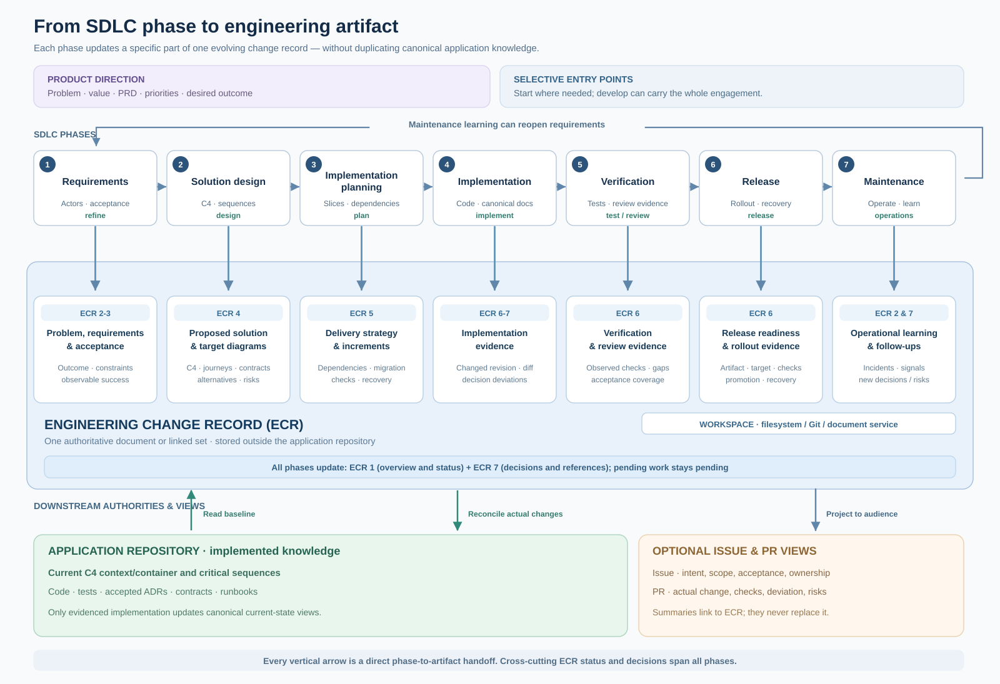
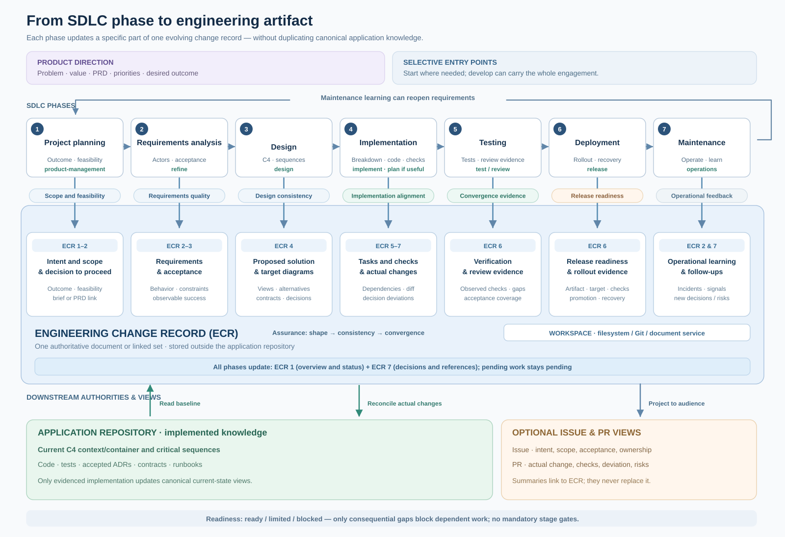

# SDLC coverage

Use the [SDLC overview](../README.md#sdlc-coverage) to orient yourself and the [task menu](usage.md#skills-you-invoke) to start work. This reference links the expertise behind those activities. `develop` spans the useful lifecycle; individual tasks let you enter at any phase. Phases describe outcomes, **not required agent invocations or stage-gate approvals**. For new applications, [new-application flow](../plugins/sdlc/skills/develop/references/new-application-flow.md) defines the dependent decisions; `setup` alone does not establish the full lifecycle.

## Read the lifecycle map

The lifecycle uses seven phases: **project planning → requirements analysis → design → implementation → testing → deployment → maintenance**. Enter where an outcome is missing and revisit earlier decisions when evidence changes them. A known bug can start with reproduction. A new initiative may need feasibility work before requirements. Product direction helps choose the outcome and priority, and feedback can reopen either.

Every phase starts by checking the inputs, deciding what work is needed and identifying the evidence or decision the next person will need. Scale that preparation to the uncertainty. During implementation, break agreed requirements and design into deliverable tasks, dependencies and checks. The [implementation preparation method](../plugins/sdlc/skills/activity-system/references/implementation-preparation.md) supports requests that stop at a breakdown.

| Part of the diagram | How it contributes |
| --- | --- |
| Product direction | Select users, problems, value, priorities and success signals; learn from delivered value |
| Engineering lifecycle | Establish and deliver required behavior, design, implementation, evidence, release and long-lived operational health |
| Project baseline | Reuse accepted decisions, existing contracts, instructions and evidence; update their canonical owners as they change |
| Shared methods | Research, documentation, security and review provide conditional expertise across phases |
| Technical/domain expertise | Choose by actual engineering concern and accepted stack rather than assuming Python, React or a particular framework |

Green labels identify entry-point skills or directly requested activities; dashed warm labels identify specialist support. Some expertise can also be requested directly. These are explanatory examples, not a fixed dependency graph. An agent must still respect user scope, runtime access, credentials and separate authorization for deployment or production actions.

## User-facing entry points

| Need or missing outcome | Appropriate entry point |
| --- | --- |
| Business direction and product priority | `business-strategy`, `product-management` |
| Engineering requirements and acceptance | [refine](../plugins/sdlc/skills/refine/SKILL.md), supported by [requirements-engineering](../plugins/sdlc/skills/requirements-engineering/SKILL.md) when substantive |
| Architecture, user experience or interface contracts | `design`, with `system-design`, `interface-design` or `backend-design` expertise when applicable |
| Agreed implementation needs dependency ordering | Request an implementation breakdown |
| Build an already-defined change | `implement` |
| Rough idea through implementation, tests and review | `develop` |
| Behavior checks and source assessment | `test`, `review`; review also applies earlier |
| Delivery readiness or named authorized deployment | `release` |
| Live incident or restoration | [incident-response](../plugins/sdlc/skills/incident-response/SKILL.md), recovery expertise as applicable |
| Proactive operation, maintenance and improvement | `improve`, `dependencies`, [observability](../plugins/sdlc/skills/observability/SKILL.md), and other targeted operating skills |
| Project foundation or activity selection | `setup`, `activity-system` |

### Which entry point should you use?

| Starting situation | Typical work and stopping points |
| --- | --- |
| Company product request | Product direction establishes priority → `refine` defines behavior and quality constraints → `design` settles consequential solution choices → `implement` breaks down and builds the change, `test`, `review`, `release` as authorized |
| Company refactor / rearchitecture | Inspect current behavior and maintenance pain → `refine` the preserved contracts, migration constraints and expected outcome → `design` alternatives and migration boundary → authorized implementation in compatible increments with rollback and checks |
| Local agent-assisted feature or new app | Select `develop` for an authorized end-to-end slice; it establishes the missing decisions directly with relevant supporting expertise. Select `plan`, `refine`, `design` or `implement` individually when a bounded artifact or stopping point is desired |
| Known bug or narrow change | Use `fix` to reproduce, repair and verify the affected behavior. No required planning or new specification ceremony |
| Incident, recovery or operational drift | Start with the matching operations activity; follow causal evidence and actual operating policy. Turn confirmed learning into a requirement/design/improvement only when warranted |
| Exploration, security review or architecture question | Request research, `harden`, `review`, design or specialist expertise; stop at the requested analysis rather than beginning implementation |

Implementation preparation converts agreed requirements and design into actionable increments, dependencies and tests. It can iterate when implementation discovers a new constraint. The end-to-end `develop` activity does not need to invoke each explicit-only task skill by name to accomplish those outcomes.

## Standard engineering artifacts and workspace handoffs

An Engineering Change Record (ECR) carries the outcome of each performed activity on a change. A standalone inquiry can finish with a research report in the chosen workspace. Use the [artifact system](../plugins/sdlc/skills/artifact-system/SKILL.md) for the shared artifact model, contracts, homes, quality and assurance, and [coordination storage](../plugins/sdlc/skills/artifact-system/references/storage/coordination.md) for coordination-artifact discovery and persistence. The application repository owns implemented architecture and operating documentation.

Every durable output is an artifact with a type, primary plane, home, authority, maturity and relations. The ECR is the coordination spine for a change, not the only artifact: architecture views, runbooks, code, tests, issues and PRs are artifacts too. `setup` establishes the repository artifact home map; `project-conventions` maintains its placement method; `develop`, implementation and release read or update it.

Read each column for the phase, its possible handoff artifacts, its contribution to the ECR and the roles involved. The feedback arrow shows where test and operational evidence can reopen earlier decisions.

The phase view above shows who contributes and which documents the work may produce. Phase contributors author supporting documents, and the ECR captures their outcome or links the authoritative artifact. Issues and PR descriptions use that information to serve their own readers.

The contribution view below follows the evidence into the ECR and shows how it relates to current application documentation and the issue and PR views.

The diagram shows the ECR as the coordination spine for one change. The [artifact system](../plugins/sdlc/skills/artifact-system/SKILL.md) treats the surrounding application documentation, code, tests, issues, PRs and release records as first-class artifacts with their own authority, homes and evidence; the ECR links and reconciles them rather than absorbing them.

See the [worked examples](artifact-workflow.md) for how this looks to the reader and the [activity system](../plugins/sdlc/skills/activity-system/SKILL.md) for activity selection.

## Different starting points

The same capability collection serves full applications and bounded changes. Reuse accepted context and reopen only affected decisions. A new product needs enough outcome, feasibility, requirements and design evidence before irreversible commitments; a bug fix starts with reproduction. Operational incidents begin with response and recovery, not a product-planning ritual.

Direct strategy, design, documentation and specialist requests can end at their own useful results. People and trusted automation can request the same activities; the host supplies triggering, tools, credentials, limits and action scope. Implementation and verification iterate; an actual deployment or recovery is not established by a passing unit test.

## Before and around the cycle

- Product discovery and direction: [product-management](../plugins/strategy/skills/product-management/SKILL.md) owns user problems, priorities, useful scope and success signals; business-strategy owns viability and positioning. These decisions inform project planning and may be reopened by evidence.
- Foundations: `setup` uses [project-conventions](../plugins/sdlc/skills/project-conventions/SKILL.md) and relevant [delivery workflow](../plugins/sdlc/skills/release/references/delivery.md). Establish foundations after sufficient product and architecture decisions for a new project; maintain them as conditions change.
- Feedback: [learn-from-product-feedback](../plugins/strategy/skills/learn-from-product-feedback/SKILL.md) informs product direction; incident learning addresses reliability and may also expose missing requirements or design protections.
- Changes to consequential decisions: follow [the shared decision policy](../plugins/sdlc/skills/activity-system/references/authority.md#consequential-findings) and continue independent authorized work. Do not invent acceptance or account permissions.

## Roles across the phases

These are typical contributions. In a small team, one person can cover several roles. Involve specialists when the change affects their decisions or the evidence they need.

| Phase | Typical lead and contributors | ECR contribution |
| --- | --- | --- |
| Project planning | Product manager or change owner leads. Engineering advises on feasibility and SRE advises on material operating risks. | Outcome, scope, feasibility and next decision, with links to the brief, PRD or roadmap when useful |
| Requirements analysis | Product and engineering define behavior with stakeholders. Design contributes journeys, QA helps make acceptance observable, and SRE checks relevant reliability requirements and SLOs. | Agreed behavior, quality constraints and acceptance |
| Design | Architect, designer and engineers lead their respective concerns. QA reviews testability and SRE reviews operating and recovery implications. | Proposed design, alternatives, affected diagrams and accepted decisions |
| Implementation | Engineers break down the work, build it and add tests. Design, architecture, QA and SRE support affected areas. | Task breakdown, planned checks, actual changes and deviations |
| Testing | Engineers and QA verify acceptance. Product and design review user outcomes, and SRE helps verify affected reliability paths. | Checked behavior, actual results and remaining gaps |
| Deployment | Engineering and release or SRE owners coordinate delivery and recovery. QA contributes smoke checks. | Target, rollout or rollback evidence and observed result |
| Maintenance | SRE and engineering maintain service health. Product uses feedback to revisit priorities. | Operational learning and linked follow-up decisions |

See the [reference role diagram](https://share.google/aimode/PpTjDsdFrpSGyXtZq) for the illustration that informed these overlaps.

## Skills by phase

### 1. Project planning

Use [plan](../plugins/sdlc/skills/plan/SKILL.md) to agree why a change is worth doing, its first useful scope and whether it is feasible. Draw on product expertise for discovery and priority, engineering for feasibility, and delivery coordination when several changes or owners share prerequisites. Record the decision in the ECR or link the existing product brief or roadmap. A planning ticket can hand off a concrete investigation or a change with clear acceptance.

### 2. Requirements analysis

Start with [refine](../plugins/sdlc/skills/refine/SKILL.md). For new systems, significant changes, rearchitecture or uncertain requirements, use its supporting [requirements-engineering](../plugins/sdlc/skills/requirements-engineering/SKILL.md) method to elicit needs, define functional and measurable quality constraints, validate conflicts and link acceptance to evidence. Preserve accepted product intent; product-management is not repeated as a development phase. Requirements may be ready for solution design before implementation architecture is decided.

### 3. Design

Use [design](../plugins/sdlc/skills/design/SKILL.md) with [system-design](../plugins/sdlc/skills/system-design/SKILL.md) for consequential system choices. For UI work compose [interface-design](../plugins/frontend-development/skills/interface-design/SKILL.md) with relevant domain patterns and selected platform constraints **from the outset**. Use [backend-design](../plugins/backend-development/skills/backend-design/SKILL.md) for service behavior, authority, state and API contracts. Preserve current-versus-target status, meaningful alternatives, and verification consequences. No comprehensive design document is required for a trivial local fix.

### 4. Implementation

Start by breaking agreed work into bounded increments and choosing the verification for each. Use [implementation preparation](../plugins/sdlc/skills/activity-system/references/implementation-preparation.md) when dependencies, migration, recovery or coordination warrant an explicit breakdown. Keep it in the ECR implementation strategy or link the existing plan.

Start with the bundled upstream `implement` when explicitly selected, or use `develop` for the broader end-to-end engagement. Use [git-contributions](../plugins/sdlc/skills/git-contributions/SKILL.md) for the objective worktree, plus matching frontend/backend/AI/database/native-client and operating expertise. Carry tests and affected documentation with the change.

### 5. Testing

Start with [verification](../plugins/sdlc/skills/test/SKILL.md), and use [journey-testing](../plugins/sdlc/skills/journey-testing/SKILL.md), performance/resilience and other specialist methods where relevant. `review` may apply in any phase. Observe real behavior, repair failures and recheck without weakening acceptance.

### 6. Deployment

Start with [release](../plugins/sdlc/skills/release/SKILL.md). [Delivery workflow](../plugins/sdlc/skills/release/references/delivery.md) supports artifacts, CI, publication, promotion, rollout and recovery; actual remote actions require named authorization and target verification.

### 7. Maintenance

Maintenance is one lifecycle outcome with four complementary responsibilities: **respond & restore**, **reliability & signals**, **learn & prevent**, and **maintain & evolve**. Operations activities are direct ways of achieving those outcomes; they are **not just substeps** of `improve` or `dependencies`. React to incidents with [incident-response](../plugins/sdlc/skills/incident-response/SKILL.md) and appropriate recovery, runbook and [postmortem](../plugins/sdlc/skills/postmortem/SKILL.md). Proactively manage [reliability and SLOs](../plugins/sdlc/skills/system-design/references/reliability.md), [observability](../plugins/sdlc/skills/observability/SKILL.md), [operations review](../plugins/sdlc/skills/operations-review/SKILL.md), capacity, cost, vulnerability and credentials. `improve` and `dependencies` complement those responsibilities. Reliability and operations expertise also informs requirements, design, implementation and testing before a release.

## UI/UX methods across activities

[Interface design](../plugins/frontend-development/skills/interface-design/SKILL.md) defines and reviews structure, behavior and visual direction for the intended experience; [UX writing](../plugins/frontend-development/skills/ux-writing/SKILL.md) connects language to real actions and states; [usability research](../plugins/frontend-development/skills/usability-research/SKILL.md) prepares studies or analyzes supplied observations. These skills are directly requestable and model-available support for relevant design, development, improvement and review. Interface-design owns visual direction, flows, cross-view consistency and critique; technical conventions own the selected implementation; journey-testing retains executable verification. No study or design tool is compulsory for every UI change.

## Across phases

[Technical writing](../plugins/documentation/skills/technical-writing/SKILL.md) supplies cross-type writing craft and reader review. [System documentation](../plugins/sdlc/skills/system-documentation/SKILL.md) explains structural/runtime/interface/deployment views with source evidence. The [artifact system](../plugins/sdlc/skills/artifact-system/SKILL.md) owns artifact contracts, homes, quality and assurance; system-design owns design choices.

Research, explicit clarification, prose editing, documentation, Git contributions, security and operating constraints can support any relevant phase. `review` is not confined to a final gate. Design and verification can recur during implementation; a phase label does not restrict when guidance is useful.

[reliability design](../plugins/sdlc/skills/system-design/references/reliability.md) connects outcomes and SLIs/SLOs to design and operation. [observability](../plugins/sdlc/skills/observability/SKILL.md) supplies signal implementation; the [artifact system](../plugins/sdlc/skills/artifact-system/SKILL.md) and [project conventions](../plugins/sdlc/skills/project-conventions/SKILL.md) keep affected knowledge and its homes current. Upstream research, Humanizer and clarification techniques are listed below. [grill-me](https://github.com/mattpocock/skills/tree/4588b32ecab9ecc9fc8cc6b6c5e7d675b6004b0d/skills/productivity/grill-me) and other explicit workflows still require a request.

## Skills by area

Generic means reusable across stacks; stack-specific means select it only for matching technology. Some areas combine both. Supporting and directly requested specialist activities are both included; role and applicability are different dimensions. To extend the collection, follow [adding stack support](maintainers/adding-stack-support.md).

Expand the area catalogue and upstream techniques

| Area | Local applicability | Local guidance | Upstream techniques or contextual tools |
| --- | --- | --- | --- |
| Database engineering | Generic | [database-design](../plugins/database-development/skills/database-design/SKILL.md), [database-performance](../plugins/database-development/skills/database-performance/SKILL.md) | Data contracts, consistency, schema evolution and evidence-led performance methods. |
| PostgreSQL implementation | Stack-specific | [postgresql-development](../plugins/database-postgresql-development/skills/postgresql-development/SKILL.md), [postgresql-operations](../plugins/database-postgresql-development/skills/postgresql-operations/SKILL.md), [postgresql-performance](../plugins/database-postgresql-development/skills/postgresql-performance/SKILL.md) | PostgreSQL development, diagnostics and operating mechanics. |
| Security engineering | Generic | [security-and-privacy-design](../plugins/sdlc/skills/security-and-privacy-design/SKILL.md), [security-auth-development](../plugins/sdlc/skills/security-auth-development/SKILL.md) | Identity/access and security/privacy design with contextual implementation selection. |
| SaaS applications | Generic | [saas-dashboard-design](../plugins/saas-development/skills/saas-dashboard-design/SKILL.md), [saas-design](../plugins/saas-development/skills/saas-design/SKILL.md), [saas-readiness](../plugins/saas-development/skills/saas-readiness/SKILL.md) | Tenant/customer and commercial lifecycle, SaaS dashboard design and scoped readiness. |
| Governance and assurance | Generic | [compliance-readiness](../plugins/sdlc/skills/compliance-readiness/SKILL.md) | Applicability, accountable controls and GDPR/SOC 2 readiness evidence. |
| TypeScript implementation | Stack-specific | [typescript-conventions](../plugins/typescript-development/skills/typescript-conventions/SKILL.md) | Runtime/module/package contracts and TypeScript implementation verification without React. |
| Go implementation | Stack-specific | [go-conventions](../plugins/go-development/skills/go-conventions/SKILL.md) | Go module/package, lifecycle, error and verification contracts for services, libraries and CLIs. |
| Product direction | Generic | [product-management](../plugins/strategy/skills/product-management/SKILL.md) | Existing research and feedback; no tracker required |
| Business strategy | Generic | [business-strategy](../plugins/strategy/skills/business-strategy/SKILL.md) | Preserved strategy references |
| Project foundations | Generic | [project-conventions](../plugins/sdlc/skills/project-conventions/SKILL.md) for affected structure, commands and constraints | None required |
| Artifact system | Generic | [artifact-system](../plugins/sdlc/skills/artifact-system/SKILL.md) | [writing-for-agents](https://github.com/mattpocock/skills/tree/4588b32ecab9ecc9fc8cc6b6c5e7d675b6004b0d/skills/productivity/writing-for-agents) for agent instructions |
| Writing craft | Generic | [technical-writing](../plugins/documentation/skills/technical-writing/SKILL.md) | Reader fit, explanation, structure and presentation; [humanizer](https://github.com/blader/humanizer/tree/225a6f39ac85f76ee48dbad772ea4abe4ed6c9d8) for prose polish |
| Prose editing | No local skill | Follow the document's author and technical claims | [humanizer](https://github.com/blader/humanizer/tree/225a6f39ac85f76ee48dbad772ea4abe4ed6c9d8) |
| Frontend development | Generic + stack-specific | [frontend-conventions](../plugins/frontend-reactjs-development/skills/frontend-conventions/SKILL.md), [interface-design](../plugins/frontend-development/skills/interface-design/SKILL.md) for unified UX design and full-surface coverage | Built-in visual craft in interface-design; official shadcn, Tailwind design system, Vercel React/composition for matching implementations |
| Browser extensions | Stack-specific | [browser-extension-development](../plugins/browser-extension-development/skills/browser-extension-development/SKILL.md), [browser-extension-security](../plugins/browser-extension-development/skills/browser-extension-security/SKILL.md), [browser-extension-ui](../plugins/browser-extension-development/skills/browser-extension-ui/SKILL.md), [browser-extension-testing](../plugins/browser-extension-development/skills/browser-extension-testing/SKILL.md), [browser-extension-delivery](../plugins/browser-extension-development/skills/browser-extension-delivery/SKILL.md) | Chrome/MV3 and current compatible framework, driver and store contracts |
| Desktop and mobile clients | Stack-specific | [native-client-development](../plugins/frontend-native-development/skills/native-client-development/SKILL.md) for TypeScript/Tauri and informed iOS/Android choices | Current Tauri/Expo/React Native/platform documentation |
| Backend development | Generic + stack-specific | [backend-design](../plugins/backend-development/skills/backend-design/SKILL.md), [backend-conventions](../plugins/backend-python-development/skills/backend-conventions/SKILL.md) | [modern-python](https://github.com/trailofbits/skills/tree/82fe8226252622fa807643bdca1710901198553a/plugins/modern-python/skills/modern-python) |
| AI development | Generic + stack-specific | [ai-development](../plugins/ai-development/skills/ai-development/SKILL.md), [ai-conventions](../plugins/ai-python-development/skills/ai-conventions/SKILL.md) (local, not an upstream skill) | Chosen model/provider, harness and protocol SDK guidance; Google ADK or LangChain/LangGraph only when selected |
| AI testing and evaluation | Generic | [ai-testing](../plugins/ai-development/skills/ai-testing/SKILL.md) owns levels, cases, graders, acceptance and evidence | Matching evaluator/driver implementation when selected |
| AI operating behavior | Generic | [ai-operations](../plugins/ai-development/skills/ai-operations/SKILL.md) owns AI-specific task/quality signals, limits, drift and recovery | Generic service operations and matching implementation expertise as relevant |
| AI evaluation implementation | Stack-specific | [ai-deepeval-testing](../plugins/ai-python-development/skills/ai-deepeval-testing/SKILL.md) for a selected Python DeepEval runner; generic AI testing owns conceptual levels/criteria | DeepEval APIs and CI; deterministic service/protocol tests remain separate |
| AI observability implementation | Stack-specific | [python-ai-observability](../plugins/ai-python-development/skills/python-ai-observability/SKILL.md) for Python OpenTelemetry; generic AI operations and service operations own signal/target decisions | Compatible provider/framework instrumentation and chosen exporter/backend |
| MCP interfaces | Generic + stack-specific | MCP section of [ai-development](../plugins/ai-development/skills/ai-development/SKILL.md), [ai-conventions](../plugins/ai-python-development/skills/ai-conventions/SKILL.md); reuse authorized application services | [mcp-builder](https://github.com/anthropics/skills/tree/8a1541c4a3ffa5a20a5a91de0dcf3f0bab1d1ef4/skills/mcp-builder), in ai-python-development for an accepted Python MCP implementation |
| Selected development tools | Stack-specific | [tooling-conventions](../plugins/development-tooling/skills/tooling-conventions/SKILL.md) for accepted CI/container/checker, telemetry-backend and web-driver mechanics | Existing provider/tool documentation and installed matching specialists |
| Testing | Generic | [verification](../plugins/sdlc/skills/test/SKILL.md), [journey-testing](../plugins/sdlc/skills/journey-testing/SKILL.md) for web/desktop/mobile journeys | [tdd](https://github.com/mattpocock/skills/tree/4588b32ecab9ecc9fc8cc6b6c5e7d675b6004b0d/skills/engineering/tdd), [property-based-testing](https://github.com/trailofbits/skills/tree/82fe8226252622fa807643bdca1710901198553a/plugins/property-based-testing/skills/property-based-testing), [playwright-cli](https://github.com/microsoft/playwright-cli/tree/b85c7a736bb473bf55b584e54a09ffa698d6d871/skills/playwright-cli) |
| Failure testing | Generic | [resilience-testing](../plugins/sdlc/skills/resilience-testing/SKILL.md) for scoped fixtures and controlled experiments | Project-native test tools; optional isolated fault proxy |
| Performance testing | Stack-specific | [performance-testing](../plugins/development-tooling/skills/performance-testing/SKILL.md) for local, CI-runner and deployed non-production k6 checks | Official k6 references; no cloud account required |
| Code review | No local skill | Requested behavior and project standards | [code-review](https://github.com/mattpocock/skills/tree/4588b32ecab9ecc9fc8cc6b6c5e7d675b6004b0d/skills/engineering/code-review); [differential-review](https://github.com/trailofbits/skills/tree/82fe8226252622fa807643bdca1710901198553a/plugins/differential-review/skills/differential-review) for security-sensitive diffs |
| Debugging | No local skill | Preserve the affected scope and regression evidence | [diagnosing-bugs](https://github.com/mattpocock/skills/tree/4588b32ecab9ecc9fc8cc6b6c5e7d675b6004b0d/skills/engineering/diagnosing-bugs) |
| Research | No local skill | Record decision-changing findings where the project keeps them | [research](https://github.com/mattpocock/skills/tree/4588b32ecab9ecc9fc8cc6b6c5e7d675b6004b0d/skills/engineering/research) |
| Architecture and domain design | Generic | [system-design](../plugins/sdlc/skills/system-design/SKILL.md) | [codebase-design](https://github.com/mattpocock/skills/tree/4588b32ecab9ecc9fc8cc6b6c5e7d675b6004b0d/skills/engineering/codebase-design), [domain-modeling](https://github.com/mattpocock/skills/tree/4588b32ecab9ecc9fc8cc6b6c5e7d675b6004b0d/skills/engineering/domain-modeling), [prototype](https://github.com/mattpocock/skills/tree/4588b32ecab9ecc9fc8cc6b6c5e7d675b6004b0d/skills/engineering/prototype) when exploration is requested |
| Git contributions | Generic | [git-contributions](../plugins/sdlc/skills/git-contributions/SKILL.md) | No separate PR template required |
| Delivery | Generic | [delivery workflow](../plugins/sdlc/skills/release/references/delivery.md) | [github-actions-hardening](https://github.com/github/awesome-copilot/tree/143a3d976b3c1603cc8932984d5e1f28501cb5fc/skills/github-actions-hardening) for GitHub Actions |
| Security and privacy | Generic | [security-and-privacy-design](../plugins/sdlc/skills/security-and-privacy-design/SKILL.md) | [differential-review](https://github.com/trailofbits/skills/tree/82fe8226252622fa807643bdca1710901198553a/plugins/differential-review/skills/differential-review), [supply-chain-risk-auditor](https://github.com/trailofbits/skills/tree/82fe8226252622fa807643bdca1710901198553a/plugins/supply-chain-risk-auditor/skills/supply-chain-risk-auditor) within supported coverage |
| Data recovery | Generic | [data-recovery](../plugins/sdlc/skills/data-recovery/SKILL.md) | Current platform/database references |
| Capacity | Generic | [capacity-and-cost](../plugins/sdlc/skills/capacity-and-cost/SKILL.md) | Current platform references |
| Cost | Generic | [capacity-and-cost](../plugins/sdlc/skills/capacity-and-cost/SKILL.md) | [aks-cost-optimization](https://github.com/Azure/AKS-Skills/tree/20bf35201a79b324d2ca3e00e5c82020ff362024/skills/aks-cost-optimization) only for Azure AKS |
| System discovery | Generic | [system-documentation](../plugins/sdlc/skills/system-documentation/SKILL.md) for evidence, topology and journeys | No particular platform required |
| Interactive architecture | Generic | [system-flow-explorer](../plugins/visualization/skills/system-flow-explorer/SKILL.md) on request; evidence-backed HTML and JSON | Bundled offline renderer; optional existing Playwright for browser checks |
| Shell automation | Stack-specific | [bash-engineering](../plugins/development-tooling/skills/bash-engineering/SKILL.md) | Bash-specific; no new task framework required |
| Python automation | Stack-specific | [python-automation-engineering](../plugins/backend-python-development/skills/python-automation-engineering/SKILL.md) for CLI/API jobs | [modern-python](https://github.com/trailofbits/skills/tree/82fe8226252622fa807643bdca1710901198553a/plugins/modern-python/skills/modern-python) where useful; separate from FastAPI service conventions |
| Reliability | Generic | [reliability design](../plugins/sdlc/skills/system-design/references/reliability.md) for outcomes, SLIs/SLOs, budgets and alerts | Current first-party references; optional Datadog/Terraform example |
| Observability | Generic | [observability](../plugins/sdlc/skills/observability/SKILL.md) for signal contracts and pipeline verification | Use the project's libraries/collectors |
| Incident response | Generic | [incident-response](../plugins/sdlc/skills/incident-response/SKILL.md) for current impact and independently verified recovery | Existing authorized tools and service evidence |
| Runbooks | Generic | [runbook-authoring](../plugins/sdlc/skills/runbook-authoring/SKILL.md) for branching diagnostics, actions and verification | The service's actual procedures |
| Incident learning | Generic | [postmortem](../plugins/sdlc/skills/postmortem/SKILL.md) | Evidence-led review and deployed completion checks |
| Vulnerability remediation | Generic | [security-maintenance](../plugins/sdlc/skills/security-maintenance/SKILL.md) | Existing scanners, vendor advisories and deployed artifact evidence |
| Credentials | Generic | [security-maintenance](../plugins/sdlc/skills/security-maintenance/SKILL.md) | Actual identity provider/store; never expose secret values |
| Kubernetes resources | Stack-specific | [kubernetes-resource-engineering](../plugins/operations-platforms/skills/kubernetes-resource-engineering/SKILL.md) | Current cluster/operator/Helm/Kustomize documentation |
| JVM performance | Stack-specific | [infra-jvm-optimization](../plugins/operations-platforms/skills/infra-jvm-optimization/SKILL.md) only for Java/JVM workloads | Installed runtime and platform guidance |
| Operational upkeep | Generic | [operations-review](../plugins/sdlc/skills/operations-review/SKILL.md) | Reuse project records; targeted reviews remain targeted |
| Product feedback | Generic | [learn-from-product-feedback](../plugins/strategy/skills/learn-from-product-feedback/SKILL.md) | Existing evidence; no analytics vendor required |

For the complete acquired set, licenses and precise source pins, use the [upstream catalogue](maintainers/sources.md#upstream-catalogue) and [artifact declarations](../agent-depot.json). Kubernetes, JVM and AKS skills apply only to those platforms. Reference-only techniques are not necessarily installed.

## Coverage and limits

The skills describe ways of working across the lifecycle; installing them does not establish application correctness, production readiness or compliance. Tooling, credentials, devices and platform-specific procedures must exist in the target environment. Package and discovery checks are recorded separately from application evidence in the [maintainer reference](maintainers/evaluations.md#recorded-evidence-and-limits).

Specialist methods and diagrams live with their skills: [verification](../plugins/sdlc/skills/test/SKILL.md), [journey testing](../plugins/sdlc/skills/journey-testing/SKILL.md), [performance](../plugins/development-tooling/skills/performance-testing/SKILL.md), [resilience](../plugins/sdlc/skills/resilience-testing/SKILL.md) and [observability](../plugins/sdlc/skills/observability/SKILL.md).
