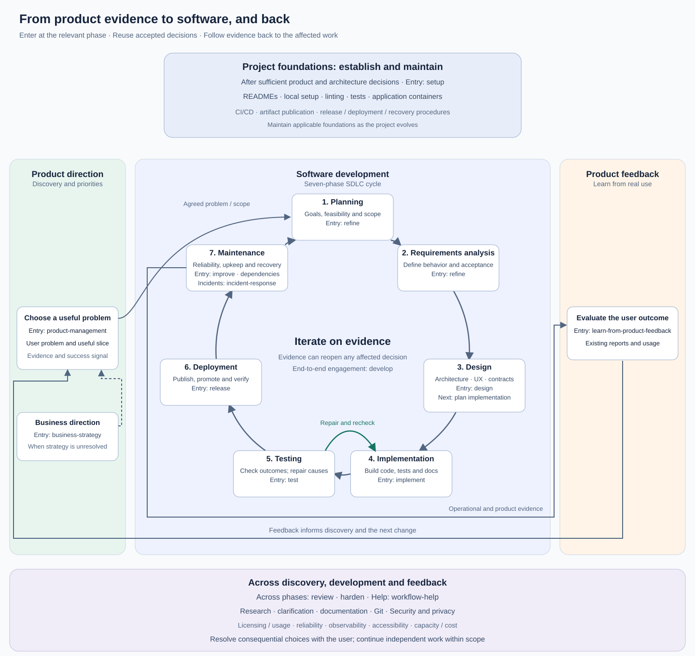
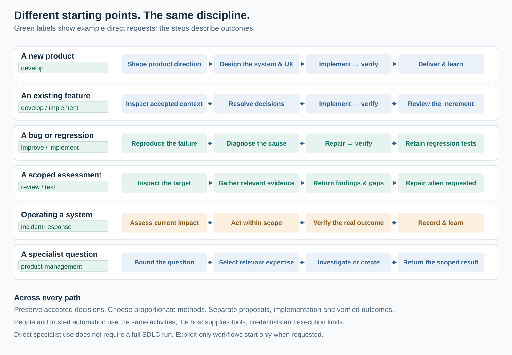

# SDLC coverage

Use the [SDLC overview](../README.md#sdlc-coverage) to orient yourself and the [task menu](usage.md#skills-you-invoke) to start work. This reference links the expertise behind those activities. `develop` spans the useful lifecycle; individual tasks let you enter at any phase. Phases are a map, not required handoffs. For a new application, [new-application flow](../plugins/development/skills/develop/references/new-application-flow.md) defines the decision outcomes develop must establish before dependent work; setup alone does not establish the lifecycle.

## Read the lifecycle map

The circle names seven phases and their intended outcomes. Enter where the work needs attention and return to affected decisions when evidence changes. Detailed implementation planning (`plan`) follows the relevant requirements and design decisions; the initial Planning phase establishes goals, constraints and feasibility.

| Part of the diagram | How it contributes |
| --- | --- |
| Product direction and feedback | Choose useful scope and success signals; learn from delivered value |
| SDLC cycle | Turn accepted needs into designed, verified and operated software |
| Project baseline above the flow | Carry accepted decisions, working conventions and reproducible foundations into relevant work; update them as decisions change |
| Shared methods below the flow | Apply research, documentation, review, protection and reliability expertise where needed |
| Technical expertise below the flow | Inform feasibility and requirements, then realize and verify decisions using the accepted stack throughout delivery and maintenance |

Green filled labels show direct requests; red outlined labels show supporting use; neutral labels identify project records. These are uses within the diagram: a skill can serve both direct and supporting roles. The named examples identify available skills for readers; workflows discover optional expertise by capability. Plugins are independent installation bundles, with generic methods and accepted-stack technical packages selected separately. The arrows do not authorize execution, release or deployment.

## User-facing entry points

| Need or phase | Entry point |
| --- | --- |
| Business direction | business-strategy |
| Product discovery, priorities and success | product-management |
| Requirements and scope | refine |
| System, experience or contract design | design; focused visual-design or backend-design when installed |
| Implementation sequencing | plan |
| Implementation | implement; develop for the broader engagement |
| Verification and assessment | test; review across phases |
| Delivery | release |
| Maintenance and learning | improve, dependencies, relevant operations; learn-from-product-feedback |
| Foundations or choosing an activity | setup / workflow-help |

Some disciplines are directly selectable and also support requested work. Entry points may span phases; they do not imply a mandatory invocation chain.

## Different starting points

The same cycle supports a whole product and a small change. A new product needs enough refinement, feasibility and design evidence before dependent implementation; an existing feature reuses accepted context and revisits only affected decisions. Bug repair starts with reproduction and diagnosis. A scoped review returns findings and gaps; fixes require the corresponding request. Operations can enter through an incident, recovery exercise, capacity question or routine upkeep, with outcomes verified in the named environment.

Direct strategy, design, documentation and other specialist requests can end at their own useful result. They need no full development engagement. Representative task names in the map describe supported entry points, not universal client commands or automatic invocation of explicit-only workflows. People and trusted automation can request the same activities; the host supplies triggering, credentials, tools, limits and allowed actions.

Implementation and verification form a repeated loop inside the broader SDLC. Product feedback, incident learning and test evidence can reopen the relevant requirement, design or increment. Local checks, real-platform behavior and deployed outcomes establish different claims; a finished diagram, successful build or passing component test cannot establish them all. Follow the [shared consequential-decision policy](../plugins/development/WORKFLOW.md#resolve-consequential-findings) when new evidence requires a user choice, and continue independent work within the existing scope.

## Before and around the cycle

- Product discovery and direction: [product-management](../plugins/strategy/skills/product-management/SKILL.md) owns user problems, priorities, useful scope and success signals. [Business strategy](../plugins/strategy/skills/business-strategy/SKILL.md) owns business direction, competitive position and value capture. These decisions begin before development and evolve with evidence.
- Project foundations: `setup` uses [project-conventions](../plugins/development/skills/project-conventions/SKILL.md) and relevant [delivery-pipelines](../plugins/delivery/skills/delivery-pipelines/SKILL.md) guidance. Establish them after sufficient product and architecture decisions for a new project, then maintain affected parts as it evolves.
- Product feedback: [learn-from-product-feedback](../plugins/strategy/skills/learn-from-product-feedback/SKILL.md) examines delivered value and feeds discovery and future work. Incident learning addresses reliability and is a separate feedback source.

## Skills by phase

Product discovery and refinement establish the outcome. System design makes architectural decisions before dependent implementation planning; revisit it for features that change consequential boundaries. Phases can recur and do not require separate task invocations.

### 1. Planning

Establish the goals, feasibility, constraints and rough scope needed to decide whether and how to proceed. Product-management supplies product priorities and evidence for this decision; business-strategy supports unresolved business choices. Revisit the initial plan as requirements and design become clearer; detailed implementation planning follows the decisions it depends on.

### 2. Requirements analysis

Start with [refine](../plugins/development/skills/refine/SKILL.md). Establish actor authority, scope, observable acceptance and material unknowns. Reuse accepted product direction; product-management supports unresolved product priorities without replacing engineering requirements.

### 3. Design

#### Architecture and system design

Use [design](../plugins/development/skills/design/SKILL.md) with [system-design](../plugins/development/skills/system-design/SKILL.md). Compare consequential architecture/platform options against the product and operating constraints, map boundaries and critical flows, and carry the decisions into setup and feature plans. Reuse installed codebase-design/domain-modeling where applicable.

#### Interaction, visual and contract design

Use [design](../plugins/development/skills/design/SKILL.md), [visual-design](../plugins/frontend-development/skills/visual-design/SKILL.md), [interaction-design](../plugins/frontend-development/skills/interaction-design/SKILL.md) and [backend-design](../plugins/backend-development/skills/backend-design/SKILL.md), then relevant technical guidance. Anthropic frontend-design supports visual execution when direction is open; preserve the accepted design during ordinary changes. Derive contextual visual direction and define surfaces, behavior, authority and failure contracts from the requirements before dependent implementation.

#### Implementation planning and foundations

Start with [plan](../plugins/development/skills/plan/SKILL.md). Produce bounded dependency-ordered increments, tests and delivery/recovery consequences from the accepted system and experience design. Reconcile earlier rough plans after material decisions; establish complete applicable project foundations.

### 4. Implementation

Start with bundled upstream implement. Use [git-contributions](../plugins/development/skills/git-contributions/SKILL.md) for the actual objective worktree and applicable frontend/backend/AI/native-client guidance. For repository instruction authoring, the bundled Sentry agents-md complements project-conventions and writing-for-agents. Keep source, configuration, tests and docs in that objective.

### 5. Testing

Start with [test](../plugins/development/skills/test/SKILL.md). Use [deliver-reliable-changes](../plugins/development/skills/deliver-reliable-changes/SKILL.md), [journey-testing](../plugins/development/skills/journey-testing/SKILL.md), and performance/resilience methods when relevant. Commit meaningful tests, inspect failures, repair and recheck the real behavior.

### 6. Deployment

Start with [release](../plugins/development/skills/release/SKILL.md). Use [delivery-pipelines](../plugins/delivery/skills/delivery-pipelines/SKILL.md) for CI, artifacts, registry publication, promotion and recovery. Setup authors applicable delivery foundations; live release/deployment requires a named authorized action.

### 7. Maintenance

Start with improve/dependencies or the requested operations activity. Use relevant upkeep, vulnerability, credential, capacity/cost and data-recovery guidance. Feed product evidence and incident learning into the next refinement/design decision.

## UI/UX methods across activities

[Interface quality](../plugins/frontend-development/skills/interface-quality/SKILL.md) assesses and refines the intended experience; [UX writing](../plugins/frontend-development/skills/ux-writing/SKILL.md) connects language to real actions and states; [usability research](../plugins/frontend-development/skills/usability-research/SKILL.md) prepares studies or analyzes supplied observations. They are both directly requestable and model-available support for relevant design, development, improvement and review. Visual-design owns direction, interaction-design owns flows and technical conventions own the selected implementation; journey-testing retains executable verification. No study or design tool is compulsory for every UI change.

## Across phases

[Documentation writing](../plugins/documentation/skills/documentation-writing/SKILL.md) guides authoring and reader review. [Architecture documentation](../plugins/documentation/skills/architecture-documentation/SKILL.md) explains structural/runtime/interface/deployment views with source evidence. They complement documentation-conventions and system-design rather than replacing their ownership.

Research, explicit clarification, prose editing, documentation, Git contributions, security and operating constraints can support any relevant phase. `review` is not confined to a final gate. Design and verification can recur during implementation; a phase label does not restrict when guidance is useful.

[reliability-design](../plugins/operations/skills/reliability-design/SKILL.md) connects outcomes and SLIs/SLOs to design and operation. [observability-operations](../plugins/operations/skills/observability-operations/SKILL.md) supplies signal implementation; [documentation-conventions](../plugins/documentation/skills/documentation-conventions/SKILL.md) keeps affected knowledge current. Upstream research, Humanizer and clarification techniques are listed below. [grill-me](https://github.com/mattpocock/skills/tree/4588b32ecab9ecc9fc8cc6b6c5e7d675b6004b0d/skills/productivity/grill-me) and other explicit workflows still require a request.

## Skills by area

Generic means reusable across stacks; stack-specific means select it only for matching technology. Some areas combine both. Supporting and directly requested specialist activities are both included; role and applicability are different dimensions. To extend the collection, follow [adding stack support](maintainers/adding-stack-support.md).

Expand the area catalogue and upstream techniques

| Area | Local applicability | Local guidance | Upstream techniques or contextual tools |
| --- | --- | --- | --- |
| Product direction | Generic | [product-management](../plugins/strategy/skills/product-management/SKILL.md) | Existing research and feedback; no tracker required |
| Business strategy | Generic | [business-strategy](../plugins/strategy/skills/business-strategy/SKILL.md) | Preserved strategy references |
| Project foundations | Generic | [project-conventions](../plugins/development/skills/project-conventions/SKILL.md) for affected structure, commands and constraints | None required |
| Documentation | Generic | [documentation-conventions](../plugins/documentation/skills/documentation-conventions/SKILL.md) | [writing-for-agents](https://github.com/mattpocock/skills/tree/4588b32ecab9ecc9fc8cc6b6c5e7d675b6004b0d/skills/productivity/writing-for-agents) for agent instructions |
| Prose editing | No local skill | Follow the document's author and technical claims | [humanizer](https://github.com/blader/humanizer/tree/225a6f39ac85f76ee48dbad772ea4abe4ed6c9d8) |
| Frontend development | Generic + stack-specific | [frontend-conventions](../plugins/frontend-reactjs-development/skills/frontend-conventions/SKILL.md), [visual-design](../plugins/frontend-development/skills/visual-design/SKILL.md), [interaction-design](../plugins/frontend-development/skills/interaction-design/SKILL.md) for prior UX design and full-surface coverage | Anthropic frontend-design for visual craft; official shadcn, Tailwind design system, Vercel React/composition for matching implementations |
| Desktop and mobile clients | Stack-specific | [native-client-development](../plugins/frontend-native-development/skills/native-client-development/SKILL.md) for TypeScript/Tauri and informed iOS/Android choices | Current Tauri/Expo/React Native/platform documentation |
| Backend development | Generic + stack-specific | [backend-design](../plugins/backend-development/skills/backend-design/SKILL.md), [backend-conventions](../plugins/backend-python-development/skills/backend-conventions/SKILL.md) | [modern-python](https://github.com/trailofbits/skills/tree/82fe8226252622fa807643bdca1710901198553a/plugins/modern-python/skills/modern-python) |
| AI development | Generic + stack-specific | [ai-development](../plugins/ai-development/skills/ai-development/SKILL.md), [ai-conventions](../plugins/ai-python-development/skills/ai-conventions/SKILL.md) (local, not an upstream skill) | Chosen model/provider, harness and protocol SDK guidance; Google ADK or LangChain/LangGraph only when selected |
| AI evaluation implementation | Stack-specific | [ai-testing](../plugins/ai-python-development/skills/ai-testing/SKILL.md) for a selected Python DeepEval runner; generic AI development owns conceptual levels/criteria | DeepEval APIs and CI; deterministic service/protocol tests remain separate |
| AI observability implementation | Stack-specific | [ai-operations](../plugins/ai-python-development/skills/ai-operations/SKILL.md) for Python OpenTelemetry; generic operations owns signal/SLO decisions | Compatible provider/framework instrumentation and chosen exporter/backend |
| MCP interfaces | Generic + stack-specific | MCP section of [ai-development](../plugins/ai-development/skills/ai-development/SKILL.md), [ai-conventions](../plugins/ai-python-development/skills/ai-conventions/SKILL.md); reuse authorized application services | [mcp-builder](https://github.com/anthropics/skills/tree/8a1541c4a3ffa5a20a5a91de0dcf3f0bab1d1ef4/skills/mcp-builder), in ai-python-development for an accepted Python MCP implementation |
| Selected development tools | Stack-specific | [tooling-conventions](../plugins/development-tooling/skills/tooling-conventions/SKILL.md) for accepted CI/container/checker, telemetry-backend and web-driver mechanics | Existing provider/tool documentation and installed matching specialists |
| Testing | Generic | [deliver-reliable-changes](../plugins/development/skills/deliver-reliable-changes/SKILL.md), [journey-testing](../plugins/development/skills/journey-testing/SKILL.md) for web/desktop/mobile journeys | [tdd](https://github.com/mattpocock/skills/tree/4588b32ecab9ecc9fc8cc6b6c5e7d675b6004b0d/skills/engineering/tdd), [property-based-testing](https://github.com/trailofbits/skills/tree/82fe8226252622fa807643bdca1710901198553a/plugins/property-based-testing/skills/property-based-testing), [playwright-cli](https://github.com/microsoft/playwright-cli/tree/b85c7a736bb473bf55b584e54a09ffa698d6d871/skills/playwright-cli) |
| Failure testing | Generic | [resilience-testing](../plugins/development/skills/resilience-testing/SKILL.md) for scoped fixtures and controlled experiments | Project-native test tools; optional isolated fault proxy |
| Performance testing | Stack-specific | [performance-testing](../plugins/development-tooling/skills/performance-testing/SKILL.md) for local, CI-runner and deployed non-production k6 checks | Official k6 references; no cloud account required |
| Code review | No local skill | Requested behavior and project standards | [code-review](https://github.com/mattpocock/skills/tree/4588b32ecab9ecc9fc8cc6b6c5e7d675b6004b0d/skills/engineering/code-review); [differential-review](https://github.com/trailofbits/skills/tree/82fe8226252622fa807643bdca1710901198553a/plugins/differential-review/skills/differential-review) for security-sensitive diffs |
| Debugging | No local skill | Preserve the affected scope and regression evidence | [diagnosing-bugs](https://github.com/mattpocock/skills/tree/4588b32ecab9ecc9fc8cc6b6c5e7d675b6004b0d/skills/engineering/diagnosing-bugs) |
| Research | No local skill | Record decision-changing findings where the project keeps them | [research](https://github.com/mattpocock/skills/tree/4588b32ecab9ecc9fc8cc6b6c5e7d675b6004b0d/skills/engineering/research) |
| Architecture and domain design | Generic | [system-design](../plugins/development/skills/system-design/SKILL.md) | [codebase-design](https://github.com/mattpocock/skills/tree/4588b32ecab9ecc9fc8cc6b6c5e7d675b6004b0d/skills/engineering/codebase-design), [domain-modeling](https://github.com/mattpocock/skills/tree/4588b32ecab9ecc9fc8cc6b6c5e7d675b6004b0d/skills/engineering/domain-modeling), [prototype](https://github.com/mattpocock/skills/tree/4588b32ecab9ecc9fc8cc6b6c5e7d675b6004b0d/skills/engineering/prototype) when exploration is requested |
| Git contributions | Generic | [git-contributions](../plugins/development/skills/git-contributions/SKILL.md) | No separate PR template required |
| Delivery | Generic | [delivery-pipelines](../plugins/delivery/skills/delivery-pipelines/SKILL.md) | [github-actions-hardening](https://github.com/github/awesome-copilot/tree/143a3d976b3c1603cc8932984d5e1f28501cb5fc/skills/github-actions-hardening) for GitHub Actions |
| Security and privacy | Generic | [security-and-privacy-design](../plugins/development/skills/security-and-privacy-design/SKILL.md) | [differential-review](https://github.com/trailofbits/skills/tree/82fe8226252622fa807643bdca1710901198553a/plugins/differential-review/skills/differential-review), [supply-chain-risk-auditor](https://github.com/trailofbits/skills/tree/82fe8226252622fa807643bdca1710901198553a/plugins/supply-chain-risk-auditor/skills/supply-chain-risk-auditor) within supported coverage |
| Data recovery | Generic | [protect-and-restore-data](../plugins/operations/skills/protect-and-restore-data/SKILL.md) | Current platform/database references |
| Capacity | Generic | [plan-application-capacity](../plugins/operations/skills/plan-application-capacity/SKILL.md) | Current platform references |
| Cost | Generic | [optimize-application-cost](../plugins/operations/skills/optimize-application-cost/SKILL.md) | [aks-cost-optimization](https://github.com/Azure/AKS-Skills/tree/20bf35201a79b324d2ca3e00e5c82020ff362024/skills/aks-cost-optimization) only for Azure AKS |
| System discovery | Generic | [system-mapping](../plugins/development/skills/system-mapping/SKILL.md) for evidence, topology and journeys | No particular platform required |
| Interactive architecture | Generic | [system-flow-explorer](../plugins/visualization/skills/system-flow-explorer/SKILL.md) on request; evidence-backed HTML and JSON | Bundled offline renderer; optional existing Playwright for browser checks |
| Shell automation | Stack-specific | [bash-engineering](../plugins/development-tooling/skills/bash-engineering/SKILL.md) | Bash-specific; no new task framework required |
| Python automation | Stack-specific | [python-automation-engineering](../plugins/backend-python-development/skills/python-automation-engineering/SKILL.md) for CLI/API jobs | [modern-python](https://github.com/trailofbits/skills/tree/82fe8226252622fa807643bdca1710901198553a/plugins/modern-python/skills/modern-python) where useful; separate from FastAPI service conventions |
| Reliability | Generic | [reliability-design](../plugins/operations/skills/reliability-design/SKILL.md) for outcomes, SLIs/SLOs, budgets and alerts | Current first-party references; optional Datadog/Terraform example |
| Observability | Generic | [observability-operations](../plugins/operations/skills/observability-operations/SKILL.md) for signal contracts and pipeline verification | Use the project's libraries/collectors |
| Incident response | Generic | [incident-response](../plugins/operations/skills/incident-response/SKILL.md) for current impact and independently verified recovery | Existing authorized tools and service evidence |
| Runbooks | Generic | [runbook-engineering](../plugins/operations/skills/runbook-engineering/SKILL.md) for branching diagnostics, actions and verification | The service's actual procedures |
| Incident learning | Generic | [postmortem-facilitation](../plugins/operations/skills/postmortem-facilitation/SKILL.md), [postmortem-followup](../plugins/operations/skills/postmortem-followup/SKILL.md) | Evidence-led review and deployed completion checks |
| Vulnerability remediation | Generic | [vulnerability-management](../plugins/operations/skills/vulnerability-management/SKILL.md) | Existing scanners, vendor advisories and deployed artifact evidence |
| Credentials | Generic | [credential-lifecycle](../plugins/operations/skills/credential-lifecycle/SKILL.md) | Actual identity provider/store; never expose secret values |
| Kubernetes resources | Stack-specific | [kubernetes-resource-engineering](../plugins/operations-platforms/skills/kubernetes-resource-engineering/SKILL.md) | Current cluster/operator/Helm/Kustomize documentation |
| JVM performance | Stack-specific | [infra-jvm-optimization](../plugins/operations-platforms/skills/infra-jvm-optimization/SKILL.md) only for Java/JVM workloads | Installed runtime and platform guidance |
| Operational upkeep | Generic | [operational-housekeeping](../plugins/operations/skills/operational-housekeeping/SKILL.md) | Reuse project records; targeted reviews remain targeted |
| Product feedback | Generic | [learn-from-product-feedback](../plugins/strategy/skills/learn-from-product-feedback/SKILL.md) | Existing evidence; no analytics vendor required |

For the complete acquired set, licenses and precise source pins, use the [upstream catalogue](maintainers/sources.md#upstream-catalogue) and [lockfile](../upstream.lock.json). Kubernetes, JVM and AKS skills apply only to those platforms. Reference-only techniques are not necessarily installed.

## Coverage and limits

The skills describe ways of working across the lifecycle; installing them does not establish application correctness, production readiness or compliance. Tooling, credentials, devices and platform-specific procedures must exist in the target environment. Package and discovery checks are recorded separately from application evidence in the [maintainer reference](maintainers/evaluations.md#recorded-evidence-and-limits).

Specialist methods and diagrams live with their skills: [change evaluation](../plugins/development/skills/deliver-reliable-changes/SKILL.md), [journey testing](../plugins/development/skills/journey-testing/SKILL.md), [performance](../plugins/development-tooling/skills/performance-testing/SKILL.md), [resilience](../plugins/development/skills/resilience-testing/SKILL.md) and [observability](../plugins/operations/skills/observability-operations/SKILL.md).
