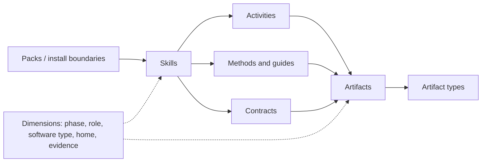

# Skills map

Generated from `SKILL.md` metadata and `agent-depot.json` labels. Open [skills-map.html](skills-map.html) for the filterable explorer.

## The simple model

Two core models, one method layer, three cross-cutting dimensions:

- **Activity** — what work is requested and where it stops.
- **Artifact** — what durable output exists, with authority, home, maturity, relations and evidence.
- **Method** — how to deepen or produce the work; `*-guide` methods own artifact craft.
- **Dimensions** — phase, role, software type, home and evidence filter the two core models.

## Counts

133 skills · 21 plugins · 4 packs · 19 domains

| Pack | Skills |
| --- | ---: |
| `sdlc` | 72 |
| `technical` | 50 |
| `craft` | 7 |
| `product` | 4 |

| Kind | Skills |
| --- | ---: |
| `method` | 93 |
| `activity` | 29 |
| `workflow` | 9 |
| `system` | 2 |

## Artifact guides

| Guide | Domain | Use for |
| --- | --- | --- |
| [release-note-guide](../plugins/sdlc/skills/release-note-guide/SKILL.md) | delivery | Guide to writing a release note or changelog. Covers what shipped, target, changes, migration, compatibility, verification and rollback. |
| [adr-guide](../plugins/sdlc/skills/adr-guide/SKILL.md) | development | Guide to writing an architecture or product decision record. Covers context, options, decision, consequences, status and supersession. |
| [architecture-set-guide](../plugins/sdlc/skills/architecture-set-guide/SKILL.md) | development | Guide to writing an architecture document set. Covers context, containers, components, runtime, data, interfaces, deployment, qualities, decisions and evidence. |
| [compatibility-matrix-guide](../plugins/sdlc/skills/compatibility-matrix-guide/SKILL.md) | development | Guide to producing and reviewing a compatibility matrix. Use for public surfaces, versions, platforms, runtimes, deprecation, migration and consumer evidence across libraries, CLIs and APIs. |
| [design-proposal-guide](../plugins/sdlc/skills/design-proposal-guide/SKILL.md) | development | Guide to writing a design proposal. Covers the decision, constraints, affected components, materially different options, linked artifacts, tradeoffs, seam and recommendation. |
| [ecr-guide](../plugins/sdlc/skills/ecr-guide/SKILL.md) | development | Guide to writing an Engineering Change Record. Covers overview, problem, requirements, solution design, implementation, verification and decisions across a change. |
| [issue-guide](../plugins/sdlc/skills/issue-guide/SKILL.md) | development | Guide to writing an actionable issue. Covers context, intended outcome, scope, acceptance, constraints, verification, dependencies and ownership. |
| [pr-guide](../plugins/sdlc/skills/pr-guide/SKILL.md) | development | Guide to writing a pull request description. Covers why, what changed, design impact, validation, risk, release and reviewer links. |
| [research-report-guide](../plugins/sdlc/skills/research-report-guide/SKILL.md) | development | Guide to writing a decision-oriented research report. Covers question, recommendation, evidence, alternatives, limits and open decision. |
| [rfc-guide](../plugins/sdlc/skills/rfc-guide/SKILL.md) | development | Guide to writing a request for comments or technical proposal. Covers problem, current state, affected components, proposal, alternatives, impact and open decision. |
| [state-machine-guide](../plugins/sdlc/skills/state-machine-guide/SKILL.md) | development | Guide to producing and reviewing state machines. Use for states, triggers, guards, terminal states, denied transitions, invariants and concurrent or retried behavior. |
| [readme-guide](../plugins/sdlc/skills/readme-guide/SKILL.md) | documentation | Guide to writing a repository README. Covers purpose, audience, quickstart, what it does, docs map, development, support, status and limits. |
| [design-spec-guide](../plugins/sdlc/skills/design-spec-guide/SKILL.md) | frontend | Guide to producing a design specification that implementation can build and verify from. Covers flows, wireframes, mockups, prototypes, states, content, components, responsiveness, accessibility, motion, assets, handoff and design QA. |
| [assurance-assessment-guide](../plugins/sdlc/skills/assurance-assessment-guide/SKILL.md) | governance | Guide to writing a scoped assurance assessment. Covers applicability, service boundary, controls, evidence, gaps, disposition and ownership. |
| [incident-record-guide](../plugins/sdlc/skills/incident-record-guide/SKILL.md) | operations | Guide to writing an incident record. Covers impact, severity, ownership, timeline, mitigation, recovery verification, current state and follow-up. |
| [postmortem-guide](../plugins/sdlc/skills/postmortem-guide/SKILL.md) | operations | Guide to writing a blameless postmortem. Covers timeline, contributing conditions, what worked, actions, owners, verification and open questions. |
| [runbook-guide](../plugins/sdlc/skills/runbook-guide/SKILL.md) | operations | Guide to writing and reviewing operational runbooks. Covers triggers, prerequisites, diagnosis, mitigation, verification, escalation, recovery and exercise evidence. |
| [prd-guide](../plugins/sdlc/skills/prd-guide/SKILL.md) | product | Guide to writing a product brief or PRD. Covers problem, audience, outcome, scope, success signal, constraints, evidence and open decisions. |
| [c4-view-guide](../plugins/sdlc/skills/c4-view-guide/SKILL.md) | visualization | Guide to producing and reviewing C4 context, container and component views. Use for system boundaries, actors, responsibilities, directed dependencies, current versus proposed state and text equivalents. |
| [sequence-view-guide](../plugins/sdlc/skills/sequence-view-guide/SKILL.md) | visualization | Guide to producing and reviewing sequence views. Use for participant responsibilities, request ordering, synchronous versus asynchronous work, branches, failure, retry and recovery. |

## Full inventory

Run `python scripts/skill_map.py` to regenerate this page and the HTML explorer. The generated HTML is the filterable view; this page is the stable summary.
