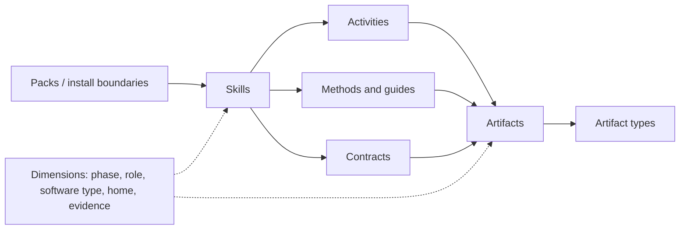

# Skills map

Generated from `SKILL.md` metadata and `agent-depot.json` labels. Open [skills-map.html](skills-map.html) for the filterable explorer.

## The simple model

Two core models, one method layer, three cross-cutting dimensions:

- **Activity** — what work is requested and where it stops.
- **Artifact** — what durable output exists, with authority, home, maturity, relations and evidence.
- **Method** — how to deepen or produce the work; `guide-*` methods own artifact craft.
- **Dimensions** — phase, role, software type, home and evidence filter the two core models.

## Counts

142 skills · 21 plugins · 4 packs · 20 domains

| Pack | Skills |
| --- | ---: |
| `technical` | 67 |
| `sdlc` | 61 |
| `craft` | 10 |
| `product` | 4 |

| Kind | Skills |
| --- | ---: |
| `method` | 87 |
| `activity` | 26 |
| `guide` | 19 |
| `workflow` | 8 |
| `system` | 2 |

## Artifact guides

| Guide | Domain | Use for |
| --- | --- | --- |
| [guide-release-note](../plugins/sdlc/skills/guide-release-note/SKILL.md) | delivery | Guide to writing a release note or changelog. Covers what shipped, target, changes, migration, compatibility, verification and rollback. |
| [guide-adr](../plugins/sdlc/skills/guide-adr/SKILL.md) | development | Guide to writing an architecture or product decision record. Covers context, options, decision, consequences, status and supersession. |
| [guide-compatibility-matrix](../plugins/sdlc/skills/guide-compatibility-matrix/SKILL.md) | development | Guide to producing and reviewing a compatibility matrix. Use for public surfaces, versions, platforms, runtimes, deprecation, migration and consumer evidence across libraries, CLIs and APIs. |
| [guide-design-proposal](../plugins/sdlc/skills/guide-design-proposal/SKILL.md) | development | Guide to writing a design proposal. Covers the decision, constraints, affected components, materially different options, linked artifacts, tradeoffs, seam and recommendation. |
| [guide-ecr](../plugins/sdlc/skills/guide-ecr/SKILL.md) | development | Guide to writing an Engineering Change Record. Covers overview, problem, requirements, solution design, implementation, verification and decisions across a change. |
| [guide-issue](../plugins/sdlc/skills/guide-issue/SKILL.md) | development | Guide to writing an actionable issue. Covers context, intended outcome, scope, acceptance, constraints, verification, dependencies and ownership. |
| [guide-pr](../plugins/sdlc/skills/guide-pr/SKILL.md) | development | Guide to writing a pull request description. Covers why, what changed, design impact, validation, risk, release and reviewer links. |
| [guide-research-report](../plugins/sdlc/skills/guide-research-report/SKILL.md) | development | Guide to writing a decision-oriented research report. Covers question, recommendation, evidence, alternatives, limits and open decision. |
| [guide-rfc](../plugins/sdlc/skills/guide-rfc/SKILL.md) | development | Guide to writing a request for comments or technical proposal. Covers problem, current state, affected components, proposal, alternatives, impact and open decision. |
| [guide-state-machine](../plugins/sdlc/skills/guide-state-machine/SKILL.md) | development | Guide to producing and reviewing state machines. Use for states, triggers, guards, terminal states, denied transitions, invariants and concurrent or retried behavior. |
| [guide-system-documentation](../plugins/sdlc/skills/guide-system-documentation/SKILL.md) | development | Guide to discovering, tracing, creating and reviewing the current-system architecture set. Covers evidence, boundaries, responsibilities, runtime behavior, interfaces, deployment, current versus proposed state and document quality. |
| [guide-readme](../plugins/sdlc/skills/guide-readme/SKILL.md) | documentation | Guide to writing a repository README. Covers purpose, audience, quickstart, what it does, open-source adoption, honest claims, docs map, development, support, status and limits. |
| [guide-design-spec](../plugins/sdlc/skills/guide-design-spec/SKILL.md) | frontend | Guide to producing a design specification that implementation can build and verify from. Covers flows, wireframes, mockups, prototypes, states, content, components, responsiveness, accessibility, motion, assets, handoff and design QA. |
| [guide-assurance-assessment](../plugins/sdlc/skills/guide-assurance-assessment/SKILL.md) | governance | Guide to writing a scoped assurance assessment. Covers applicability, service boundary, controls, evidence, gaps, disposition and ownership. |
| [guide-incident-record](../plugins/sdlc/skills/guide-incident-record/SKILL.md) | operations | Guide to writing an incident record. Covers impact, severity, ownership, timeline, mitigation, recovery verification, current state and follow-up. |
| [guide-postmortem](../plugins/sdlc/skills/guide-postmortem/SKILL.md) | operations | Guide to writing a blameless postmortem. Covers timeline, contributing conditions, what worked, actions, owners, verification and open questions. |
| [guide-runbook](../plugins/sdlc/skills/guide-runbook/SKILL.md) | operations | Guide to authoring, exercising and auditing operational runbooks. Covers triggers, prerequisites, diagnosis, mitigation, verification, escalation, recovery, artifact craft and exercise evidence; invoke from design, release, incident response, recovery and operations review as well as runbook maintenance. |
| [guide-prd](../plugins/sdlc/skills/guide-prd/SKILL.md) | product | Guide to writing a product brief or PRD. Covers problem, audience, outcome, scope, success signal, constraints, evidence and open decisions. |
| [guide-architecture-views](../plugins/sdlc/skills/guide-architecture-views/SKILL.md) | visualization | Guide to producing and reviewing C4 and sequence views. Use for system boundaries, actors, responsibilities, directed dependencies, current versus proposed state, request ordering, synchronous versus asynchronous work, failure, retry, recovery and text equivalents. |

## Full inventory

Run `python scripts/skill_map.py` to regenerate this page and the HTML explorer. The generated HTML is the filterable view; this page is the stable summary.
