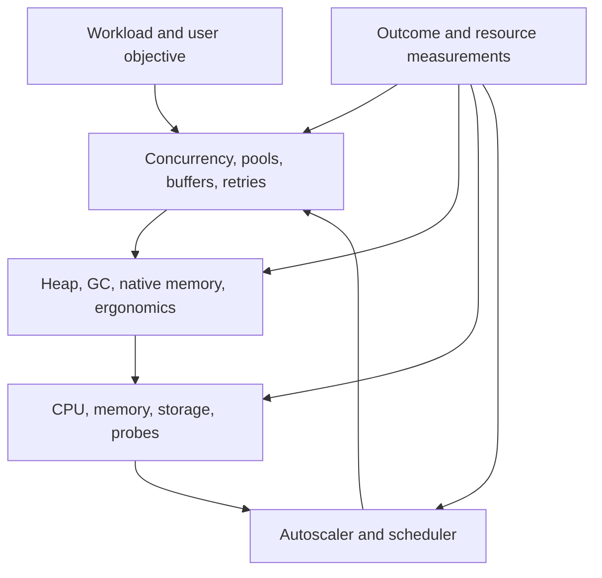
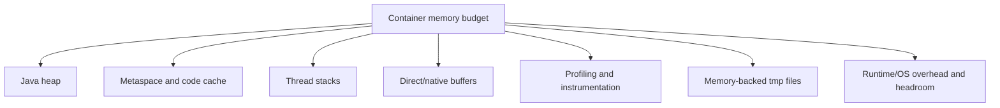
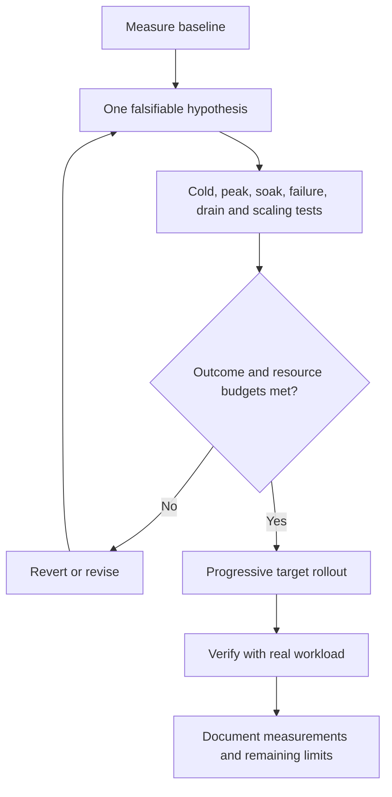

# Optimizing containerized applications and the JVM

## Contents

- [Optimize a coupled system](#optimize-a-coupled-system)
- [Memory and CPU budgets](#memory-and-cpu-budgets)
- [Collector and heap choices](#collector-and-heap-choices)
- [Application behavior](#application-behavior)
- [Scaling and scheduling](#scaling-and-scheduling)
- [Experiments and rollout](#experiments-and-rollout)

## Optimize a coupled system

Application settings, container resources and autoscaling form one control system. Tuning one layer in isolation can make another unstable.

Historical tuning often evolves from broad percentage-heap/parallel collector defaults toward tighter pool bounds or smaller single-core configurations. That evolution is a hypothesis to benchmark, not a proof that the latest setting wins everywhere. Production and test environments may intentionally remain different during validation.

## Memory and CPU budgets

Container memory includes more than heap:

Use actual peak/steady RSS and appropriate native-memory diagnostics. Configured maxima are not all committed immediately, and their sum is not a perfect RSS predictor. Yet leaving every pool unbounded is not a budget.

Hypothetical 1024Mi container: 384Mi heap +280Mi metaspace cap +128Mi code-cache cap +20Mi direct-buffer cap leaves 212Mi for thread stacks, agents, tmpfs and other native overhead. That is a *candidate constraint set*, not a guarantee. Caps may cause metaspace/direct-memory OOM before the container limit; test class loading, load and diagnostics.

Keep `Mi`/MiB and decimal MB explicit: `384MiB = 402,653,184 bytes`. Comments, percentage heap ergonomics and autoscaler thresholds often drift. Obtain effective max heap from the actual JVM/runtime and render every target override.

Memory-backed `emptyDir` counts as memory, not ephemeral disk. Disk-backed volumes/logs need separate limits and inode/mount checks. Heap dumps can expose sensitive data and fill disk; either provision protected bounded storage/retention or intentionally disable them and retain another diagnostic path. JFR/continuous profiling likewise needs writable bounded scratch space.

CPU requests affect scheduling; CPU limits may throttle. JVM available-processor detection depends on JDK and cgroups. `-XX:ActiveProcessorCount=N` changes ergonomic thread/pool behavior; it neither reserves cores nor bypasses quotas. Measure CPU throttling, initialization, steady throughput and latency before fixing N.

## Collector and heap choices

| Choice | Potential benefit | Verify |
| --- | --- | --- |
| Serial GC | Lower parallel-GC overhead in small/single-core workloads | Stop-the-world latency and throughput under peak load |
| G1 | Balanced throughput/pause behavior for many workloads | CPU overhead, heap/region behavior, pause distributions |
| ZGC or another low-pause collector | Low pause needs with compatible runtime/resources | CPU/native overhead, supported JDK/architecture, load behavior |
| Fixed `Xms/Xmx` | Predictable heap ceiling; equal values avoid resizing | Native headroom and memory retained after load |
| Percentage-based heap | Adapts to container memory | Effective runtime max, consistency with scaling thresholds |

Do not copy universal flags from a different architecture. ARM64/x86 and musl/glibc differences can change performance and failure behavior. A stack-size change can help a diagnosed native/stack failure but is not a universal cure for ARM64 crashes. Confirm JVM crash artifacts and test the same base image/agent/runtime combination.

`ExitOnOutOfMemoryError` can make a failed JVM recover promptly under an orchestrator, but does not fix a leak or native container OOMKill. Check retry/backlog consequences and retain evidence rather than accept endless restarts.

## Application behavior

Bound concurrency and measure per-request/work-item allocation. More threads, virtual threads or replicas do not expand downstream connection capacity automatically. For example, four replicas with ten database connections each can demand forty connections plus jobs/migrations; include surge replicas and other clients in the limit.

Review connection-pool acquisition/connection/response timeouts as an end-to-end budget. Retries consume latency and load, so use bounded attempts/backoff/jitter and idempotency. Consumers need poll/processing/commit behavior aligned with batch size and dependency timeouts. Split API, consumer and scheduled-job roles when it clarifies resource/scaling ownership, without duplicating work unintentionally.

Readiness controls new traffic; liveness addresses a condition restarting can resolve; startup protects legitimate initialization from premature checks. Avoid tying liveness to a downstream outage that would restart every replica. Management endpoints need appropriate exposure, not a blanket public wildcard.

Shutdown is a budget: endpoint draining + `preStop` + application graceful shutdown must fit inside termination grace. A ten-second preStop plus a thirty-second application phase cannot reliably finish in a thirty-second pod grace. Test requests, consumers, in-flight jobs and offset/state persistence during termination. Ensure the process receives signals (for example an `exec` launch rather than a shell swallowing them).

## Scaling and scheduling

For a simple resource average, HPA approximately proposes `ceil(current_replicas × current_metric / target_metric)` subject to tolerance, bounds, missing/readiness handling and behavior policies. Multiple metrics generally choose the largest desired count; errors can prevent safe scale-down.

Understand the adapter: an external metric already aggregated as an average combined with `AverageValue` may be divided by replicas again. Confirm whether the source/adapter supplies total or per-pod values, units, freshness and population. Do not infer behavior from comments.

Memory-only scaling is often weak: per-replica heaps/caches may remain allocated when work is redistributed, and a leak remains a leak. Use workload/queue/CPU/concurrency signals that correlate with useful capacity; memory can be an additional guard. Leave enough time for startup before saturation, and ensure scaling does not overload the datastore or exceed partition parallelism.

Use scale-down stabilization and bounded scale rates to prevent oscillation, plus sufficient minimum capacity for disruption/load. Model node/zone failure, rollout surge and constrained scheduling. Hard node spreading helps fault isolation but can force extra nodes or Pending pods; soft zone spreading encourages rather than guarantees zone diversity. PDBs govern eligible voluntary disruption, not all failures or every rollout action.

Avoid GitOps repeatedly restoring static replicas while HPA owns them. Scheduled hibernation and HPA can also compete; define ownership and verify wake-up, job execution and alert schedules. Scope controller exceptions to the application/resource actually owning the field.

## Experiments and rollout

Record objective, artifact/config/runtime/architecture identities, changed parameters, effective heap/pools/resources, load shape, test duration, GC/RSS/throttle measurements, outcome regression bounds, cost per useful work and rollback criteria. Preserve intentional production overrides; rendered manifests need checks after base/env changes, especially positional patches targeting environment arrays.

**Review scenarios:** choose collector/heap experiments for a single-core service without claiming a universal winner; identify tmpfs and pool costs in the budget; detect HPA unit/aggregation drift; test graceful shutdown with preStop; reject scale-out as a cure for a leak or exhausted shared database.

References: [Kubernetes HPA](https://kubernetes.io/docs/concepts/workloads/autoscaling/horizontal-pod-autoscale/), [Container resource management](https://kubernetes.io/docs/concepts/configuration/manage-resources-containers/), [Java 21 tool/flag reference](https://docs.oracle.com/en/java/javase/21/docs/specs/man/java.html), [Java GC tuning guide](https://docs.oracle.com/en/java/javase/21/gctuning/).
