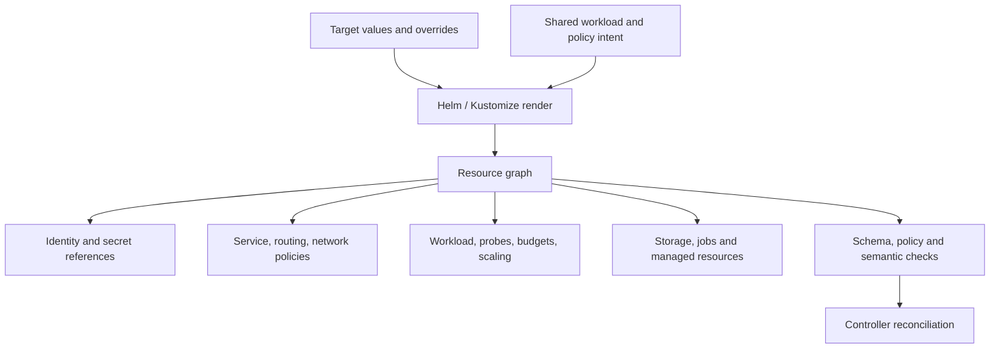

# Secure, reliable and maintainable Kubernetes resources

## Contents

- [Resource graph and defaults](#resource-graph-and-defaults)
- [Security and network boundaries](#security-and-network-boundaries)
- [Reliability and workload lifecycle](#reliability-and-workload-lifecycle)
- [Configuration and ownership](#configuration-and-ownership)
- [Stateful and infrastructure resources](#stateful-and-infrastructure-resources)
- [Validation and delivery](#validation-and-delivery)

## Resource graph and defaults

| Category | Sensible baseline | Decision needing workload/target evidence |
| --- | --- | --- |
| Identity | Dedicated least-privilege identity; no token mount without need | Required API/cloud access and token projection |
| Containers | Nonroot, no privilege escalation, drop capabilities, runtime seccomp; read-only root where compatible | Necessary capabilities/writable mounts, platform/OS support |
| Artifacts | Immutable identity, declared update policy and supported base | Version/pull/cache policy and architecture |
| Networking | Internal Service, explicit ingress/egress intent | Public routes, auth/TLS, dependencies, CNI enforcement |
| Runtime | Explicit resource/probe/drain budgets | Numeric resources, replicas, probe timing, limits and scaling signals |
| Operations | Ownership, version/config traceability, restore/deletion plan | SLO, recovery requirements and pruning/retention |

Do not prescribe universal CPU/heap/replica numbers, namespaces, UID values or node-provider labels. A base `latest` or placeholder that is transformed must be checked in the rendered output; never assume the image transformer covers every container/init/sidecar/job.

## Security and network boundaries

For compatible Linux app containers, use explicit `runAsNonRoot`, `allowPrivilegeEscalation: false`, `capabilities.drop: [ALL]` and `seccompProfile.type: RuntimeDefault`; add only justified capabilities. A read-only root is a valuable additional control, not a requirement of every Pod Security Standard profile. Provide bounded writable tmp/log/cache locations and valid file ownership.

Check init/sidecar containers too. Avoid hostNetwork/hostPID/hostIPC/hostPath/privileged access for ordinary apps. Infrastructure agents with necessary host privileges need narrowly scoped documented exceptions, not an estate-wide relaxation. Evaluate Pod Security Admission against the actual Kubernetes/OS version. A historical unconfined AppArmor workaround is not a default for new clusters.

Use dedicated service accounts and scoped RBAC. Avoid wildcard verbs/resources and broad secret `list/watch` when a named `get` suffices. `automountServiceAccountToken: false` reduces unnecessary token exposure; API/cloud federation needing a projected token must be configured deliberately. Secret availability, external-store permission and refresh do not prove app reload.

Namespaces alone do not isolate network traffic. Verify CNI policy enforcement. Policies are additive: an allow-all egress rule overrides the intended effect of another restrictive policy. `policyTypes: [Ingress, Egress]` with `egress: [{}]` still permits all egress.

Define DNS and legitimate dependency flows before denying them; distinguish namespaceSelector AND podSelector in one peer from OR alternatives in separate peers. Restrict ports as needed and test both directions. Standard NetworkPolicy does not provide portable hostname allowlists or application-layer authorization; NAT/host traffic semantics and managed provider features need target verification.

Expose only required Service/Ingress/Gateway ports; management ports should not become public inadvertently. Verify TLS, auth, origin protections and header contracts at the serving boundary. Readiness should remove failed endpoints; a correct selector/targetPort is necessary to send traffic to the right pods.

## Reliability and workload lifecycle

Requests shape scheduling and utilization baselines; limits constrain resources and can cause CPU throttling/OOM. Use measured CPU/memory/ephemeral storage budgets and inspect init/sidecar overhead. Tmpfs uses memory, not the ephemeral disk budget. Capacity must include rollout surge, topology constraints and node failure.

Startup probes protect legitimate initialization; readiness defines traffic eligibility; liveness restarts a locally unrecoverable condition. Do not make downstream outages kill all replicas via liveness. Test cold start and actual user operation, not only a generic ping.

Align endpoint draining, preStop, app/consumer shutdown and terminationGracePeriodSeconds. A sleep alone is not proven draining. Consumers/jobs must finish or checkpoint work safely; repeated delivery requires idempotency.

Availability depends on meaningful replica minimums and failure-domain spread. Hard node/zone spread can block scheduling; soft constraints do not guarantee separation. PDBs constrain eligible voluntary eviction, not all node failures or Deployment rolling updates. A rendered `minAvailable: 0` provides no minimum available guarantee. Check overlay modifications, selector coverage and the ability to drain without deadlock.

Give HPA the replica field when it owns it; avoid a static GitOps value fighting it. Understand metric adapter units/aggregation and min/max/stabilization. Scheduled hibernation needs documented timezone, opt-in, workload-kind behavior, backups/consumers and wake-up checks. It is not a blanket production cost setting.

Jobs/CronJobs need `concurrencyPolicy`, starting/active deadlines, bounded retries, retained success/failure history or TTL and timezone where supported. Choose values from work semantics; retries or a duplicate scheduled run must not repeat irreversible effects. A completed pod means the process exited, not that the backup/report was durably stored.

## Configuration and ownership

Keep immutable selectors separate from changeable metadata; do not inject version/owner labels into all selectors accidentally. Kustomize labels with selector inclusion can alter Services, workloads, PDBs and policies together. Test the resource relationships.

Use config generation/hash or an explicit restart/reload mechanism. A ConfigMap update mounted by an app is not necessarily reloaded; `subPath` mounts and environment variables differ. Avoid positional patches to env/containers when stable name-based paths are supported; otherwise add assertions protecting their target identity.

Helm charts have namespaced helpers, explicit optional values, `required`/schema validation for mandatory decisions, sensible quoting and tests for enabled/disabled features. Kustomize overlays express target differences without duplicating entire bases. Pin remote chart/base references and tools. Stable cross-app ConfigMap names may require a deliberate hash exception plus synchronization/reload behavior.

Assign one owner per mutable field/resource and document controller handoffs. Scope ignoreDifferences to the owning application/resource/field. Broad drift suppression hides real defects. Dependencies on external secrets, CRDs and shared resources require actual readiness ordering, not just assuming a YAML listing enforces it.

## Stateful and infrastructure resources

Distinguish PVC/storage reclaim, managed-resource deletion policy and GitOps prune behavior. Orphan/Retain protects data from accidental deletion but can leave expensive or privileged resources behind; Delete cleans up but can irreversibly destroy state. Choose intentionally, document ownership and test lifecycle in an isolated target.

Manage backups, restore identities/keys and application-consistent recovery; replication is not a backup. Plan schema/CRD/controller upgrades, finalizers, storage expansion/access modes and dependent application compatibility. Do not force-remove finalizers or delete surviving databases because a bootstrap procedure expects an empty environment.

Crossplane/operator interfaces are versioned contracts: inspect installed CRDs, conditions and composition/provider behavior, not historic example APIs. Kubernetes schema success does not prove a cloud resource is provisioned or policy enforced.

## Validation and delivery

Use staged evidence:

1. Render every affected target with its actual Helm values/Kustomize overlay and pinned toolchain.
2. Validate standard resources and CRDs against target-version schemas. Inventory missing/ignored schemas; a skip is unknown coverage, not a pass. Do not adopt `ignore-missing-schemas` universally.
3. Run security/reliability policy checks with narrow reasons, owners and review conditions for exemptions.
4. Test semantics: selectors/reference resolution, ports, images/digests, final secret keys, no unresolved placeholders, probe/drain budgets, PDB/replica ownership, jobs, policy flows and deletion intent.
5. Where authorized, run target server-side dry-run/admission and diff with explicit context/namespace. Rendering/schema checks cannot predict every admission/controller effect. Dry-run still contacts the API and needs appropriate access.
6. Review replacements/deletes and changes to immutable selectors/CRDs/state. Apply through the established controller; verify current reconciliation, endpoint traffic, isolation, data/job outcomes and rollback compatibility.

Build/audit pipeline failures must propagate from every stage. Never replace semantic render validation with grep for `kind:` or trust a green job that skipped unknown schemas. Local fixtures and policy tests are useful for recurring reviews without production mutation.

**Acceptance cases:** new service with least-privilege identity and tested dependency flows; overlay retaining a permissive PDB; selector/version label mutation; missing CRD schema; GitOps/HPA conflict; backup CronJob completing without uploaded recovery point; deleting a managed resource with orphaned data.

References: [Pod Security Standards](https://kubernetes.io/docs/concepts/security/pod-security-standards/), [NetworkPolicy](https://kubernetes.io/docs/concepts/services-networking/network-policies/), [Resource management](https://kubernetes.io/docs/concepts/configuration/manage-resources-containers/), [Disruptions](https://kubernetes.io/docs/concepts/workloads/pods/disruptions/), [Kustomize](https://kubernetes.io/docs/tasks/manage-kubernetes-objects/kustomization/), [Helm chart best practices](https://helm.sh/docs/chart_best_practices/).
