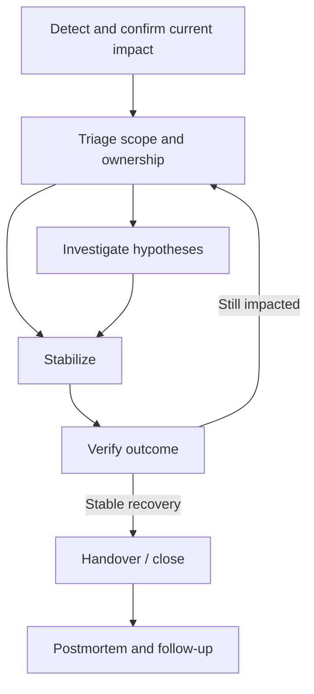

# Operating an incident response



## Triage and communication

Customer-visible impact, data correctness and trend drive urgency. Use the organization's severity scale rather than impose a universal P1–P5 mapping. Capture affected journeys, targets and segments; a small region fully down can disappear in a global average. An unaffected statement needs evidence, not merely silence.

Stakeholder update:

```text
Status and customer-visible symptom:
Impact and scope since <UTC time>:
Confirmed unaffected scope / unknown coverage:
Current mitigation and observed result:
Next update at <absolute time and timezone>:
```

Avoid raw technical details for audiences unable to act on them. Do not give an estimated fix time unless supported. Recovery communication should be as prompt as failure communication. Log corrections to severity/scope clearly.

## Investigation record

| UTC time | Observation/change/action | Scope | Evidence | Expected/actual effect |
| --- | --- | --- | --- | --- |
| Populate during response | | | | |

| Hypothesis | Evidence for/against | Discriminating test | Confidence/status |
| --- | --- | --- | --- |
| Populate from evidence | | | |

Check actual deployed/served revisions against pipeline history and configuration. Expand the change window when gradual effects or expiry require it; do not prescribe a fixed 48h for every incident. External dependency failure, demand/data changes and collector failures remain possibilities when deployment history is unchanged.

Inspect workload termination/prior logs, mounts/quotas, DNS/endpoints/policy, TLS/auth, cache variants and source-to-consumer event paths as indicated. A dependency graph can include inferred hops/aggregations; validate real outbound calls rather than interpret every graph node as a new service.

## Mitigation and recovery

Define the target, expected effect and reversal before execution. Compatibility determines whether rollback is viable after schema/state changes. Scaling can overload shared dependencies; restarts can erase evidence or replay work. Preserve necessary facts and use the scoped runbook.

Verify the user's path, actual served version and downstream durable outcome. A monitor can recover because traffic stopped; a pod can be ready while consumers are stalled. Keep incident recovery and proof of root cause separate.

Handover includes current scope/status, last check time, action ledger, best hypothesis/unknowns, tests ruled out, temporary measures, pending jobs and the next intended step. Obtain clear ownership transfer in the actual incident process rather than assume sending a message completes it.

**Acceptance cases:** old alert already recovered; current impact after configuration change; rollback green but cached faulty content remains; accepted API traffic with silent downstream loss; no live access requiring a precise responder handoff.

Public background: [Google SRE incident response](https://sre.google/workbook/incident-response/), [PagerDuty incident response](https://response.pagerduty.com/).
