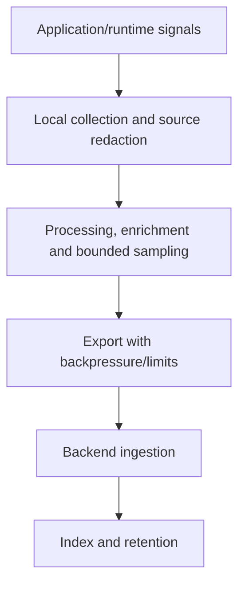

# Implementing a signal contract

## Logging and canonical summaries

Use the project's existing schema or document an explicit migration. For new schemas:

| Scope | Fields |
| --- | --- |
| Every log | `timestamp`, `level`, `service`, `version`, `environment`, `message` |
| Work summary | `canonical: true`, `work_type: http/job/event`, numeric `duration_ms`, `outcome` |
| HTTP | Method, normalized/sanitized route, status, diagnostic request/trace ID |
| Job | Bounded job name and execution ID in logs only |
| Event | Bounded event type, event/work ID in logs, attempt/retry context |
| Optional measurements | Database/upstream duration/count, processed/failed count, cache outcome, sanitized error class |

Use consistent `snake_case` or the adopted schema; include units in duration fields. Keep canonical records flat for aggregation. Work outcome represents actual semantics: HTTP accepted is not durable completion. Emit terminal summaries on failure paths as well as success.

Example message convention:

```text
canonical_log_line request:GET /api/items -> 200 (0.05s)
canonical_log_line job:inventory_sync -> failure (1.20s)
canonical_log_line event:item.updated -> success (0.12s)
```

ERROR means failed work needing attention; WARN means degradation/recovery needing awareness; INFO means useful lifecycle/business records; DEBUG is targeted diagnostics. Log exceptions at the handling boundary rather than repeatedly logging and rethrowing.

## Metrics, traces and client collection

Define metric type, unit, update semantics and bounded labels. Counters need restart-safe backend interpretation; histograms need suitable buckets for the agreed latency boundary. Never use percentiles as counts or average instance percentiles to represent a global percentile.

Use supported trace-context propagation for HTTP and messaging. Trace/request identifiers are diagnostic IDs, not authentication session cookies/tokens. Validate export instrumentation instead of requiring duplicate agents that generate double spans.

For browser telemetry record consent and sampling coverage, navigation/work start, relevant completion/failure, source bundle/version and normalized route. Avoid sensitive DOM/request/session payloads. A dropped client event is a collection gap that downstream analysis needs to understand.

## Collection pipeline



Derived metrics may be generated before index exclusion; tags/facets present in a search UI may not exist earlier. Record generation stages, exclusions and ingestion delay. Use buffered bounded exporters so backend outages do not exhaust application memory or fail business work.

Version/log-format/filter changes can break queries: preserve compatibility or update signal consumers in the same planned migration. Configure encryption/access/retention from classification; source redaction is necessary even when the collector masks patterns.

## Evidence record and scenarios

```text
Signal / emitting path / semantic contract:
Schema, type, units and labels:
Correlation and work/attempt boundaries:
Sensitive fields excluded and redaction tests:
Collector/exporter/generation-stage configuration:
Sampling, drops, delay and cost/cardinality limits:
Local validation and backend sample evidence:
Unknown coverage / follow-up owner:
```

Acceptance scenarios: instrument request/job/event failures without duplicate logs; propagate context through async work; detect high-cardinality labels; verify redaction and bounded exporter failure; reconcile declared configuration with missing backend samples.

Public background: [OpenTelemetry concepts](https://opentelemetry.io/docs/concepts/), [OWASP logging guidance](https://cheatsheetseries.owasp.org/cheatsheets/Logging_Cheat_Sheet.html).
