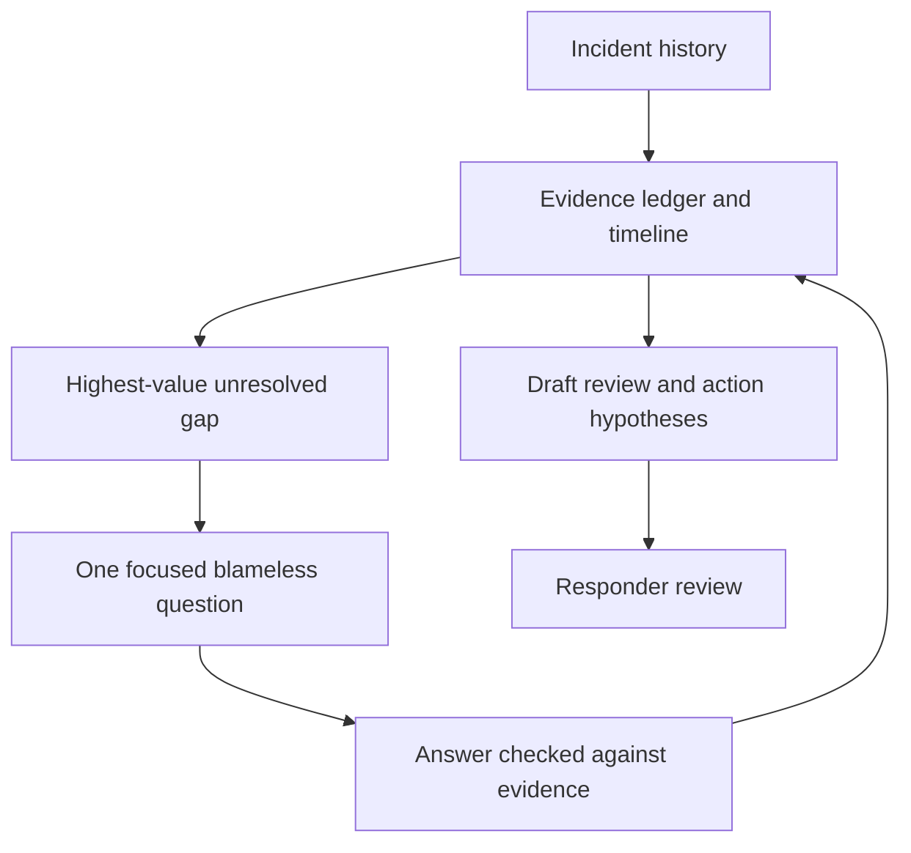

# Learning through an incident review

## Interview method

An adaptive interview alternates source analysis, a focused question and an updated model. The goal is useful causal understanding, not exhausting a checklist.



Question examples, selected according to the gap:

| Gap | Question |
| --- | --- |
| Impact inferred from graphs | Which user operation actually failed, and what evidence bounds the affected attempts? |
| Trigger named without mechanism | What changed in the failing path, and how did that produce this specific symptom? |
| “Human error” conclusion | What did the responder see and expect, and which missing constraint allowed the action to have this effect? |
| Restart credited as root-cause proof | What did restart reset, and what evidence distinguishes those possible causes? |
| Slow mitigation | Which uncertainty, dependency or access boundary delayed the decision, given information available then? |
| Recovery not established | What independent check proved the original user outcome worked again? |
| Vague action | What failure mechanism does this action interrupt, and how will a future test demonstrate it? |
| Repeat incident | Which prior actions were implemented, deployed and exercised, and where did the remaining pathway bypass them? |
| Conflicting clocks or recovery times | Which timezone and milestone does each timestamp represent, and what source confirms technical recovery versus public reopening? |
| “Not detectable” conclusion | Which boundary did existing monitoring miss, and what representative signal or journey check could observe this failure? |
| Shared-provider scope assumed | Which consumers are confirmed affected, which are potentially exposed, and what evidence distinguishes them? |

Do not ask a question already answered by the sources. Explain an evidence discrepancy without accusing participants. Retrospective certainty is different from what was knowable during the response. Distinguish necessity, correlation and causality; counterfactuals are hypotheses until supported.

## Evidence ledger

| Claim or fact | Source / time | Confidence / limits | Contradiction / next evidence |
| --- | --- | --- | --- |
| Populate from history | | | |

Record missing source access, approximate times and estimates with their method. Never fabricate revenue loss, exact counts, participant motivations or the name of an owner who has not accepted the action.

## Review template

```text
Incident / review owner / draft-review-publication state:
Summary: user harm, duration, recovery and residual risk
Background: architecture and terms needed by an outside reader
Impact: intervals, scope, measured/estimated counts and data correctness
Timeline: observation, decision/action, result and evidence
Analysis: trigger, mechanism, conditions, failed/effective barriers
Response: detection, coordination, mitigation, verification and decision context
Learning: what worked, gaps, unexpected resilience
Unknowns: evidence required and investigation owner
Actions: causal rationale, proposed owner, priority/due date, tracking and test
Review/publication record and accessible supporting evidence
```

Useful diagrams include a causal graph and a response timeline; label hypothesis edges distinctly. Keep lengthy raw histories linked rather than obscure the review with complete chat transcripts. Respect the target project's data access rules when publishing summaries.

Read [proxy-security-review.md](proxy-security-review.md) for a worked example of timestamp conflict, security/proxy coupling, detection coverage and action-list provenance.

**Acceptance cases:** known deployment mechanism with complete evidence; restart recovery with unknown cause; contradictory timelines; blameful draft; ambiguous “improve monitoring” action transformed into a specific signal/test proposal.

Public background: [Google SRE postmortem culture](https://sre.google/workbook/postmortem-culture/), [PagerDuty postmortem template](https://response.pagerduty.com/after/post_mortem_template/). This is an original facilitation workflow rather than a copy of another interviewing skill.
