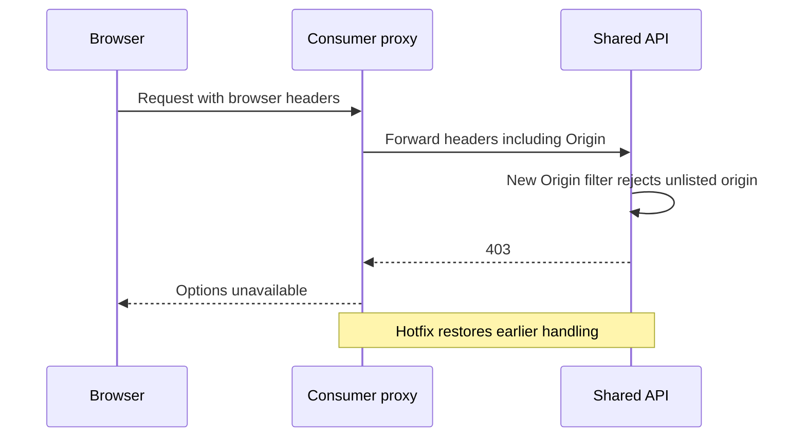

# Worked review: security change breaks a proxied user journey

This independently worded, generalized case demonstrates how to review an incident report critically while preserving its useful mechanism. It is not a verdict on the original responders or proof of other consumers being affected.

## Reported mechanism

An API adds an Origin/CORS filter for browser-based API exploration. A consumer's backend proxy forwards browser headers wholesale. A previously accepted request now carries an Origin outside the provider's allowlist and is rejected with 403. The client cannot display payment choices. Removing the new filter restores traffic; the team later decides not to retain that particular change.

CORS is primarily a browser-enforced cross-origin access mechanism; it is not authentication/authorization. A server filter returning 403 is a specific implementation behavior, not an inevitable property of all CORS handling. Do not recommend removing security controls generally. Evaluate the intended policy and a compatible, tested design.

## First questions after reading the evidence

1. **Timing:** Does the summary's end time describe technical recovery, public reopening or something else? Normalize explicit source timezones; leave an unlabeled ticket timestamp unresolved. If the table's UTC interval matches the detailed local timeline but the summary differs, retain that discrepancy rather than silently choosing a duration.
2. **Scope:** Which consumers and endpoint versions are confirmed affected? Which merely share the header-forwarding pattern? Confirm by telemetry, consumer inventory and journey tests; do not convert “we believe only one” into a verified exclusivity statement.
3. **Detection:** What existing monitor observed which boundary? If the classification says monitoring/user report but the narrative says monitors cannot detect it, ask what actually initiated response. Service health, status-code handling and the full consumer journey have different coverage.
4. **Recovery:** Was a customer-equivalent request verified after the hotfix? Was the public path still in maintenance? Record technical health and resumed user access separately; do not claim recovery from the hotfix timestamp alone.
5. **Prevention:** Which contractual header behavior was documented before the incident, and what representative request tests exercised the proxy path? Separate a consumer defect from the provider's change-compatibility/test gap without assigning personal blame.

## Detection is a boundary question

“Existing service monitors do not cover this interaction” is an evidenced coverage gap. “This issue is inherently undetectable” is a much stronger claim. Possible additions include customer-path probes with representative headers, rejection rate by bounded reason/endpoint version, valid-attempt-to-options-render coverage and a controlled replay test. Evaluate privacy, synthetic side effects, traffic volume and false positives before selecting one.

Do not classify every 4xx as good: expected invalid input differs from systemic rejection of valid clients. A 403 regression can leave a `not 5xx` indicator green. The provider may not know all consumer behavior, so the consumer journey owner and provider both need a clear observation/contract boundary.

## Draft action candidates

| Candidate | Failure mechanism addressed | Verification |
| --- | --- | --- |
| Explicit proxy header contract | Unintentional coupling to arbitrary browser headers | Customer-equivalent tests prove only required/approved headers reach the provider and functional/security semantics remain correct |
| Security-policy compatibility tests | New policy blocks established valid request variants | Contract tests cover direct, proxied and intended browser calls, allowed/rejected Origin, preflight where applicable and endpoint versions |
| Consumer journey signal | Provider-local health omits rendered payment options | A controlled valid-request rejection is detected through the chosen boundary and routed to the right responder |
| Staged policy rollout | Lower-environment success assumed without representative traffic | Documented representative variants pass, rollout is bounded and failure triggers a compatible rollback/stop |
| Shared-consumer inventory | Uncertain blast radius for shared API changes | Owners confirm affected patterns and evidence-backed coverage for relevant consumers |

An allowlist is not “strip every header”: preserve required auth, content negotiation, tracing and supported context. Test against the actual API/proxy contract. Merely waiting in a lower environment does not validate representative behavior.

## Follow-up quality

Actions need accepted owners, tracking relationships, dates and demonstrated outcomes. A task table displaying items older than the incident may be an embedded global query rather than its action list. Check provenance and links before assigning those tasks to this incident or declaring follow-up complete.

Before publication, retain uncertain timing/scope and missing verification honestly. A useful review can explain the failure mechanism while still asking for these facts.
