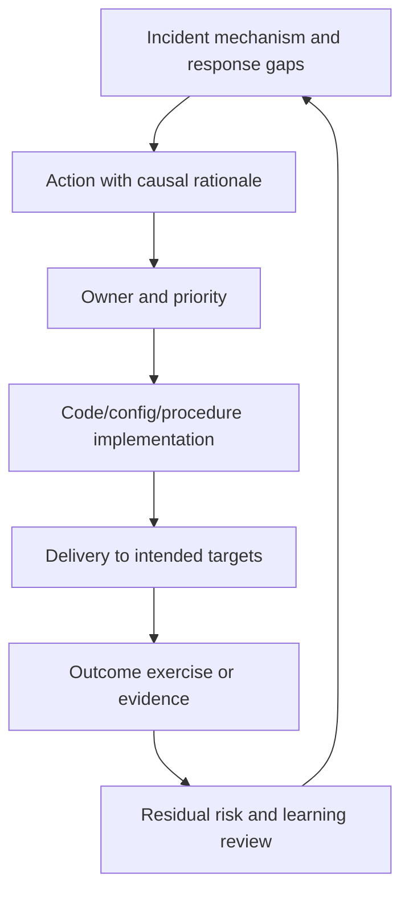

# Verifying incident learning

## Action register

| ID / source incident | Mechanism or gap | Action / class | Owner / acceptance | Priority / due date | Target / dependencies | Verification criterion | State / evidence |
| --- | --- | --- | --- | --- | --- | --- | --- |
| Populate from evidence | | | | | | | |

Useful action classes are correction, prevention, detection, mitigation, recovery, investigation and cleanup. Do not require one of every class regardless of the incident. A small set that interrupts concrete failure pathways is better than a large checklist.

### Weak and strong examples

| Weak | Specific and verifiable |
| --- | --- |
| Improve monitoring | Add admission-to-deadline completion coverage for the affected queue; a deliberately stuck item triggers the routed test alert within the agreed interval |
| Train people to avoid mistakes | Reject an empty target set before executing the mutating operation; regression tests prove empty input acts on no resources |
| Make rollback faster | Rehearse rollback from a representative release; the critical journey recovers within the agreed bound and the served identity is recorded |
| Fix memory | Bound the identified allocation/pool and run a workload soak demonstrating RSS and latency stay within the budget |
| Improve backups | Restore the application to an isolated target and verify invariants/journeys within RTO/RPO |

A training/documentation action can be useful, but should not substitute for a missing enforceable control when that control is feasible. Do not promise recurrence is impossible.

## Recurring analysis

Read current records and previous findings; avoid recreating a ticket per scan. Verify deployment/configuration rather than infer it from merged code. Flag missing evidence with the exact next test. Group repeated incidents by mechanism or failed barrier, not just similar titles/alert names.

If a completed action did not prevent recurrence, determine whether it addressed another pathway, was not deployed everywhere, was bypassed, degraded, or had wrong assumptions. Reopen/update the existing action where appropriate and retain its history. A new incident does not automatically prove every old action failed.

Report aging, blocked dependencies, verified outcomes and residual high-impact risk. Broadening checks/tests to other susceptible services is justified by a shared mechanism, not a blanket demand to audit everything.

## Traceable coordination

Maintain explicit incident -> review -> action links using the chosen tracker's relationship model. Use due/review dates to check progress, and stable labels/metadata to support retrieval without importing another company's tracker vocabulary. Missing auto-created follow-up records need reconciliation; a ticket created by a bot is not proof an owner accepted it.

Validate query provenance before using a task table: items older than the source incident may be unrelated historical backlog. Confirm their relationships and causal rationale rather than blindly attach or close them. Track owner reassignment and original age when moving actions between teams.

For shared-provider regressions, separate consumer contract fixes, provider compatibility checks, monitoring coverage and security-policy disposition. Removing the triggering filter restores handling but does not eliminate arbitrary-header coupling in other callers; dropping a proposed feature is a disposition, not proof every risk is resolved. Validate each accepted action at its own boundary.

**Acceptance cases:** ticket done but deployed behavior unchanged; duplicate actions across incidents; valid prevention verified by a fault test; repeated failure bypassing an earlier barrier; missing owner acceptance and evidence kept visible instead of invented.

Reference: [Google SRE postmortem culture and action follow-through](https://sre.google/workbook/postmortem-culture/).
