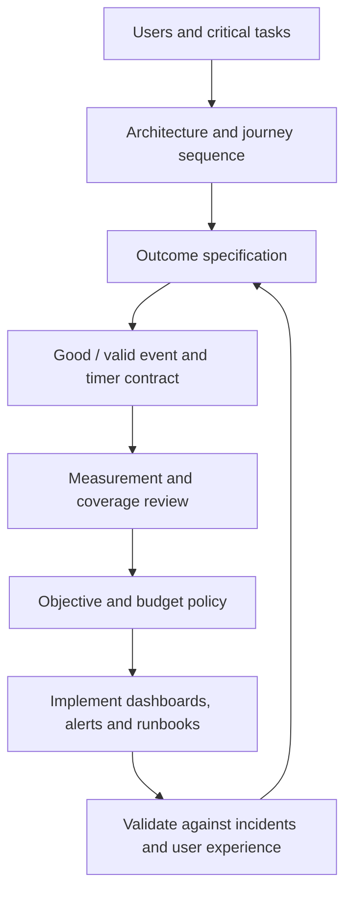
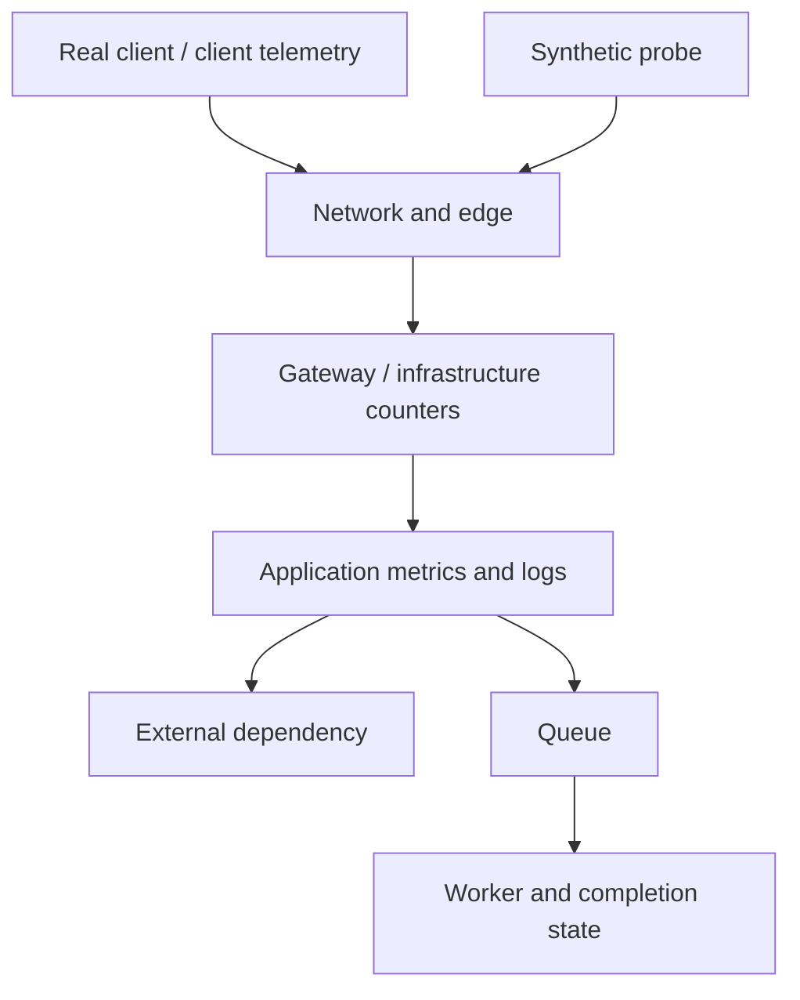
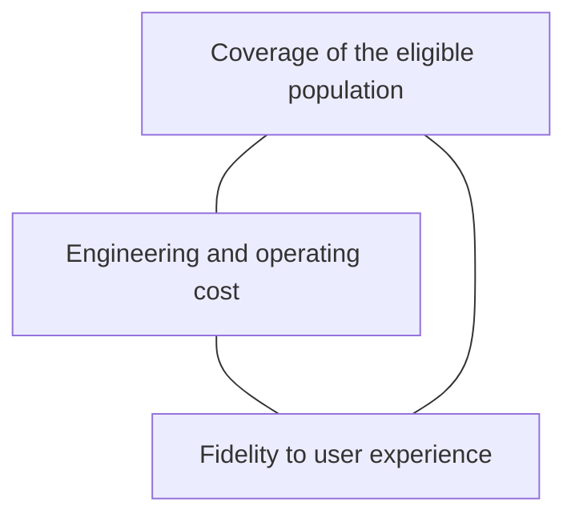
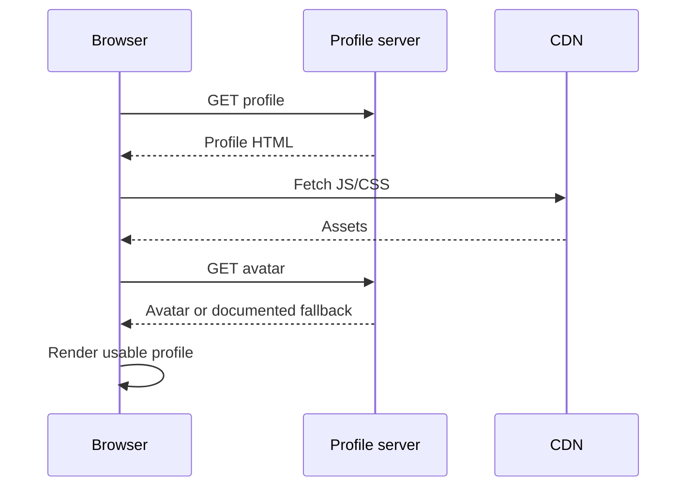
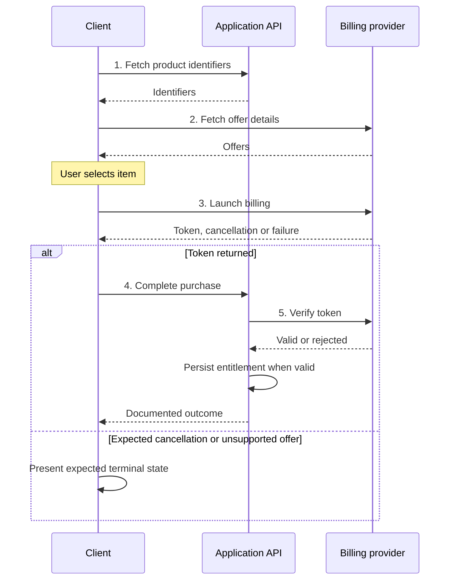
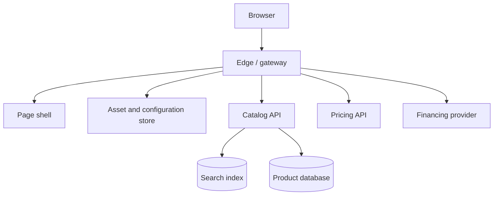
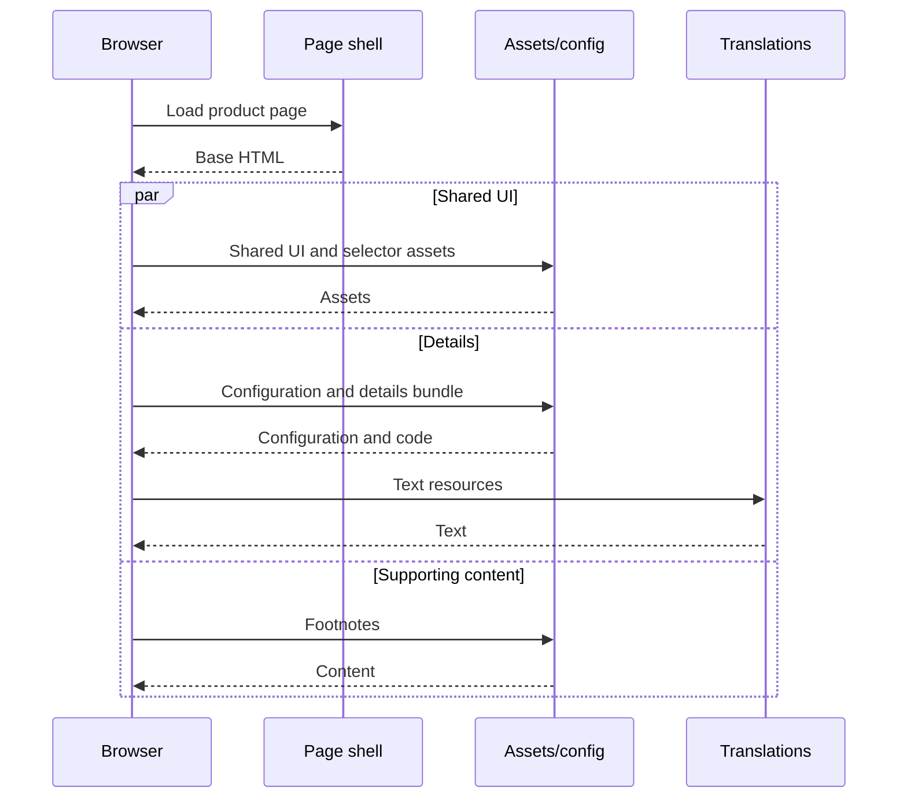
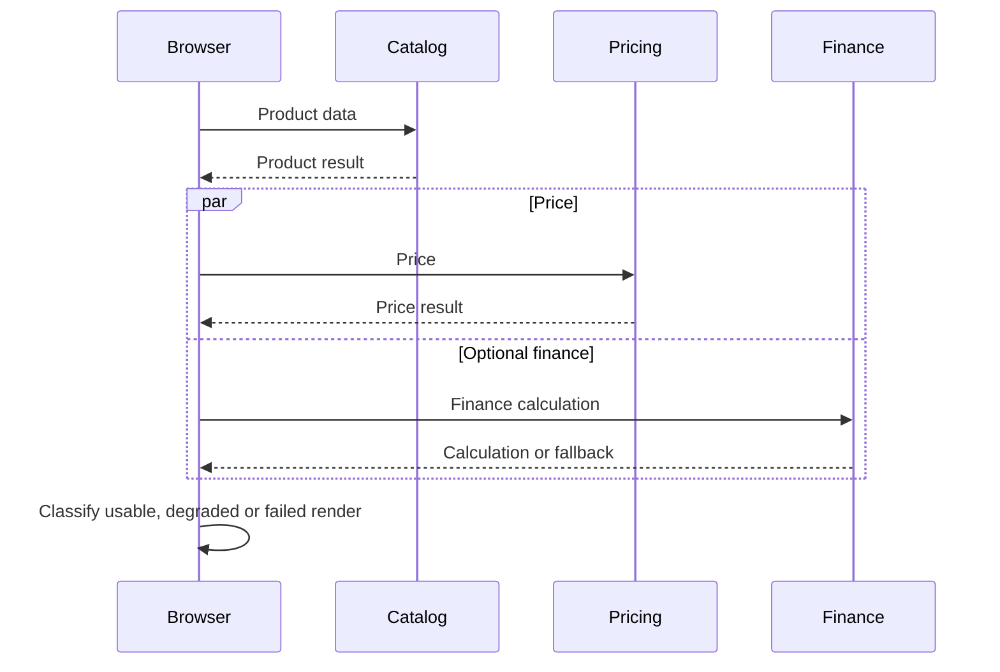
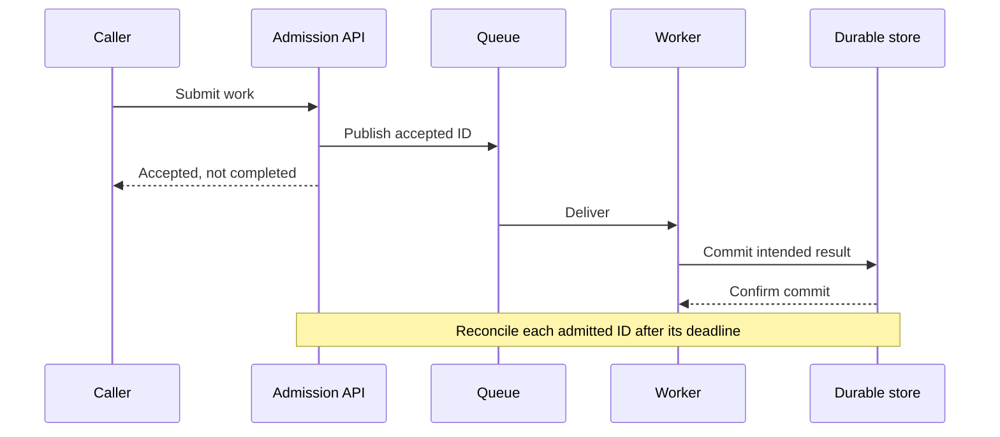
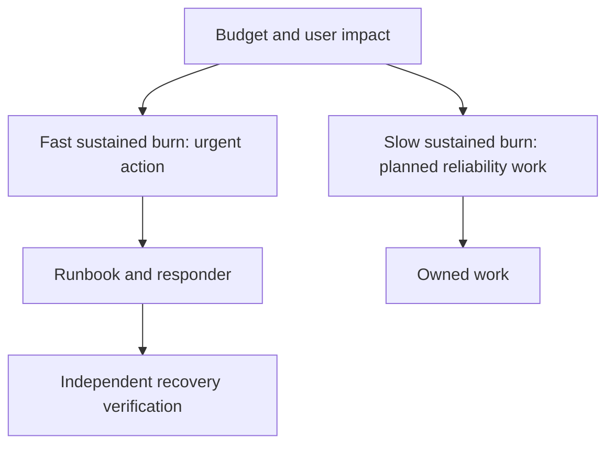

# From user journey to SLI, SLO and monitoring

## Contents

- [Reliability and the workflow](#reliability-and-the-workflow)
- [Measurement and tradeoffs](#measurement-and-tradeoffs)
- [Worked journeys](#worked-journeys)
- [Objectives, budgets and alerts](#objectives-budgets-and-alerts)
- [Implementation and review](#implementation-and-review)

## Reliability and the workflow

A system can be reachable while failing its purpose: a page returns 200 with no price, a job reports success after skipping half its input, or an accepted order never reaches fulfillment. Reliability means delivering the agreed user outcome. Availability, latency, undegraded quality and data correctness describe different parts of it.



An **SLI specification** describes what matters independent of the tool: “eligible submissions complete correctly within two minutes.” Its **implementation** says how to observe this: “admission IDs reconciled with completion state after the deadline, counted once.” One specification can have multiple imperfect implementations.

For event-based indicators, `SLI = good / valid`. Multiply by 100 when reporting a percentage. Define the denominator first; otherwise easy-to-observe successes quietly become the only “valid” work.

## Measurement and tradeoffs



| Source | Good use | Blind spot / cost |
| --- | --- | --- |
| Application counters | Precisely classified local work | Requests that never arrive, client-only failures |
| Structured logs | Rich outcomes, reconstruction, derived metrics | Ingestion/filter delay, collection loss, processing cost |
| Gateway/load balancer | Broad HTTP populations near the client | Rendering, parse errors, third-party browser paths, async completion |
| Client instrumentation | Full page/user-flow outcomes | Consent, sampling, dropped reports, device/network variability |
| Synthetics | External path, selected states, no-user periods | Probe outages, limited locations/coverage, cleanup and side effects |
| Reconciled durable state | Deadline completion and correctness | Query cost, attribution delay, correctness of independent reconciliation |



Document which population is actually observed. Consent-based measurement is not automatically representative of all users. Stored trace sampling and metric-generation sampling are different: inspect where counters are computed before deciding that an APM metric is sampled.

USE (utilization, saturation, errors), RED (rate, errors, duration) and the golden signals (latency, traffic, errors, saturation) help diagnose components. They do not replace an explicit user-outcome contract.

## Worked journeys

### 1. View a profile



**Goal:** the profile becomes usable. A gateway SLI can cheaply measure successful profile requests, but is a proxy for rendered usability. A client signal can join HTML, assets and avatar/fallback to the page attempt; initial navigation failures may still require external probes.

| Contract part | Example decision |
| --- | --- |
| Valid | Eligible profile-page attempts, once per attempt |
| Good | Required content rendered or documented usable fallback within deadline |
| Latency | Navigation start to usable render; or explicitly labeled gateway-response proxy |
| Rejections | Expected missing profile is handled correctly, tracked separately from successful profile viewing |
| Gaps | Uninstrumented/consent-excluded users and missing terminal reports |

Do not classify every 4xx as good without inspecting semantics. A broken authorization rollout can turn all requests into 403 while a “not 5xx” monitor stays green. Unexpected 429 can be a capacity failure rather than valid rejection.

### 2. Buy an item through an external billing provider



Steps 2 and 3 bypass the application. Server metrics alone cannot see their failures. Count launched billing attempts for the observable population, then classify the applicable terminal branch. A cancellation need not call the completion API; a logical definition requiring both is invalid.

Keep two questions separate:

- **Technical handling:** did the system correctly handle the applicable billing branch, including a genuine user cancellation or documented invalid-token rejection?
- **Purchase completion:** did an eligible accepted purchase persist the entitlement correctly within its deadline?

For API latency, time request acceptance to completed response, excluding user thinking time. Suppose a *hypothetical* budget permits 500 ms verification, 200 ms storage and 300 ms overhead: “99% of eligible completion requests finish within 1 second” is a candidate to test with users and data, not a universal threshold. A fast rejection must not hide slow successful work; expose both classes if important.

### 3. Product details built from multiple services



The following two views describe the same page attempt. Shared assets, supporting content and business-data work can overlap; correlate them before classifying the final render.





Define required/optional components per supported variant. If product data and price are required, page success needs both, correlated to the same attempt. Optional finance failure can be a quality degradation instead of total unavailability.

The last API response is only a valid shortcut if it proves all prior required steps and the denominator includes attempts stopped earlier. Parallel calls, cache/fallback paths and missing starts violate that assumption. Parseable JSON may still contain the wrong product or price; semantic correctness needs its own evidence.

### 4. Async processing and storage



Request acceptance, terminal success, deadline coverage and correctness are distinct indicators. Reconcile eligible admissions with completed outcomes when deadlines mature. Account for retries by work identity, late completion and cancellations according to the contract. “Succeeded / (succeeded + failed)” ignores stuck work.

For freshness, prefer accessed data younger than the threshold when user relevance matters. For correctness use independent invariants or reference outputs, not the pipeline declaring itself correct. For durability verify recoverable/readable written records over a stated retention period; replicas and green backup jobs do not establish durability alone.

## Objectives, budgets and alerts

An SLO records the indicator, target, window, rationale, owner, review date and decision policy. A contractual SLA is separate. Avoid 100% as an ordinary budget target: it permits no bad-event budget and makes routine change/incident tradeoffs impossible. Security and data-loss constraints still require their own safeguards.

Example: 99.9% over 30 days and 1,000,000 eligible events gives 1,000 allowed bad events. An incident causing 200 bad events consumes 20% of that event budget. Do not convert it to minutes unless the indicator is time-based or a traffic model justifies the estimate.

Use fraction units for arithmetic:

```text
allowed_bad_fraction = 1 - target_fraction
observed_bad_fraction = bad_events / valid_events
burn_rate = observed_bad_fraction / allowed_bad_fraction
```

Under an approximately steady event rate, budget consumption over a window is `burn_rate × window / SLO_period`. Variable traffic changes that estimate; use actual event counts for retrospective consumption.



For a 30-day period (720h), spending 2% in 1h implies 14.4x burn; 5% in 6h implies 6x. A multiwindow page could require `(1h burn >14.4 AND 5m burn >14.4) OR (6h burn >6 AND 30m burn >6)`. These are teaching values from the public SRE method, not required policy. Derive thresholds for the actual period, impact and response time.

The short window checks that burning is ongoing; the long window establishes significance. Test precision, recall, detection time and reset time. Avoid a long fixed “for” duration that delays a total outage as much as a minor regression.

Low traffic can make one failure significant; determine its value before applying a minimum-volume gate. Keep probes separate from real-user traffic so synthetic successes do not dilute failures. A quiet period differs from collector failure or admitted work not completing. Predictive disk/expiry/capacity alerts can be actionable even before user impact; use an appropriate urgency.

## Implementation and review

### SLI/SLO contract template

```text
Journey / users / owner:
Start / success / rejection / cancellation / deadline:
Required and optional dependencies, diagram evidence:
SLI dimension and specification:
Valid population and exclusions:
Good subset and handling of missing/late terminal events:
Observation point / timer / units / deduplication:
Signal names, queries, tags and metric-generation stage:
Sampling, consent, collection latency and coverage gaps:
Target / window / rationale / budget policy / review date:
Monitor strategy / routing / action / runbook:
Validation: ordinary, failure, quiet, retry, stuck and recovery cases:
Status: proposed / agreed / implemented / live verified:
```

Test an uneven-traffic fixture: 100 good/100 valid in one bucket and 0/1 in another gives 100/101 ≈99.01%, not an average of 100% and 0% =50%. The same principle applies across instances and regions. Segment SLOs when a small population's complete outage would otherwise disappear in a global total.

A latency SLO can use counts under a duration threshold over total eligible observations. A p95 diagnostic chart is useful, but averaging p95s or turning a percentile gauge into an event numerator is not equivalent.

**Review scenarios:** derive profile/purchase/product-page contracts without assuming server metrics see the entire journey; detect a terminal-only async denominator; handle mismatched numerator/denominator families and no data; compare alerts with known incidents rather than simply raising thresholds.

Public background: [Google SRE: Implementing SLOs](https://sre.google/workbook/implementing-slos/), [Alerting on SLOs](https://sre.google/workbook/alerting-on-slos/), [Example SLO document](https://sre.google/workbook/slo-document/). This guide uses original wording and generalized diagrams.
