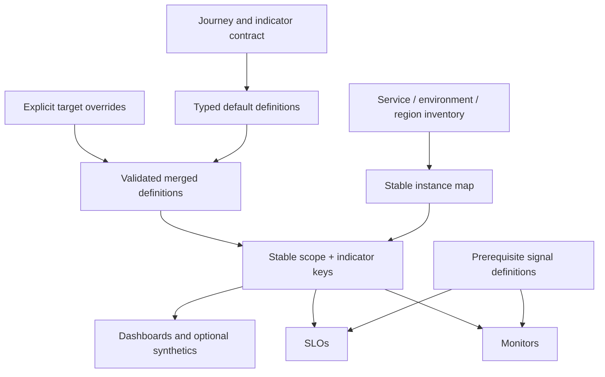

# Data-driven monitoring with Terraform

Optional Datadog reference architecture. The ideas work with other declarative tools; this document is not an executable module and contains no account, backend or secret configuration.

## Structure

```text
monitoring/
  main.tf                 provider and service instance wiring
  variables.tf            typed inventory and common tags
  metrics.tf              prerequisite metric definitions
  modules/service/
    variables.tf          typed contract, routing and scope
    indicators.tf         reviewed indicator data
    overrides.tf          explicit per-target differences
    monitors.tf           resource generation
    slos.tf                resource generation
    dashboards.tf         intentional dashboard ownership
    synthetics.tf         optional probes
  tests/                  fixtures and contract validation
  docs/                   specifications and decisions
```



Define data once, validate and generate resources. Keep the semantic specification alongside queries. Use stable map keys instead of list-position identity to reduce accidental replacements when adding scopes. Changing keys needs reviewed `moved` blocks/state migration rather than surprise destroy/create.

## Illustrative contract

```hcl
variable "indicators" {
  type = map(object({
    name              = string
    good_query        = string
    valid_query       = string
    target_percent    = number
    window            = string
    runbook_url       = string
    tags              = list(string)
  }))
  validation {
    condition = alltrue([
      for i in values(var.indicators) :
      i.target_percent > 0 && i.target_percent < 100 &&
      length(trimspace(i.good_query)) > 0 &&
      length(trimspace(i.valid_query)) > 0 &&
      startswith(i.runbook_url, "https://")
    ])
    error_message = "Provide event queries, a nonzero budget target, and an HTTPS runbook."
  }
}

resource "datadog_service_level_objective" "event_ratio" {
  for_each = var.indicators
  name     = each.value.name
  type     = "metric"
  tags     = each.value.tags
  query {
    numerator   = each.value.good_query
    denominator = each.value.valid_query
  }
  thresholds {
    timeframe = each.value.window
    target    = each.value.target_percent
  }
}
```

Verify supported windows, query algebra and attributes against the pinned provider before use. Infrastructure validation cannot prove semantic correctness or actual signal existence. Do not infer runbook reachability from `https://` alone.

## Lessons that matter

1. **One population:** numerator/denominator must use matching metric families, dimensions, eligible outcomes and timestamps. Subtracting one HTTP framework's errors from another's total is not a valid shortcut.
2. **Aggregation algebra:** event-weighted SLOs sum counts before division. Mechanically changing count to rate and averaging ratios can change the meaning. Validate provider/platform evaluation with unequal-traffic fixtures.
3. **Explicit proxies:** an alert with a different latency threshold from the SLO is a separate operational predicate, not automatically a burn-rate alert on the same SLI.
4. **Prerequisites:** do not activate SLOs backed by nonexistent placeholder logs. Record manual API/provider gaps as unmanaged dependencies, with verification and ownership; check current provider support rather than historic notes.
5. **Collection stages:** log-derived metrics may execute before index routing/exclusion. An index facet valid in log search can be unavailable in metric generation. Test queries at the stage they execute.
6. **Cardinality:** service, environment, region, normalized operation and bounded outcome are useful. Request IDs, user IDs, prompts, arbitrary URLs and exception text belong in appropriately protected diagnostic records, not metric labels.
7. **Routing state:** distinguish live, paused, excluded and silent-soak explicitly. A silent monitor needs an owner and promotion/review date; a resource existing in state does not mean paging works.
8. **Overrides:** deep merging may be useful, but test precedence, null/removal behavior and field types. Environment differences need rationale; they should not silently weaken the objective.
9. **Dashboard ownership:** create dashboards once for the intended scope, using filtering for environments/regions. “Production only” is one implementation choice, not a universal rule.
10. **Runbook linkage:** derive the URL from the actual published path and verify target/content. Resource naming and documentation nesting often differ.

## Terraform delivery

Pin Terraform/provider constraints and retain the lockfile. Format, initialize with `-backend=false` for isolated validation, validate, test contract fixtures, and review the plan against intended scope. A local validation is not a live plan or API check.

Protect remote state, backup/version it, and use the backend's supported locking. Serialize apply operations by state and avoid cancelling an active apply. Force-unlock only after proving no writer is active. Restrict credentials and do not publish sensitive plans/state as unrestricted logs.

Keep the reviewed plan associated with its commit and state; if either changes, replan under the configured policy. Inspect all destroys/replacements and provider errors, including pages omitted by truncated comments.

Measure refresh/plan/apply time and rate-limit failures before tuning parallelism. Use bounded provider retries with backoff and a total timeout. More concurrent requests can worsen throttling; modeled speedups are not measured results. Partition state only with clear resource ownership and dependencies.

Validate query results, no-data semantics, alert/recovery routing and the published runbook after apply. For new alert policies backtest incidents/quiet periods and run a time-bounded silent soak before promotion.

References: [Datadog metric SLOs](https://docs.datadoghq.com/service_management/service_level_objectives/metric/), [Terraform Datadog provider](https://registry.terraform.io/providers/DataDog/datadog/latest/docs), [Datadog count evaluation](https://docs.datadoghq.com/monitors/guide/as-count-in-monitor-evaluations/).
