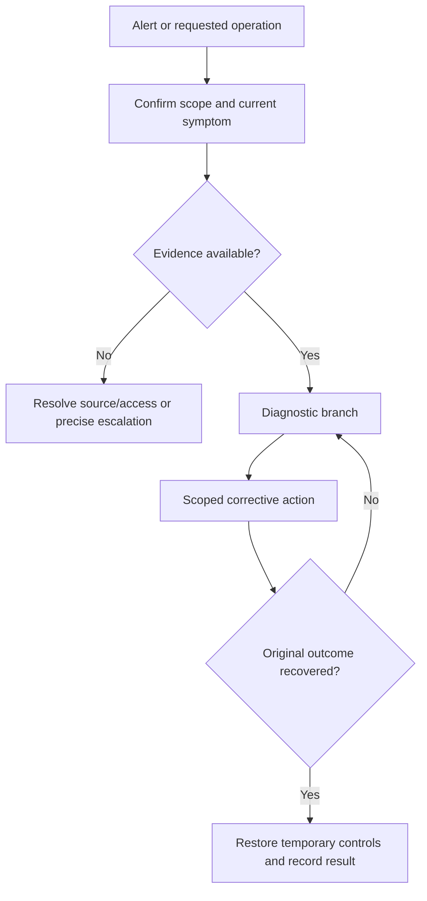

# Runbooks that lead to decisions

## Procedure template

```text
Title / purpose / owner / last exercised date:
Trigger, applicability and customer impact:
Target selection and prerequisites:
First verification steps and expected output:
Diagnostic branches with scoped evidence:
Corrective actions: impact, rollback and stop conditions:
Independent outcome verification:
Escalation contacts and required handoff information:
Restore temporary controls / close-out:
Related specifications, changes and incident learnings:
```

Different action/failure modes deserve specific procedures; a shared page is acceptable when the response genuinely is the same. Do not mandate one runbook per resource or a numeric reuse threshold disconnected from action complexity.



## Diagnostic quality

A step should narrow the cause or determine an action. Include what a healthy and unhealthy observation looks like. Map runtime/gateway names and actual namespaces/targets, which may differ from repository names. Empty query results need a telemetry/scope check before declaring no errors.

Provide ready-to-use links when possible and the query text so it remains usable if the UI URL changes. Runbook links usually need rolling/current windows; historical incident evidence intentionally needs fixed windows. Timestamp parameters can define a rolling duration when the provider's live mode is active. Verify semantics rather than reject all epoch parameters.

Queries should use the provider's actual tenant/index/environment dimensions at the stage they run. Do not add a log-index filter to a metrics query or assume every telemetry surface supports the same tag.

Stable IDs/links are preferable to display-name lookups. A readable authenticated repository page may be acceptable in some environments; use the project's responder access requirements rather than require one publishing product. Verify the published target, not just the source filename.

## Actions and review gates

Every mutation states the target, effect, reversibility and stop condition. Destructive or irreversible steps expose their specific consequences prominently. Shell snippets use explicit context and scoped identifiers, protected secret handling and supported current commands. Do not document an action as verified merely because it looks plausible.

Review each dimension as complete/partial/missing:

- Correct trigger/impact and target.
- First checks discriminate real failure from measurement noise.
- Diagnostic branches narrow hypotheses.
- Actions are executable within their prerequisites and authority.
- Recovery checks establish the original outcome.
- Escalation is reachable and evidence-rich.
- Links and identifiers match the real system.
- Exercise evidence and unknowns are honest.

An aggregate score must not compensate for a dangerous action, nonexistent owner or missing recovery check. A changed-file ratchet can block new defects or regressions while retaining legacy findings in an owned backlog.

**Acceptance cases:** replace a template stub using actual evidence; find a query built with repo shorthand instead of the runtime service identity; preserve a valid sliding link; exercise a rollback and verify public outcome; refuse to manufacture an unknown solution.
