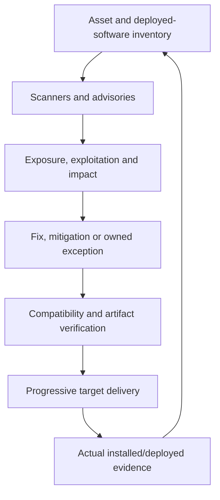

# Vulnerability and patch management

Treat patching as preventive maintenance: identify, prioritize, acquire, install and verify updates across applications, containers, runtimes, operating systems, infrastructure, firmware and tooling. Scanner alerts are one input, not the complete inventory.

## Inventory and prioritization

Associate each finding with actual artifact/version/asset, owner, exposure, first discovery and source freshness. Include transitive/resolved dependencies and image OS packages, supported runtime/base versions, CI tools and unmanaged resources. SBOMs help identify components but do not prove reachability or complete vulnerability coverage.

Use severity with known exploitation, exploit likelihood/reachability, internet exposure, privilege impact and asset importance. CISA KEV is exploitation evidence; its directive deadlines are not automatically every organization's deadlines. A package claiming the same upstream version may have a vendor backport—verify advisory/package evidence before recommending an unnecessary downgrade or suppression.

Set routine and emergency patch paths, service owners, applicable deadlines, test/rollback requirements and exception review. Moving a finding to another ticket does not reset age. Track end-of-life software explicitly; a scanner reporting no findings does not make unsupported software maintained.

## Remediation design

Acquire fixes from trusted vendor/package sources and verify version/coordinate/integrity. Prefer supported release lines and curated compatible dependency sets. Keep coupled artifacts aligned and assess release notes/config migrations. An OS/base-image fix generally needs a rebuilt artifact and deployment; updating a floating base tag in source alone does not patch existing containers.

Use temporary mitigation/virtual patching with an evidence-based scope, limitations and review/removal condition when a fix cannot ship immediately. A scanner error is unknown, not no available remediation. Risk acceptance/not-affected disposition needs evidence and accountable authority, not an agent's wish to clear findings.

Stage changes with representative tests, contracts and load where warranted. Use canary/progressive rollout, rollback compatibility and emergency procedure. Verify every relevant fleet/target actually uses the fixed identity/version and rescan or use equivalent authoritative evidence. Include nodes/VMs/services requiring restart or reboot; installation can differ from active code.

## Recurring operation

Reconcile duplicated findings and scanner/project coverage drift. Maintain separate states for source fixed, artifact verified, deployed and closure verified. Measure overdue exposure and time to deployed remediation, not just merged PR count. Review stale exceptions/mitigations and remove redundant dependency overrides after verified curated upgrades.

## Illustrative acceptance cases

- Scanner-neutral portfolio with a known exploited medium-severity issue.
- Vendor-backported fix.
- Updated base-image source but old deployed digest.
- Reboot-required patch.
- No vendor fix requiring bounded mitigation and owned review.

Primary references: [NIST SP 800-40r4](https://csrc.nist.gov/pubs/sp/800/40/r4/final), [CISA Known Exploited Vulnerabilities](https://www.cisa.gov/known-exploited-vulnerabilities-catalog), [OWASP vulnerable dependency management](https://cheatsheetseries.owasp.org/cheatsheets/Vulnerable_Dependency_Management_Cheat_Sheet.html).
