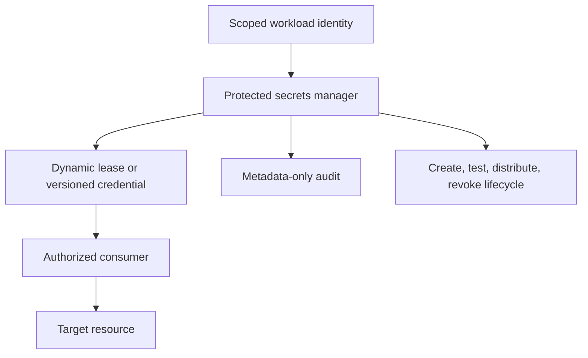

# Designing secret management

## Identity before distribution

Use short-lived workload/app identity where the provider supports it. Federation exchanges a verifiable workload identity for narrowly scoped access rather than installing one shared long-lived token everywhere. Define issuer/audience/subject conditions and permissions for the exact service, environment and action.

For unavoidable static secrets, centralize authoritative custody and automate creation/distribution/rotation. “Centralized” can include several stores with a clear authority per credential; uncontrolled duplicate copies are the problem.

## Runtime and CI integration

Select runtime SDK retrieval, agent/sidecar, protected file injection or a supported operator based on reload behavior and threat model. Environment variables may remain in child processes/dumps and do not generally reload automatically. Mounted files also require consumers to detect/reload changes; a successful store update is not migration evidence.

Use TLS, fine-grained access, scoped identities and metadata audit. Exclude values from logs, errors, shell tracing, build arguments, image layers, source, plan/state output and CI artifacts. Prefer secret mounts/federation over embedding secrets in build contexts. Avoid sending runtime application credentials through CI when the workload can obtain them directly.

For Kubernetes configure appropriate API/RBAC access, encryption at rest and restricted mounts/service accounts; base64 Secret fields are not encrypted merely because they are encoded. Keep rotation operators' privileges limited and verify whether synchronization delay/reconciliation will overwrite manual edits.

CI trust boundaries matter: fork/untrusted PR code must not run with publication/deploy secrets. Scope federated credentials to workflow/source/target policy, not just a broad repository audience.

## Lifecycle

Creation uses secure generation and purpose-bound privilege. Rotation maps consumers, supports overlap or bounded cutover, verifies new authentication and business behavior, then revokes replaced access. Dynamic leases expire/revoke at the provider; do not assume app restart invalidates a stolen lease.

Automated rotation should be resumable/idempotent and protect against changing the wrong resource. Validate credential version/state, target identity and current access; create/set/test/promote steps may occur in separate invocations, so use durable version state rather than local variables. Test consumer reload and rollback/recovery when a stage fails.

Certificate renewal also covers trust chain, format, subject/endpoint usage and deployment reload. Encryption-key rotation differs from access-token rotation: data/backups may still require old decrypt keys or a re-encryption plan. Do not revoke a decrypt key before retained data can be recovered.

Human password policy and machine secret rotation are distinct. Do not impose periodic human password changes without applicable policy; suspected exposure requires action regardless of the ordinary schedule.

## Audit, exposure and recovery

Audit who/what requested, changed, used or revoked a credential, when and under which purpose; never audit the value. Track denied/expired reuse and administrative changes with trustworthy timestamps and tamper-resistant retention.

On exposure promptly invalidate/replace access and investigate its scope/use. Deleting a file or rewriting Git history does not revoke access. Cleanup all relevant logs/artifacts/caches and coordinate history changes separately. False-positive exceptions are narrow, documented and reviewed.

Plan for manager/network outage, startup dependency and bootstrap credentials. Test protected break-glass and restore paths that do not depend on retrieving a credential from the failed system itself. Limit cached credentials by lease/policy rather than let unavailable managers create unbounded secret reuse.

**Acceptance cases:** replace shared static CI access with scoped federation; rotate a secret whose mounted consumer does not reload; handle compromised credentials without exposing values; retain decrypt keys required by backups; rehearse secrets-manager outage access.

Primary reference: [OWASP Secrets Management Cheat Sheet](https://cheatsheetseries.owasp.org/cheatsheets/Secrets_Management_Cheat_Sheet.html).
