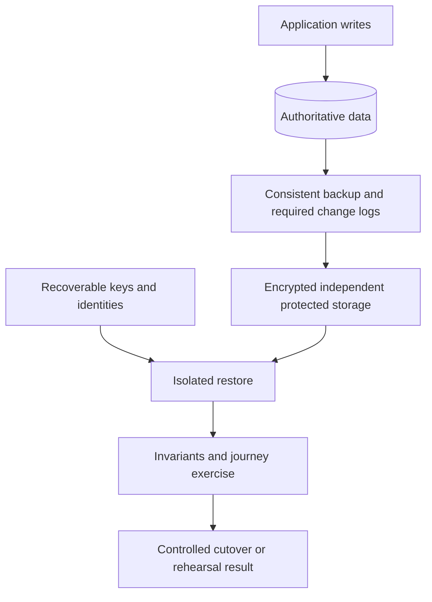

# Preparing application backup and restore

Recovery is an application design concern. A database dump alone may not reconstruct blobs, schema, configuration, message state, identities and irreversible third-party side effects.

## Design the recovery contract

Inventory persistent data and classify what is authoritative, derived/rebuildable, externally owned or intentionally disposable. Define RPO (acceptable age/loss of recoverable data) and RTO (time to usable recovery), retention, owner and verification. Scope objectives per important workflow rather than invent one number for every store.

Choose logical dumps, physical backups, snapshots and point-in-time recovery according to datastore guarantees, compatibility and objectives. Independent consistency across databases/blob stores may need coordination; a collection of individually valid snapshots can be mutually inconsistent.

Apply a 3-2-1-style independent-copy strategy where appropriate, adapted to actual failure domains rather than treating cloud replicas as independent backups. Protect copies from compromise of the primary writer account; immutable/offline isolation, retention locks and separate privileges can reduce deletion risk. Document their costs and recovery access.

Encrypt in transit/at rest and keep recovery keys available independently of the system being recovered. Test break-glass/restore access without recording secrets in procedure output. Audit backup creation/read/deletion and manage version/noncurrent-object retention, legal requirements and data deletion obligations.

## Automate and test

Backup jobs need bounded runtime/retries, overlap policy, adequate scratch space and permissions, unique artifact identity, integrity metadata and success evidence after durable upload. Alert on stale recovery points or failed restore tests, not just job exit code.

Rehearse on an isolated target using production-representative size/schema and supported restore tools. Measure download/decryption/load/index rebuild/startup/cutover and verification time together. Count records and check business invariants, relationships, representative reads/writes and downstream completion. An empty service returning health 200 has not recovered.

Re-run preparation when schemas, datastore versions, encryption, credentials or object/event formats change. Test whether the old application can read the restored schema; record forward-only migrations and restore-versus-roll-forward constraints.

## Restore operation

Inventory surviving resources and choose a usable recovery point. State the expected loss window before cutover. Quiesce writers, consumers and jobs for in-place recovery and suspend competing reconciliation where needed. Restore dependencies/access and data in order; verify before resuming writes/traffic.

Handle queued work, replay, idempotency and third-party effects explicitly. Replaying payment/shipment/email side effects can duplicate real-world actions. Reconcile durable state and approved replay ranges; do not reset offsets as an automatic cleanup step.

After restoration measure achieved objectives, resume controllers/jobs, protect or remove plaintext scratch artifacts according to retention, and track residual loss/risk. Recovery drills produce evidence, not an assurance that every future failure is covered.

**Acceptance cases:** new blob-backed feature with coordinated database recovery; fresh backups without any restore exercise; lost primary identity requiring recoverable keys/access; database surviving an infrastructure outage; recovery with queued work and irreversible external effects.

Public reference: [NIST contingency planning](https://csrc.nist.gov/pubs/sp/800/34/r1/upd1/final). Consult the current datastore's backup/restore documentation for exact commands and guarantees.
