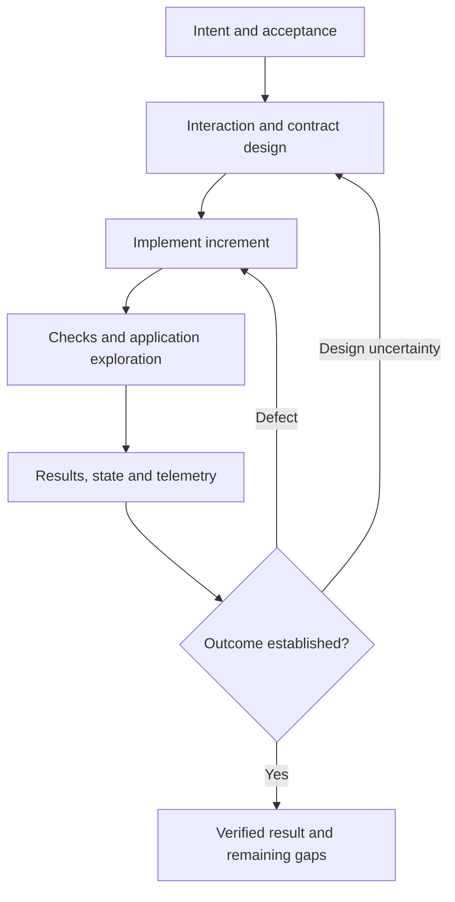

# Journey evaluation references

## Implementation feedback

Use the main skill's platform/evidence rules alongside deliver-reliable-changes. Run affected checks during meaningful increments and broader regression before completion. Keep intended outcomes and reviewed baselines stable; report missing capability or repeated unexplained failures. Versioned AI quality cases complement deterministic application handling.

## Driver and method references

Use version-matched setup instructions for the selected platform; no driver, hosted visual service or device farm is required by this collection.

- [Playwright best practices](https://playwright.dev/docs/best-practices): semantic locators, isolated data and observable-state assertions.
- [Playwright visual comparisons](https://playwright.dev/docs/test-snapshots): controlled rendering and reviewed baselines.
- [Playwright Electron](https://playwright.dev/docs/api/class-electron): experimental support and native-dialog limits.
- [Maestro supported platforms](https://docs.maestro.dev/get-started/supported-platform): mobile/web scope and device setup.
- [Appium drivers](https://appium.io/docs/en/latest/ecosystem/drivers/): inspect the selected driver's platform and maintenance; Windows server maintenance differs from driver maintenance.
- [Storybook testing](https://storybook.js.org/docs/writing-tests): optional component states, interactions, accessibility and visual checks.
- [W3C accessibility evaluation](https://www.w3.org/WAI/test-evaluate/): tools cannot establish full accessibility without appropriate manual/user evaluation.
